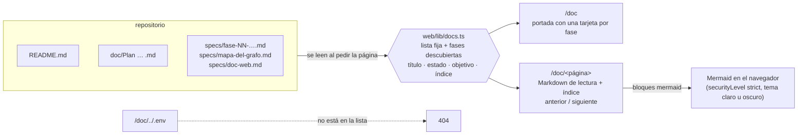

# Extra: la documentación en la web (`/doc`)

Estado: **terminada** (fuera del plan de fases, después de `fase-09`)

## Objetivo
Leer y estudiar toda la documentación del proyecto desde el chat web, en `/doc`: el README, el plan, la spec de cada fase y el mapa del grafo, con los diagramas Mermaid dibujados (no como código), una navegación clara y un índice por página.

## Requisitos
- R1: `/doc` es la portada: qué es el proyecto, y una tarjeta por fase con su número, título, estado, objetivo y cuántos diagramas tiene. Desde ahí se llega a todo.
- R2: `/doc/<página>` muestra un documento. Hay una página por cada archivo:
  - `inicio`: el README;
  - `plan`: el plan en `doc/`;
  - `fase-01` a `fase-09`: las specs;
  - `mapa-del-grafo`: el mapa del grafo;
  - `doc-web`: esta spec.

  Las fases se descubren solas: una spec nueva `specs/fase-10-….md` aparece sin tocar código.
- R3: **Los diagramas se dibujan.** Cada bloque ` ```mermaid ` se convierte en el diagrama (con Mermaid, en el navegador), en tema claro u oscuro según la página. Si un diagrama tiene un error, se muestra el código con un aviso, y la página sigue andando.
- R4: Para leer y estudiar:
  - texto con tipografía de lectura;
  - tablas que se pueden desplazar en el celular;
  - un índice «En esta página» con los títulos `##` y `###` (en pantallas anchas);
  - botones de fase anterior y siguiente;
  - tiempo de lectura estimado;
  - una barra lateral con todo el contenido.

  Los links entre documentos (por ejemplo, a `specs/fase-04-persistencia.md`) llevan a su página en `/doc`.
- R5: **Siempre al día.** Los archivos se leen del repositorio cuando se pide la página: no hay una copia que se desactualice.
- R6: **Seguridad.**
  - Solo se leen los archivos de una lista armada por el código (README, plan y `specs/*.md`). El nombre en la dirección se compara con esa lista y nunca se usa como ruta: `/doc/../.env` da 404.
  - El Markdown no interpreta HTML.
  - Mermaid corre con `securityLevel: "strict"`.
- R7: El chat tiene un link a la documentación, y la documentación, uno al chat.

## Criterios de aceptación
- [x] CA1: la portada lista las 9 fases con su estado y objetivo; cada página de R2 responde y muestra su título.
- [x] CA2: en la página de una fase, los diagramas se ven como SVG (no como código) en tema claro y oscuro, y la página no tiene errores.
- [x] CA3: el índice lleva a cada título; los links entre documentos llevan a `/doc/…`; anterior y siguiente recorren las fases en orden.
- [x] CA4: un nombre fuera de la lista (`../.env`, `fase-99`, `README.md`) da 404. Las funciones que arman la lista, el índice y los links tienen tests sin navegador.
- [x] CA5: `npm test`, los typecheck, `npm run web:build` y las pruebas del navegador pasan; el README menciona `/doc`.

## Fuera de alcance
- Buscar en toda la documentación.
- Editar documentos desde la web.
- Exportar a PDF.

## Diseño
- `web/lib/docs.ts`: lista de documentos (fija más las fases descubiertas en `specs/`), lectura, título, estado, objetivo, índice, tiempo de lectura y reescritura de links. Las funciones puras se prueban con vitest (`tests/doc-web.test.ts`).
- `web/app/doc/layout.tsx` (barra lateral con la lista), `web/app/doc/page.tsx` (portada), `web/app/doc/[slug]/page.tsx` (un documento; `notFound()` fuera de la lista).
- `web/components/doc/`: el Markdown de lectura (con `@tailwindcss/typography`, `rehype-slug` para los ids de los títulos) y `Mermaid` (componente del navegador que carga `mermaid` solo cuando hay diagramas).

## Mapas



## Decisiones
- **Se lee del repositorio en cada pedido**, no se copia a `web/`: la documentación es la misma que se edita en `specs/`, y `npm run web` la muestra al día sin build.
- **Mermaid en el navegador, cargado a demanda.** Dibujar en el servidor necesitaría un navegador sin pantalla. En el navegador alcanza con importar `mermaid` cuando la página tiene diagramas, y así se pueden redibujar al cambiar de tema.
- **`@tailwindcss/typography` para el texto largo.** Las specs tienen títulos, listas, tablas y código: la clase `prose` les da una tipografía de lectura pareja, con los tokens del tema.
