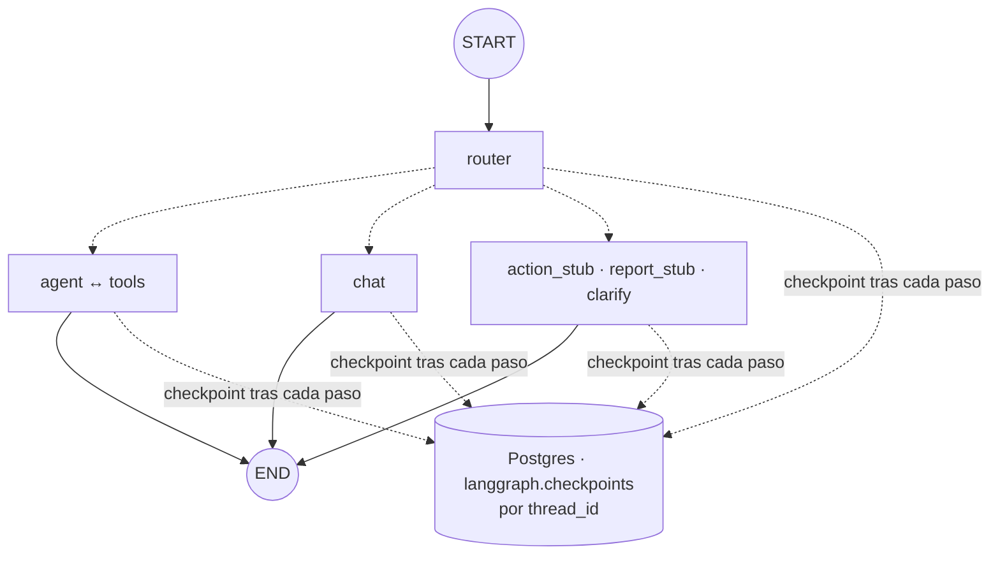

# Fase 4: Persistencia de conversaciones

Estado: **terminada** (etiqueta `fase-04`)

## Objetivo
Que una conversación sobreviva al cierre del programa: cada conversación es un **hilo** (`thread_id`) cuyo estado se guarda en Postgres, y se puede listar, retomar, inspeccionar y borrar.

## Contexto
Existe de la fase 3 (etiqueta `fase-03`):

- Grafo con router y cinco ramas (7 nodos propios, 13 conexiones; ver `specs/mapa-del-grafo.md`).
- El grafo **no recuerda nada** entre invocaciones: la terminal guarda el historial en una variable y se lo vuelve a pasar completo en cada turno (`runTurn(agent, history, input)`). Al cerrar el programa se pierde.
- Dos roles de base: el dueño (`DATABASE_URL_WRITE`, solo para migraciones y seed) y `copilot_reader` (solo lectura, lo usan las herramientas).

Qué se necesita de tu parte: nada. Genero la contraseña del rol nuevo y la guardo en `.env` sin mostrarla, igual que con `copilot_reader`.

## Requisitos
- R1: Paquete `@langchain/langgraph-checkpoint-postgres` (versión exacta, 1.1.2 al escribir esta spec; su dependencia `@langchain/langgraph-checkpoint` debe quedar en una sola versión). Se usa `PostgresSaver` con un `pg.Pool` propio y el esquema `langgraph`, separado de las tablas del negocio.
- R2: `buildGraph` acepta un `checkpointer` opcional y lo pasa a `compile`. Sin checkpointer el grafo se comporta como en la fase 3 (los tests de las fases 1 a 3 no cambian).
- R3: Un rol nuevo, `copilot_checkpointer`, con login, que solo puede leer y escribir (`SELECT`, `INSERT`, `UPDATE`, `DELETE`) las tablas del esquema `langgraph`. No puede ver las tablas del negocio ni crear objetos. Su URL va en `DATABASE_URL_CHECKPOINTS` (usuario `copilot_checkpointer.<tenant>`, como `copilot_reader`). Las tablas las crea el dueño con `setup()`, no el rol de la aplicación.
- R4: `npm run db:checkpoints` (con el dueño) crea el esquema, ejecuta `setup()` y aplica los permisos; es idempotente y lo llama `db:reset`. Se vuelve a correr al actualizar el paquete, porque `setup()` también aplica sus migraciones internas. `anon` y `authenticated` no tienen ningún permiso sobre el esquema.
- R5: `thread_id` es un texto de 1 a 64 caracteres, `[A-Za-z0-9_-]`, validado con Zod antes de tocar la base. Si la persona no elige uno, se genera (`hilo-` más 8 caracteres hexadecimales).
- R6: `runTurn(agent, threadId, input)` manda **solo el mensaje nuevo** con `configurable.thread_id`; el historial lo pone el checkpointer. El resultado ya no devuelve `messages`. Los mensajes "nuevos" del turno son los que siguen al último mensaje de la persona.
- R7: Un turno puede quedar **a medias** (se cae la red o la API, se cierra la terminal, se alcanza el tope de pasos): el hilo queda con `snapshot.next` no vacío. `continueTurn(agent, threadId)` lo reanuda con `invoke(null, config)` desde el último checkpoint, sin repetir el mensaje de la persona ni duplicar nada.
- R8: Terminal:
  - `npm run chat` abre un hilo nuevo y muestra su id. `npm run chat <id>` (o `npm run chat -- --thread <id>`) retoma ese hilo (si no existe, lo crea y lo dice) y muestra los últimos mensajes para dar contexto.
  - Si el hilo está a medias, lo avisa y solo acepta `/continuar` (o `salir`), porque un mensaje nuevo detrás de una llamada a herramienta sin respuesta rompería la API de Claude.
  - `npm run threads` lista los hilos recientes (id, última actividad, cantidad de mensajes, primer mensaje, marca de "a medias"). `npm run threads -- history <id>` muestra la historia de checkpoints. `npm run threads -- delete <id>` borra un hilo con `deleteThread`.
- R9: Listar hilos usa una consulta fija y parametrizada sobre `langgraph.checkpoints` (LangGraph no ofrece "listar hilos"). Eso acopla el código a una tabla interna del paquete: lo cubre un test de integración para que una actualización lo rompa a la vista.
- R10: `db:reset` borra el esquema `langgraph` y lo recrea: los hilos hablan de datos del seed, que cambian.

## Criterios de aceptación
- [x] CA1: **retomar tras reiniciar.** Con Postgres real: se arma un agente, se corre un turno en el hilo T y se cierra todo (grafo, pool y checkpointer); se arma otro agente desde cero y un segundo turno en T recibe el historial del primero. Con Claude real (Haiku): "¿Cuántos turnos hay mañana?", reinicio, "¿Y pasado mañana?" se enruta a `query` y responde con el número de pasado mañana. Se comprueba además a mano con dos ejecuciones de `npm run chat`.
- [x] CA2: **hilos aislados.** Dos hilos usados de forma intercalada guardan solo sus propios mensajes; el contenido de uno nunca aparece en el contexto que recibe el modelo en el otro.
- [x] CA3: **historial de checkpoints.** `getStateHistory` de un hilo devuelve los checkpoints del más nuevo al más viejo, y para cada ruta (consulta, charla, aclaración, marcadores) la secuencia de nodos coincide con el recorrido esperado. `npm run threads -- history <id>` los muestra con paso, nodo que corrió, nodo que sigue, cantidad de mensajes y ruta.
- [x] CA4: **turno a medias.** Con un modelo guionado que falla una vez: el error llega a quien llama, el hilo queda con `next` no vacío, `continueTurn` termina el turno, el hilo tiene exactamente un mensaje de la persona y una respuesta (sin duplicados) y `next` queda vacío. Vale para una falla en el router y una en el agente después de ejecutar una herramienta.
- [x] CA5: **mínimo privilegio.** `copilot_checkpointer` no puede leer `public.clients` ni crear tablas; `copilot_reader` no puede leer nada de `langgraph`; `anon` y `authenticated` tampoco. Los tests de seguridad de la fase 2 siguen pasando.
- [x] CA6: **listado.** `listThreads` devuelve los hilos del más reciente al más viejo, con id, última actividad, cantidad de mensajes y primer mensaje (recortado a 80 caracteres), y marca los que están a medias. Con el límite por defecto no devuelve más de 20.
- [x] CA7: **validación del id.** Se rechazan, sin tocar la base: vacío, más de 64 caracteres, espacios, comillas, punto y coma, saltos de línea y caracteres que no son ASCII.
- [x] CA8: **borrado.** `delete` quita el hilo de las tres tablas (`checkpoints`, `checkpoint_blobs`, `checkpoint_writes`) y no toca a otros hilos.
- [x] CA9: **sin regresiones.** Pasan `npm test` (con y sin `RUN_LLM_TESTS=1`), `npm run typecheck` y `npm run db:reset`; `db:reset` y `db:checkpoints` se pueden correr dos veces seguidas. Los tests de las fases 1 a 3 solo cambian donde cambia `runTurn`.
- [x] CA10: **medición.** Se registra en esta spec: tiempo que agrega el checkpointer a un turno (con y sin), cantidad de checkpoints y tamaño en disco de un hilo de 5 turnos, y cuánto crece el costo de un turno a medida que el hilo se alarga (turno 1 vs turno 5, Haiku).
- [x] CA11: el diagrama de la fase se agrega a `specs/mapa-del-grafo.md`; se actualizan README, `.env.example` y el plan (las tablas de LangGraph viven en el esquema `langgraph`).

## Fuera de alcance
- Recortar o resumir historiales largos: el historial completo se manda en cada llamada y el costo crece con el hilo (se mide en CA10, no se corrige acá).
- Repetir una ejecución desde un checkpoint viejo o bifurcar (time travel con cambios): fase 10. Acá solo se **inspecciona**.
- Memoria de largo plazo entre hilos (Store): fase 8.
- Dos terminales escribiendo en el mismo hilo a la vez: no hay bloqueo y el resultado no está definido. Se documenta, no se resuelve.
- Pausas con aprobación humana (`interrupt`): fase 5, que se apoya en lo que se arma acá.
- Cifrado en reposo y política de retención de hilos: fase 12.
- Usuarios: hay un solo operador; los hilos no tienen dueño.

## Diseño (plan técnico)

**Grafo:** igual que en la fase 3 (mismos nodos y aristas). Lo único nuevo es que cada paso termina con un checkpoint en Postgres.

**Cómo funciona**
- Al terminar cada paso (superstep), LangGraph guarda un checkpoint: valores de los canales (`messages`, `intent`, `intentReason`), qué nodos siguen (`next`) y metadatos (`step`, `source`, `writes`). `thread_id` agrupa los checkpoints de una conversación. Al invocar con un `thread_id` existente, LangGraph parte del último checkpoint y el reducer de `messages` **agrega** el mensaje nuevo.
- `intent` e `intentReason` se guardan, pero el router los pisa en cada turno.
- Un turno que falla deja el último checkpoint válido. Por eso `next` distingue "terminó" (vacío) de "quedó a medias".

**Conexión y permisos**
- Un `pg.Pool` propio (máximo 5 conexiones) con `DATABASE_URL_CHECKPOINTS`, compartido por el `PostgresSaver` (`new PostgresSaver(pool, undefined, { schema: "langgraph" })`) y por `listThreads`. Cerrar = `pool.end()`.
- Esquema `langgraph` y tablas creados por el dueño; el rol de la aplicación recibe `USAGE` en el esquema y DML en las cuatro tablas (incluida `checkpoint_migrations`, que `setup()` lee). Revocar todo a `PUBLIC`, `anon` y `authenticated`, también sobre tablas existentes. El esquema no está expuesto en la API REST de Supabase.
- A confirmar al implementar: que `PostgresSaver` funcione detrás del pooler de Supavisor en modo sesión (puerto 5432), y los permisos mínimos exactos que necesita en tiempo de ejecución.

**Código**
- `runTurn` pasa a `runTurn(agent, threadId, input)` y se suma `continueTurn(agent, threadId)`. Ambos comparten la parte de seguimiento de uso. Los "mensajes nuevos" se toman a partir del último `HumanMessage`.
- `getStatus(agent, threadId)` devuelve `{ exists, pending, messages }` a partir de `graph.getState`. La terminal lo usa al abrir un hilo y después de un error: si el error dejó el hilo a medias, no se vuelve a mandar el mensaje, se sugiere `/continuar`.
- El primer mensaje del hilo (título del listado) sale de `getState` sobre el último checkpoint de cada hilo, no de la tabla.
- `GraphRecursionError`: el hilo queda a medias. `/continuar` da otros 12 pasos; si el ciclo es infinito vuelve a cortar. La terminal lo explica.
- El benchmark y los tests con modelo real usan un hilo propio por caso, con ids únicos, y los borran al terminar.

**Archivos**

```
src/graph/thread-id.ts        validación y generación de thread_id
src/graph/checkpointing.ts    pool, PostgresSaver y cierre
src/graph/threads.ts          listThreads, getStatus, history, deleteThread
src/graph/index.ts            buildGraph acepta checkpointer (modifica)
src/graph/create-agent.ts     arma el checkpointer (modifica)
src/graph/run-turn.ts         runTurn por thread_id y continueTurn (modifica)
src/db/checkpoints.ts         npm run db:checkpoints: esquema, setup() y permisos
src/db/reset.ts               recrea el esquema langgraph (modifica)
src/config/env.ts             DATABASE_URL_CHECKPOINTS (modifica)
src/cli/chat.ts               --thread, /continuar (modifica)
src/cli/threads.ts            npm run threads: lista, history, delete
src/cli/bench.ts              un hilo por caso (modifica)
tests/thread-id.test.ts, tests/checkpoint-roles.test.ts, tests/persistence.test.ts,
tests/threads.test.ts, tests/interrupted-turn.test.ts, tests/persistence.llm.test.ts
```

## Mapas
Mismo grafo que en la fase 3; lo nuevo es el guardado después de cada paso:



## Tareas
Una tarea = un commit en la rama `dev/fase-04`.

1. **T1:** esta spec aprobada; rama `dev/fase-04`.
2. **T2:** dependencia, `DATABASE_URL_CHECKPOINTS`, `db:checkpoints` con el rol y los permisos, integración con `db:reset`, tests de roles (CA5).
3. **T3:** ids de hilo (CA7), `checkpointing.ts` y `threads.ts` con listado, estado y borrado (CA6, CA8).
4. **T4:** `buildGraph` con checkpointer, `runTurn` por hilo, adaptación de llamadas y tests existentes (CA9).
5. **T5:** tests de persistencia: reinicio, aislamiento e historial (CA1 sin modelo real, CA2, CA3).
6. **T6:** turno a medias y `continueTurn` (CA4).
7. **T7:** terminal: `chat --thread`, `/continuar`, `threads` (CA1 a mano, CA3 en pantalla).
8. **T8:** pruebas con modelo real, mediciones (CA10), diagrama, README, plan y cierre con etiqueta `fase-04` (CA9, CA11).

## Decisiones tomadas durante la fase
- **`metadata.writes` viene vacío en LangGraph.js 1.5.3** (en la spec se asumía que mostraba qué nodo escribió cada paso). Se comprobó con un hilo real. Para la historia se deduce: los nodos que produjeron un checkpoint son los `next` del checkpoint anterior. Se muestra como "corrió". Cada turno guarda un checkpoint de entrada (`step -1`, `source: input`) y uno por paso; una consulta con una herramienta deja 6.
- **Confirmado: `PostgresSaver` funciona detrás del pooler de Supavisor en modo sesión** (puerto 5432), con un `pg.Pool` de máximo 5 conexiones. Permisos mínimos en tiempo de ejecución: `USAGE` en el esquema y `SELECT, INSERT, UPDATE, DELETE` en las cuatro tablas. Alcanzan para guardar, leer, listar y borrar; con ellos el rol no puede crear, alterar ni borrar tablas.
- **El rol se crea en el script, no en una migración de Prisma.** Las tablas son del paquete (`setup()` aplica sus propias migraciones), así que el esquema, el rol y los permisos los prepara `db:checkpoints`, que se repite al actualizar el paquete. Para no duplicar la lógica del pooler se extrajo `ensureRoleLogin` de `db:roles` (que ahora lo usa también).
- **`runTurn` rechaza mensajes en un hilo a medias** (`ThreadPendingError`), además de la terminal. No estaba en la spec: lo agregué porque el riesgo es del hilo y no de la terminal (cualquier otro programa que llame a `runTurn` mandaría un mensaje de persona detrás de una llamada a herramienta sin respuesta). Cuesta una lectura de estado por turno.
- **Un error deja el mensaje guardado.** Antes, si un turno fallaba, el historial de la terminal no se actualizaba y bastaba con reescribir la pregunta. Ahora el mensaje de la persona ya está en el hilo desde el checkpoint de entrada; reescribirlo lo duplicaría. Por eso `/continuar` y el bloqueo de mensajes nuevos. Comprobado a mano con una clave inválida: la API devuelve 401 en el router, el hilo queda esperando al router, un segundo mensaje se rechaza, y en otro proceso con la clave buena `/continuar` termina el turno.
- **Bug propio de la terminal al leer el hilo antes de abrir la entrada.** Con entrada por tubería (varias líneas de golpe) las líneas llegaban mientras se esperaba a la base y se perdían sin oyente; además el primer `rl.prompt()` fallaba con la entrada ya cerrada. Se arregló abriendo `readline` después de leer el hilo.
- **PowerShell 5.1 se come el primer `--`** en `npm run chat -- --thread x`, y npm se queda con `--thread` como opción propia: el hilo abierto era uno nuevo sin avisar. Por eso `npm run chat <id>` (id suelto) es la forma principal; `--thread` sigue funcionando donde el shell lo deja pasar (cmd, bash, `npx tsx`).
- **`db:reset` borra los hilos** (el esquema `langgraph` se recrea). Un reset cambia los datos del seed, y los hilos viejos hablarían de turnos y clientes que ya no son los mismos.
- Los tests de persistencia abren y cierran conexiones nuevas del checkpointer para simular un reinicio: un programa nuevo solo comparte la base. El caso del tope de pasos usa un modelo que insiste 8 veces con herramientas: corta con `GraphRecursionError` y `continueTurn` da otros 12 pasos.
- Un error mío al corregir la terminal: reescribí `chat.ts` con `Get-Content`/`Set-Content` de PowerShell 5.1, que leyó el UTF-8 como ANSI y lo dañó. Lo restauré desde git y reapliqué los cambios con Edit. La regla queda: archivos de código solo con las herramientas de edición.

## Medición (CA10)
Con la base local en Docker y Haiku 5.5 de agente y de router.

**Tiempo que agrega el checkpointer** (40 turnos de charla con modelos falsos, es decir, solo el grafo y la base):

| | Mediana por turno |
| --- | --- |
| Sin checkpointer | 2,1 ms |
| Con checkpointer (4 escrituras de checkpoint) | 34,0 ms |
| **Agrega** | **~32 ms** (≈ 8 ms por checkpoint) |

Un turno de consulta real (router, agente, herramienta y agente de nuevo) tardó entre 3,2 y 3,7 s en el hilo de 5 turnos de abajo; con 6 checkpoints el guardado serían unos 50 ms (estimado a ~8 ms cada uno), alrededor del 1 a 2 % del turno.

**Hilo de 5 turnos con el modelo real** (preguntas de consulta; el 5 no necesitó herramientas):

| Turno | Llamadas | Tokens de entrada | Costo US$ | Checkpoints del hilo | Bytes del hilo |
| --- | --- | --- | --- | --- | --- |
| 1 | 3 | 9.413 | 0,00107 | 6 | 34.615 |
| 2 | 3 | 15.393 | 0,00165 | 12 | 110.533 |
| 3 | 3 | 19.118 | 0,00209 | 18 | 214.215 |
| 4 | 3 | 20.147 | 0,00213 | 24 | 334.536 |
| 5 | 2 | 11.418 | 0,00124 | 28 | 403.496 |

- **Costo:** por llamada, la entrada pasa de ~3.100 tokens (turno 1) a ~6.700 (turno 4), porque el historial viaja completo, con los resultados de las herramientas (hasta 50 turnos en JSON). El costo de un turno de consulta se duplicó entre el 1 y el 4 con Haiku. Con Sonnet (20 veces más caro) un hilo largo se nota. El recorte o resumen del historial queda fuera de alcance, pero ahora hay un caso medido para justificarlo.
- **Espacio:** ~400 KB para 5 turnos (~80 KB por turno de consulta). Crece más que lineal porque cada versión del canal `messages` se guarda entera. Para desarrollo es irrelevante; con muchos hilos largos habría que pensar en retención (fase 12).
- **Checkpoints:** 6 por turno de consulta con una herramienta, 4 por turno sin herramientas, como se esperaba.

## Qué aprendí
- **Un checkpointer no es un nodo ni una arista.** Es una capa que `compile({ checkpointer })` pone debajo del grafo: después de cada paso guarda el estado y al arrancar con un `thread_id` carga el último. El grafo no cambió ni una línea; lo que cambió es quién guarda el historial y qué se manda al invocar (solo el mensaje nuevo; el reducer de `messages` lo agrega al estado cargado).
- **`thread_id` es la identidad de una conversación.** Dos hilos con el mismo grafo no se mezclan porque el estado se busca por esa clave, no porque el grafo lo sepa.
- **Un checkpoint por paso es la unidad de recuperación.** `snapshot.next` vacío = el turno terminó; no vacío = quedó a medias. `invoke(null, config)` retoma desde ahí y no repite lo que ya corrió: la herramienta de la prueba se ejecutó una sola vez aunque el programa se cerró en el medio. Eso es *durable execution*, y es la base de la aprobación humana de la fase 5 y de los reintentos de la 10.
- **Persistir cambia los modos de falla.** Sin persistencia un error se arreglaba reintentando; con persistencia el mensaje ya está en el hilo y hay que *continuar*, no *repetir*. Y un mensaje de persona detrás de una llamada a herramienta sin respuesta es inválido para la API de Claude, así que hay que prohibirlo en el código y no solo en la terminal.
- **La API de LangGraph.js no siempre coincide con la de Python.** `metadata.writes` está vacío en 1.5.3, y no hay "listar hilos". Conviene comprobar con un hilo real antes de fijar el diseño, y cubrir con tests lo que depende de tablas internas del paquete.
- **Mínimo privilegio también para lo que "solo guarda estado".** Los hilos contienen teléfonos, notas y respuestas del modelo: viven en su propio esquema y el rol de la aplicación no puede tocar la estructura ni las tablas del negocio.
- **El costo de un hilo crece con su largo.** Cada llamada reenvía el historial; medirlo (3.100 → 6.700 tokens por llamada en 4 turnos) es lo que justificará más adelante recortar o resumir.
