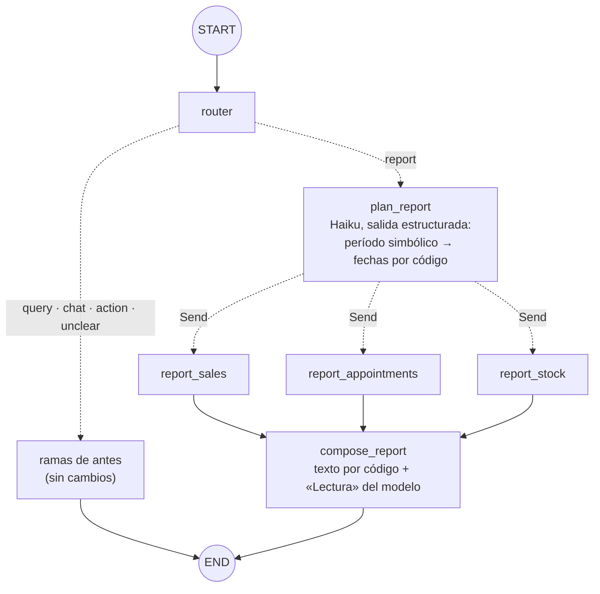

# Fase 6: Reportes en paralelo

Estado: **aprobada, en implementación**

## Objetivo
Que un pedido como «armame el resumen de la semana» junte ventas, turnos y stock bajo **a la vez** (fan-out), y que un nodo final los consolide en un solo texto (fan-in), sin que la falla de una sección tire abajo el reporte entero.

## Contexto
Existe de la fase 5 (etiqueta `fase-05`):

- Grafo de 10 nodos propios y 21 conexiones (ver `specs/mapa-del-grafo.md`). La rama `report` termina en `report_stub`: un mensaje fijo que dice que los reportes llegan en esta fase.
- Tres funciones de lectura ya probadas, sobre el rol `copilot_reader`: `getSalesSummary` (hasta 92 días), `listAppointments` (hasta 31 días; devuelve `total`, `activeCount` y `countByStatus`) y `getStockLevels` (con `onlyLow` y `lowCount`).
- El router ya clasifica estos pedidos como `report` (en la evaluación de la fase 3, 5 de 5 frases de reporte acertaron).
- Hilos persistentes (fase 4): la historia de checkpoints muestra qué nodos corrieron en cada paso, lo que sirve para ver el paralelismo.

Qué se necesita de tu parte: nada. Las pruebas con el modelo real cuestan centavos (Haiku). El reporte solo **lee**: no escribe ni usa el rol de acciones.

## Requisitos
**Fan-out y fan-in**
- R1: La rama `report` ya no termina en un mensaje fijo. El router manda a un nodo `plan_report`; de ahí una **arista condicional que devuelve `Send`** lanza **tres nodos a la vez**: `report_sales`, `report_appointments` y `report_stock`. Un nodo final, `compose_report`, corre **una sola vez** cuando terminaron los tres y arma la respuesta. `report_stub` desaparece.
- R2: Los tres nodos de sección **no llaman a ningún modelo**: ejecutan directamente las funciones de lectura existentes (mismo código, mismos límites y mismas reglas que las herramientas del agente). Cada uno recibe por `Send` solo lo que necesita (`reportId` y período).
- R3: Cada sección devuelve una **parte** `{ reportId, section, status: "ok" | "error", data? , error? }` al canal `reportParts`, un campo del estado con **reducer que concatena**: las tres escrituras del mismo paso se juntan sin pisarse, en cualquier orden. Cuando empieza un reporte nuevo en el mismo hilo, el canal arranca de cero (no se mezclan partes de reportes distintos).

**Período**
- R4: `plan_report` decide el período con un modelo barato (`MODEL_ROUTER`) y **salida estructurada**, pero **el modelo no hace cuentas de calendario**: elige una forma simbólica y el código calcula las fechas con el reloj. Formas: `today`, `yesterday`, `this_week`, `last_week`, `this_month`, `last_month`, `last_days` (con `n` de 1 a 92) y `custom` (con `dateFrom` y `dateTo` explícitos, que la persona dijo tal cual). La semana va de lunes a domingo; «este mes» es del día 1 al último.
- R5: Si no se indica período («hacé un resumen»), se usa `this_week`. Si la salida del modelo es inválida, o el período pedido supera los 366 días, o es `custom` con `dateFrom` posterior a `dateTo`, se usa `this_week` y **el reporte lo dice** («No pude interpretar el período; muestro la semana actual»). Un error real de la API no se tapa: se propaga, como en el router.
- R6: El reporte siempre dice qué período cubre, con fechas explícitas y en horario de Argentina.

**Contenido y consolidación**
- R7: Las tres secciones son siempre ventas, turnos y stock bajo:
  - **Ventas:** cantidad, total, ticket promedio, desglose por medio de pago y por tipo (productos o servicios).
  - **Turnos:** total, activos y cantidad por estado, del período.
  - **Stock:** cuántos productos están por debajo del mínimo (hoy, no del período) y cuáles son, los más urgentes primero.
- R8: `compose_report` arma el texto en dos partes. (a) **Las secciones con cifras las escribe el código** (`renderReport`) a partir de las partes: los números nunca pasan por el modelo. (b) Un modelo (`MODEL_REPORT`, por defecto Haiku 5.5) agrega al final una **«Lectura»** de dos a cuatro frases con lo más relevante, usando solo los datos recibidos. No puede inventar ni calcular cifras: solo citarlas.
- R9: **Falla parcial.** Si una sección falla, el reporte sale igual: esa sección dice «No disponible» con el motivo en palabras de la persona (sin detalles internos de la base) y las demás se muestran completas. Si fallan las tres, el reporte lo dice y no hay «Lectura». Si falla solo la llamada del modelo de la «Lectura», el reporte sale sin ella y con un aviso. Cualquier error se registra en la consola de quien opera.
- R10: Las secciones que tienen un límite propio lo respetan y lo informan en vez de recortar en silencio: los turnos admiten hasta 31 días y las ventas hasta 92. Un pedido de 60 días da un reporte con ventas y stock, y «turnos: no disponible (el máximo es 31 días)».

**Terminal y trazas**
- R11: La terminal muestra una línea con el estado de las tres secciones, por ejemplo `[reporte] semana 26/10 al 01/11 · ventas ✔ · turnos ✔ · stock ✔`, además de la ruta, el uso y el costo por modelo (que ahora incluye al planificador y a la «Lectura»).
- R12: El paralelismo **se ve en la historia de checkpoints**: `npm run threads -- history <id>` muestra las tres secciones corriendo en el mismo paso (`corrió report_sales+report_appointments+report_stock`).
- R13: Variable nueva `MODEL_REPORT` (por defecto `claude-haiku-5-5`) en el esquema de entorno, `.env.example` y README. Prompts en archivos propios: `report-plan.md` y `report.md`.

## Escenarios con el modelo real (congelados)
Se guardan en `evals/report-cases.ts` **antes** de escribir los prompts. Se evalúa el planificador con un reloj fijo, **miércoles 28 de octubre de 2026** (así el resultado esperado es siempre el mismo).

| # | Pedido | Período esperado |
| --- | --- | --- |
| P1 | «Armame el resumen de la semana.» | `this_week` → 2026-10-26 al 2026-11-01 |
| P2 | «Haceme un reporte del mes con ventas, turnos y stock.» | `this_month` → 2026-10-01 al 2026-10-31 |
| P3 | «Quiero un informe de cierre del día.» | `today` → 2026-10-28 |
| P4 | «Dame un panorama completo del negocio de los últimos 30 días.» | `last_days` con `n = 30` → termina el 2026-10-28 |
| P5 | «Resumen de la semana pasada.» | `last_week` → 2026-10-19 al 2026-10-25 |
| P6 | «Hacé un resumen.» | `this_week` (por defecto) |
| P7 | «Resumen del 5 al 12 de octubre.» | `custom` → 2026-10-05 al 2026-10-12 |
| P8 | «Cómo estuvo el mes pasado en general.» | `last_month` → 2026-09-01 al 2026-09-30 |

## Criterios de aceptación
- [ ] CA1 (paralelo): las tres secciones corren a la vez. Test con secciones que demoran 200 ms: el reporte tarda menos que la suma, los intervalos de ejecución se superponen y la historia de checkpoints muestra los tres nodos en un único paso. `compose_report` corre exactamente una vez y después de los tres.
- [ ] CA2 (el reporte incluye todo): con la base real, el reporte contiene las tres secciones y sus cifras coinciden con una consulta SQL independiente (total y cantidad de ventas, turnos por estado, productos bajo el mínimo).
- [ ] CA3 (falla parcial): con una sección que falla (para cada una de las tres), el reporte indica cuál falta y muestra las otras dos; el mensaje no contiene detalles internos (usuario de la base, texto de la excepción). Con las tres fallando, el reporte lo dice y no falla el turno. Con la «Lectura» fallando, el reporte sale sin ella y con aviso.
- [ ] CA4 (reducer): las tres partes de un mismo paso se concatenan sin perderse, en cualquier orden de llegada; un reporte nuevo en el mismo hilo reemplaza las partes del anterior.
- [ ] CA5 (período): la resolución de períodos es una función pura con tests de borde (lunes y domingo como «hoy», fin de mes, año nuevo, febrero bisiesto, `last_days` en los extremos, `custom` inválido, rango de más de 366 días) y usa siempre el horario de Argentina.
- [ ] CA6 (planificador): de P1 a P8, el planificador acierta al menos 7 de 8 con Haiku 5.5 real, en tres corridas seguidas, y P1, P3 y P6 no pueden fallar. Ninguna frase de los escenarios aparece en `report-plan.md` (lo verifica un test).
- [ ] CA7 (sin cifras inventadas): con el modelo real, cada número de la «Lectura» aparece en los datos del reporte (comparación de dígitos sin separadores). Si una corrida inventa una cifra, el criterio no se cumple.
- [ ] CA8 (límites): un pedido de 60 días da ventas y stock y «turnos: no disponible» con el motivo; un período inválido o de más de 366 días cae en la semana actual y lo avisa.
- [ ] CA9 (hilos): el reporte se guarda en el hilo como un mensaje de IA normal, se puede retomar la conversación después, y un segundo reporte en el mismo hilo no mezcla partes con el primero. Los tests de las fases 1 a 5 solo cambian donde cambia el grafo (`report_stub`).
- [ ] CA10 (solo lectura): el reporte no usa el rol `copilot_actions` ni escribe nada; después de correrlo, los conteos de la base son los mismos.
- [ ] CA11 (costo): se mide un reporte completo (Haiku y Sonnet como `MODEL_REPORT`) y se compara con el plan (US$ 0,08 con Sonnet, US$ 0,004 con Haiku). Si difiere más de un 20 %, se actualiza el presupuesto.
- [ ] CA12: `npm test`, `npm run typecheck` y `npm run db:reset` (dos veces seguidas) pasan; el diagrama de la fase se agrega a `specs/mapa-del-grafo.md`; se actualizan README, `.env.example` y el plan.

## Fuera de alcance
- Exportar a PDF, planilla o correo, gráficos, y reportes programados.
- Elegir qué secciones incluir («solo ventas»): siempre son las tres. Un pedido de un solo dato sigue siendo una consulta.
- Comparar con el período anterior («+8 % contra la semana pasada»): es una cuenta que hoy haría el modelo o un nodo nuevo; queda como extensión.
- Reportes de más de 366 días, por barbero o por cliente.
- Reintentos automáticos de una sección que falla, y límite de tiempo por sección (fase 10). Acá la falla se informa.
- Pedidos mixtos («registrá la venta y armame el resumen»): siguen yendo a la rama de acciones (fase 7).

## Diseño (plan técnico)

**Grafo**

```
                              ┌─ report_sales ───────┐
START → router ─ report ─→ plan_report ─ Send ×3 ─┼─ report_appointments ─┼─→ compose_report → END
                              └─ report_stock ───────┘
   (las otras ramas, sin cambios: query, chat, action, unclear)
```

Nodos propios: los de antes menos `report_stub` y cinco nuevos (`plan_report`, `report_sales`, `report_appointments`, `report_stock`, `compose_report`): **14 nodos propios**. Aristas fijas: `START→router`, `chat→END`, `clarify→END`, `execute_action→action_agent`, las tres secciones `→compose_report` y `compose_report→END`: 8. Condicionales: router (5), `agent` (2), `tools` (2), `action_agent` (3), `propose_action` (2), `await_approval` (2) y `plan_report` (3, uno por sección): 19. Total previsto, **27 conexiones**; se comprueba contra el grafo compilado al cerrar.

**Cómo funciona `Send`.** Una arista condicional normal devuelve el nombre de un nodo. Si devuelve una lista de `Send(nombre, entrada)`, LangGraph lanza **un nodo por cada `Send` en el mismo paso (superstep)**, y cada uno recibe su propia entrada (no el estado completo). Todo lo que los nodos escriben en ese paso se aplica junto, con el reducer del canal. Los nodos que vienen después de los tres corren recién en el paso siguiente: eso es el fan-in. A confirmar al implementar: el tipado de `Send` con `StateSchema`, que `compose_report` corre una sola vez con tres aristas entrantes, y cómo aparecen en `getGraphAsync()` las aristas de un `Send`.

**Estado:** se suman `report` (`id`, `period` resuelto, `label`, `notice?`; se reemplaza en cada pedido) y `reportParts` (**con reducer**: concatena las partes del mismo `reportId` y reemplaza todo cuando llega un `reportId` distinto, así el campo se reinicia solo en un reporte nuevo y no depende de un valor especial). Total de campos: 7.

**Planificador** (`plan_report`): `withStructuredOutput` sobre `MODEL_ROUTER` con una unión discriminada de Zod para el período. El prompt recibe la fecha de hoy y el texto del pedido (con el mismo contexto acotado del router). `resolvePeriod(period, now)` es una función pura que devuelve fechas locales de Argentina y una etiqueta («semana del 26/10 al 01/11»). Un resultado inválido cae en `this_week` con aviso.

**Secciones:** tres funciones `makeSalesSection`, `makeAppointmentsSection`, `makeStockSection`, cada una con su cliente de lectura inyectado. Capturan el error: `ToolUserError` (límites y datos) se informa con su texto; cualquier otro error se registra en la consola y se informa con un texto genérico y el código, como hace `safeTool`.

**Consolidación:** `renderReport(report, parts)` es una función pura (texto del reporte con cifras en pesos argentinos y fechas locales). `compose_report` llama al modelo con las partes en JSON y el prompt `report.md` para obtener la «Lectura», y concatena. La respuesta final es un `AIMessage` común.

**Costo esperado:** un reporte son dos llamadas al modelo (planificador y «Lectura») y tres consultas a la base, sin ciclo de herramientas. Debería salir bastante por debajo de la estimación del plan; se mide.

**Archivos**

```
src/graph/report/period.ts        Period (Zod), resolvePeriod, etiquetas
src/graph/report/sections.ts      las tres secciones y su manejo de errores
src/graph/report/render.ts        renderReport (cifras y secciones, por código)
src/graph/report/state.ts         esquema de parte y reducer de reportParts
src/graph/nodes/report.ts         plan_report, nodos de sección y compose_report
src/graph/prompts/report-plan.md, report.md
src/graph/index.ts, state.ts, create-agent.ts, run-turn.ts, models.ts   (modifican)
src/graph/nodes/stubs.ts, src/graph/messages.ts   (se eliminan: ya no quedan marcadores)
src/config/env.ts, .env.example                    MODEL_REPORT (modifican)
src/cli/chat.ts, format.ts, bench.ts               línea [reporte] y caso de costo (modifican)
evals/report-cases.ts, evals/report.ts             escenarios P1 a P8 y corredor; src/cli/eval-report.ts (npm run eval:report)
tests/report-*.test.ts                             período, secciones, render, reducer, nodos, grafo y paralelismo
tests/report.llm.test.ts, tests/report-db.test.ts  modelo real y cifras contra SQL independiente
```

## Mapas


Las tres secciones corren en el **mismo paso**; `compose_report` en el siguiente.

## Tareas
Una tarea = un commit en la rama `dev/fase-06`.

1. **T1:** esta spec aprobada; rama `dev/fase-06`; escenarios P1 a P8 congelados en `evals/report-cases.ts`.
2. **T2:** `Period`, `resolvePeriod` y sus tests de borde (CA5).
3. **T3:** secciones con manejo de errores, partes y reducer (CA4, parte de CA3).
4. **T4:** `renderReport` y sus tests (CA2 sin base, CA8).
5. **T5:** `plan_report`, nodos de sección y `compose_report` con modelos falsos, y el nuevo cableado del grafo con `Send` (sin `report_stub`); adaptación de los tests de las fases 1 a 5 (CA1, CA3, CA9).
6. **T6:** `MODEL_REPORT`, prompts, `createAgent` y comprobación contra la base real (CA2, CA10).
7. **T7:** terminal (`[reporte]`) y trazas del paralelismo en `threads -- history` (R11, R12).
8. **T8:** corredor de escenarios del planificador y pruebas con el modelo real (CA6, CA7).
9. **T9:** medición de costo (CA11), diagrama, README, plan y cierre con etiqueta `fase-06` (CA12).

## Decisiones tomadas durante la fase
(se completa al implementar)

## Qué aprendí
(se completa al cerrar la fase)
