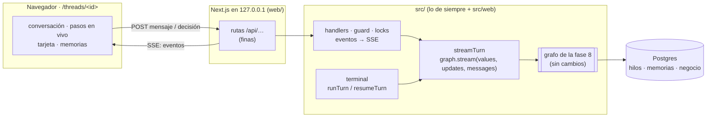
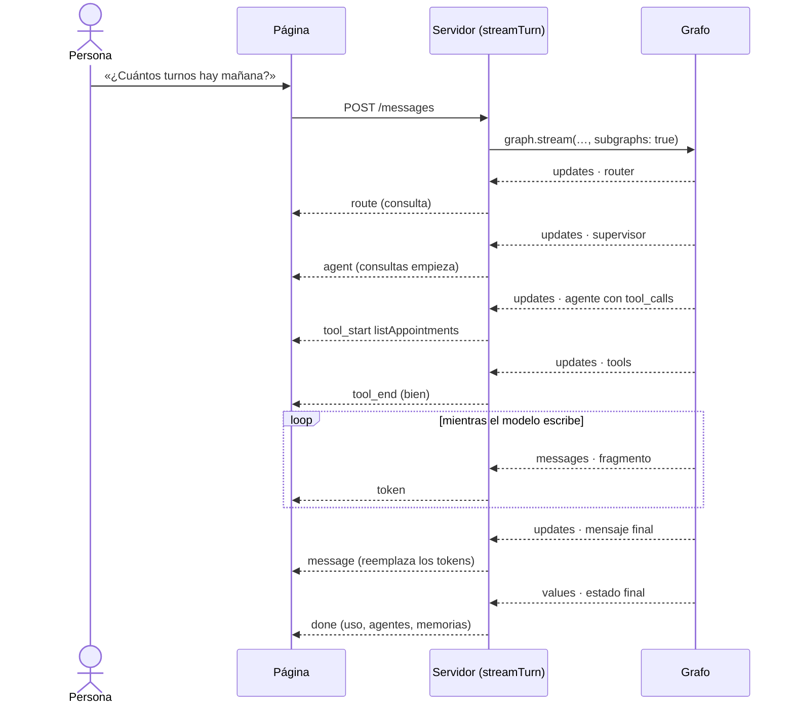
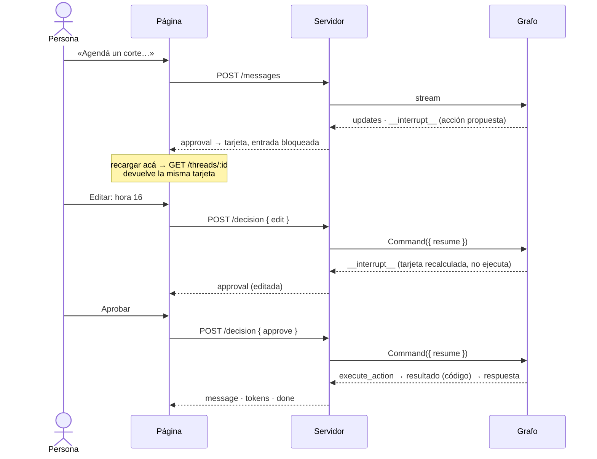
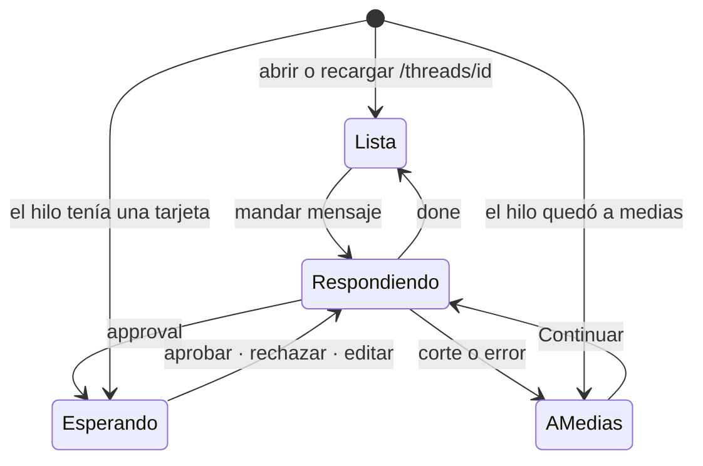
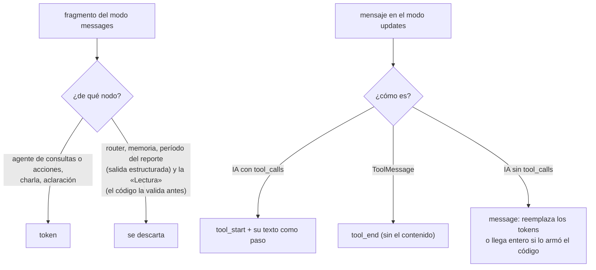

# Fase 9: Streaming y chat web

Estado: **terminada** (etiqueta `fase-09`)

## Objetivo
Usar el copiloto desde un **chat web** con la respuesta **en vivo**: el texto aparece a medida que el modelo lo escribe, se ve qué agente trabaja y qué herramienta usa mientras ocurre, las acciones se aprueban, rechazan o editan con una **tarjeta**, y recargar la página retoma el mismo hilo.

## Contexto
Existe de la fase 8 (etiqueta `fase-08`):

- El grafo completo: `load_memory → router → supervisor` y los agentes (consultas, acciones y reportes como subgrafos; charla, aclaración y memoria como nodos). 9 nodos, 16 conexiones. **Esta fase no lo cambia.**
- `runTurn`, `resumeTurn` y `continueTurn` (`src/graph/run-turn.ts`) corren un turno con `graph.invoke` y devuelven todo junto al final (`TurnResult`): la respuesta, la ruta, las herramientas, el uso, los agentes y, si hay una acción esperando, la tarjeta (`awaiting`).
- La aprobación de la fase 5: el subgrafo de acciones se pausa con `interrupt` y se reanuda con `Command({ resume: decisión })`. La decisión tiene un esquema estricto (`humanDecisionSchema`: aprobar, rechazar con motivo opcional, editar con parámetros) y cada acción se ejecuta una sola vez.
- Los hilos en Postgres (fase 4): `getStatus` dice si un hilo existe, si está a medias o si espera una decisión; `listThreads` lista los recientes.
- La terminal (`npm run chat`) es hoy la única interfaz. Sigue igual después de esta fase.
- El plan reserva la carpeta `web/` para la app Next.js. No hay usuarios ni contraseñas en ninguna fase del plan: la app es **local**.

Qué se necesita de tu parte:
- Aprobar esta spec.
- Las pruebas de punta a punta usan un navegador automático (Playwright). La primera vez descarga Chromium, unos 150 MB.
- Las pruebas con el modelo real cuestan centavos (Haiku). Una de ellas **aprueba una acción** en la base local, igual que los tests de escritura de la fase 5. Después se corre `npm run db:reset`.

## Requisitos
**El chat web**
- R1: Una app Next.js 16 en `web/`, con su propio `package.json`, hecha con **shadcn/ui y Tailwind CSS v4**. `npm run web` (desde la raíz) la levanta en `http://127.0.0.1:3000`. Usa el **mismo agente** que la terminal (`createAgent`): mismo grafo, mismos hilos, mismas memorias. Un hilo empezado en la terminal se abre en la web, y al revés.
- R2: Cada hilo tiene su dirección: `/threads/<id>`. `/` abre un hilo nuevo. Una barra lateral lista los hilos recientes y tiene «Nuevo hilo».
- R3: **Recargar retoma el hilo.** Al abrir la dirección de un hilo se ve su conversación y su situación:
  - listo para escribir;
  - una acción esperando la decisión, con su tarjeta;
  - un turno a medias, con un botón «Continuar» (como `/continuar` en la terminal).

**La respuesta en vivo**
- R4: **Texto token por token** (modo `messages` de LangGraph). Solo se transmite el texto de los nodos que le contestan a la persona: los agentes de consultas y de acciones, la charla y la aclaración. Los nodos con salida estructurada (router, memoria, período del reporte) no se transmiten: su salida no es texto para la persona. **Corrección en T2:** la «Lectura» del reporte tampoco. El código la descarta si cita una cifra que no está en los datos (fase 6), y transmitida se vería un texto que después desaparece. Del reporte se ven en vivo sus secciones, y el texto llega entero.
- R5: **Pasos visibles mientras ocurren** (modo `updates`, con `subgraphs: true`):
  - las partes del pedido (el plan del router), apenas el router termina;
  - qué agente está trabajando;
  - cada herramienta, con su nombre y sus argumentos, cuando el agente la pide;
  - cómo salió cada herramienta (bien o con error) cuando termina;
  - las secciones del reporte, a medida que terminan.

  El texto que acompaña a una herramienta («voy a consultar la agenda…») se muestra como paso, no como respuesta: es el mismo criterio de `turnReply`.
- R6: **Lo que arma el código llega entero.** La memoria («Anoté esta regla…»), el resultado de una acción, el reporte y los avisos del plan no pasan por un modelo, así que no hay tokens: llegan como un mensaje completo. Cada mensaje viaja con su id. Cuando un mensaje termina, el texto guardado en el hilo **reemplaza** al acumulado con los tokens: lo que queda en pantalla es lo que quedó en el hilo.
- R7: Al terminar cada turno se ve el mismo resumen que en la terminal:
  - uso y costo del turno y de la sesión;
  - agentes con sus herramientas y su costo;
  - cuántas memorias estaban en contexto;
  - cómo salió cada sección del reporte, si lo hubo.

  Va en una línea compacta que se puede desplegar.

**La tarjeta de aprobación**
- R8: La tarjeta muestra:
  - el resumen de la acción (lo arma el código, como en la fase 5);
  - el riesgo;
  - los parámetros;
  - un aviso si la tarjeta ya viene editada o si la decisión anterior no se pudo usar.

  Botones:
  - **Aprobar**.
  - **Rechazar**, con un motivo opcional de hasta 200 caracteres.
  - **Editar**: un formulario con un campo por parámetro. Editar no ejecuta nada: muestra la tarjeta recalculada, que hay que aprobar de nuevo.

  La decisión viaja con el mismo esquema estricto (`humanDecisionSchema`) y reanuda el grafo con `Command({ resume })`. Lo que sigue (la ejecución y la respuesta) también llega en vivo.
- R9: Mientras hay una tarjeta, no se pueden mandar mensajes: es la misma regla que en la terminal. Un doble clic o dos pestañas no deciden dos veces. El servidor no acepta un segundo turno sobre un hilo que ya tiene uno en curso, y además cada acción se ejecuta una sola vez desde la fase 5.

**El servidor**
- R10: **Un solo camino para correr un turno.** Una función nueva, `streamTurn`, corre el grafo con `graph.stream` (modos `values`, `updates` y `messages`, con subgrafos) y produce **eventos de la interfaz**. `runTurn`, `resumeTurn` y `continueTurn` pasan a consumir esos eventos y devuelven el mismo `TurnResult` que antes, así que la terminal y los tests de las fases 2 a 8 no cambian.
- R11: **Los eventos tienen un formato fijo**, definido con Zod en `src/web/events.ts`, y viajan al navegador por SSE (`text/event-stream`). Son:
  - `route`: las partes del pedido;
  - `agent`: qué agente empieza o termina;
  - `token`;
  - `message`: un mensaje terminado;
  - `tool_start` y `tool_end`;
  - `action_result`: el resultado de una acción, con el texto que arma el código (sumado en T2);
  - `report_section`;
  - `approval`: la tarjeta;
  - `done`: el `TurnResult` completo;
  - `error`.

  De una herramienta viaja si salió bien o mal, **no su contenido** (son datos de la base que el modelo ya usó).
- R12: **Si se corta la conexión** en medio de un turno (se recarga la página o se cierra la pestaña), el turno se detiene: la señal de corte del pedido llega al grafo. El hilo queda a medias, como en la fase 4. Al volver, la página ofrece «Continuar», y nada se duplica.
- R13: **Seguridad de una app local sin usuarios:**
  - El servidor escucha solo en `127.0.0.1`.
  - Las rutas que cambian algo (mandar un mensaje, decidir, continuar, borrar una memoria) exigen `Content-Type: application/json` y un `Origin` igual al del propio servidor. Así, otra página abierta en el navegador no puede mandar una aprobación al copiloto.
  - El id del hilo, el mensaje (hasta 4.000 caracteres) y la decisión se validan con Zod antes de tocar el grafo.
  - Un error llega al navegador con un mensaje claro y sin detalles internos (cadenas de conexión, rutas de archivos). El detalle queda en el registro del servidor.
- R14: **Memorias en la web:** un panel lista las memorias del negocio y permite borrar una, con confirmación. Anotar sigue siendo por el chat, como pide la fase 8 (el código valida lo que se guarda).

## Escenarios con el modelo real (congelados)
Se guardan en `evals/web-cases.ts` **antes** de escribir la interfaz. Se corren en el navegador con Playwright, cada uno en un hilo nuevo, y los hilos se borran al terminar. La fecha de los turnos es el martes que cae a tres semanas, dicha completa: queda fuera de la agenda del seed, igual que en la fase 8.

| # | Pedido | Qué se hace en la página | Esperado |
| --- | --- | --- | --- |
| W1 | «¿Cuántos turnos hay mañana?» | nada | La ruta dice consulta. La herramienta de turnos aparece **antes** que el texto de la respuesta. El texto de la respuesta crece en al menos 3 pasos visibles antes de terminar. |
| W2 | «Agendá un corte para Julián Romero el martes \<fecha\> a las 15 con Lucas.» | Rechazar, con el motivo «mejor otro día» | Aparece la tarjeta, la entrada de texto queda bloqueada y, al rechazar, no se escribe nada en la base. |
| W3 | El pedido de W2 | Editar la hora a 16, aprobar la tarjeta nueva | La tarjeta nueva dice 16. Al aprobar, el turno queda creado a las 16 y se ve el resultado de la acción. |
| W4 | El pedido de W2 | Recargar la página con la tarjeta abierta, después aprobar | Después de recargar se ven la conversación y la misma tarjeta. Aprobar funciona y el turno queda creado una sola vez. |
| W5 | «Armame el resumen de la semana.» | nada | Las tres secciones (ventas, turnos, stock) aparecen como terminadas antes que el reporte, y el reporte llega completo. |

W3 y W4 escriben en la base: van en las pruebas de escritura y después se corre `db:reset`.

## Criterios de aceptación
- [x] CA1 (en vivo): la respuesta aparece de forma progresiva.
  - Con modelos falsos que transmiten tokens: los eventos `token` llegan antes que `done` y en orden, y su texto unido es igual al del mensaje final.
  - Con el modelo real: W1 en el navegador en tres corridas.
  - Se registra el tiempo hasta el primer token frente al tiempo total.
- [x] CA2 (herramientas en vivo): las llamadas a herramientas se muestran mientras ocurren.
  - Con modelos falsos: el orden es `tool_start`, después `tool_end`, después los tokens de la respuesta.
  - El texto que acompaña a una herramienta queda como paso, no como respuesta.
  - En el navegador: W1.
- [x] CA3 (tarjeta): aprobar, rechazar o editar desde la tarjeta reanuda el grafo (W2, W3 y W4 con el modelo real).
  - Con modelos falsos: una edición inválida muestra el motivo y la acción sigue pendiente.
  - Dos decisiones simultáneas sobre el mismo hilo ejecutan la acción una sola vez: la segunda recibe 409.
- [x] CA4 (recargar): recargar la página retoma el mismo hilo, con su conversación, su tarjeta (W4) o su botón «Continuar».
  - Un hilo empezado en la terminal se abre en la web.
- [x] CA5 (un solo camino): `runTurn`, `resumeTurn` y `continueTurn` usan `streamTurn`.
  - Todos los tests de las fases 2 a 8 pasan sin cambios de comportamiento.
  - La terminal funciona igual (se prueba a mano).
- [x] CA6 (qué se transmite): con modelos falsos que sí emiten tokens en el router y en la memoria, esos tokens **no** llegan como eventos `token`. Los mensajes que arma el código llegan como `message`, sin tokens.
- [x] CA7 (seguridad), probado sobre las rutas:
  - una ruta que cambia algo responde 415 sin `Content-Type: application/json` y 403 con un `Origin` ajeno;
  - un id de hilo o una decisión inválida da 400;
  - un segundo turno en curso sobre el mismo hilo da 409;
  - un error de la base no muestra la cadena de conexión;
  - `npm run web` escucha solo en `127.0.0.1`.
- [x] CA8 (corte): con un modelo falso lento, cortar el pedido en medio del turno deja el hilo a medias. «Continuar» lo termina, con un solo mensaje de la persona y una sola respuesta.
- [x] CA9 (medición): se registra en esta spec, con Haiku:
  - el tiempo hasta el primer token y el tiempo total de W1, en la web y en la terminal;
  - la diferencia de costo entre `invoke` y `stream` para el mismo pedido (se espera ninguna: son los mismos tokens).
- [x] CA10: estos comandos pasan:
  - `npm test`;
  - `npm run typecheck` (raíz y `web/`);
  - `npm run web:build`;
  - ~~`npm run db:reset`, dos veces seguidas~~: esta fase no cambió la base; se dejó de lado para no borrar los hilos y las memorias reales (ver «Decisiones tomadas durante la fase»).

  Además:
  - `specs/mapa-del-grafo.md` dice que el grafo no cambió y suma el mapa de los eventos;
  - se actualizan README y plan.

## Fuera de alcance
- Usuarios, inicio de sesión y acceso desde otra máquina: no están en el plan. La app escucha solo en la máquina local.
- **Reconectarse a un turno en curso** después de recargar. Recargar en medio de un turno lo corta, y se continúa con «Continuar» (R12).
- El servidor de agentes de LangGraph (Agent Server) y el hook `useStream` de `@langchain/langgraph-sdk`. Se discute en el diseño; el servidor local de LangGraph es tema de la fase 12.
- ~~Mostrar las respuestas con formato Markdown~~: entró en T4 (ver «Decisiones tomadas durante la fase»).
- Anotar o editar memorias desde el panel (se anotan por el chat), borrar hilos desde la web (sigue `npm run threads -- delete`), y adjuntar archivos o usar la voz.
- Reintentos automáticos y viaje en el tiempo: fase 10.

## Diseño (plan técnico)

**Por qué eventos propios y no `useStream`.** LangGraph ofrece un camino armado: servir el grafo con su servidor de agentes y consumirlo desde React con `useStream`, que ya sabe de tokens, interrupciones e hilos. Se descarta en esta fase por tres razones:
- El objetivo de aprendizaje son **los modos de streaming**, y `useStream` los esconde.
- Exige otro servidor, que es tema de la fase 12.
- Las reglas de este copiloto (qué texto es respuesta y cuál es paso, qué arma el código, el uso por agente) ya están en `run-turn.ts`. Con eventos propios se reutilizan en vez de reescribirse en el navegador.

**De los modos de LangGraph a los eventos.** `graph.stream(entrada, { streamMode: ["values", "updates", "messages"], subgraphs: true, signal })` entrega tuplas `[namespace, modo, dato]`. Cada una se traduce así:

| Modo | De dónde | Evento |
| --- | --- | --- |
| `messages` | Un fragmento de texto de un nodo que contesta, según `langgraph_node` y el namespace en los metadatos | `token` (id del mensaje, agente, texto) |
| `updates` | El router | `route` |
| `updates` | El supervisor (empieza o termina una tarea) | `agent` |
| `updates` | Un agente: un mensaje de IA con `tool_calls` | `tool_start` por llamada; su texto, como `message` de tipo paso |
| `updates` | El nodo de herramientas: un `ToolMessage` | `tool_end` (bien o error) |
| `updates` | Una sección del reporte | `report_section` |
| `updates` | Cualquier nodo: un mensaje de IA sin `tool_calls` | `message` de tipo respuesta (reemplaza a los tokens con el mismo id) |
| `updates` | La clave `__interrupt__` | `approval` |
| `values` | La raíz, al final | se arma el `TurnResult`: `done` |

Lo que hoy calcula `invokeTurn` (respuesta, uso, agentes, reporte) se arma con el último `values` de la raíz y el mismo `UsageTracker`. A confirmar al implementar:
- el formato exacto de las tuplas en 1.5.3 con tres modos y subgrafos;
- que `ChatAnthropic` transmite tokens aunque los nodos lo llamen con `invoke` (LangGraph lo pide a través de los callbacks);
- que los ids de los fragmentos coinciden con el id del mensaje final.

**Código del servidor, fuera de Next** (`src/web/`, probado con vitest como el resto):
- `events.ts`: el esquema Zod de los eventos y `toUiEvents(tupla)`, una función pura con tests.
- `sse.ts`: codifica eventos como SSE.
- `guard.ts`: los controles de R13, que son `Content-Type`, `Origin` y tamaño.
- `locks.ts`: un turno en curso por hilo, en memoria. Hay un solo proceso local.
- `handlers.ts`: funciones `(Request) → Response` para cada ruta. Las rutas de Next solo las llaman.

`streamTurn` vive en `src/graph/run-turn.ts`, junto a las funciones que reemplaza.

**Rutas** (`web/app/api/`):

```
GET    /api/threads                       hilos recientes
GET    /api/threads/:id                   conversación + situación (listo, a medias, tarjeta)
POST   /api/threads/:id/messages          { text }       → SSE
POST   /api/threads/:id/decision          HumanDecision  → SSE
POST   /api/threads/:id/continue          {}             → SSE
GET    /api/memories                      lista
DELETE /api/memories/:id                  borra una
```

**El agente en Next.** Un solo `createAgent` por proceso, guardado en `globalThis` para que el recargado en caliente de desarrollo no abra pools nuevos. Lee el `.env` de la raíz. A confirmar al implementar:
- que Next 16 (Turbopack) compila `../src`, con imports `.js` que apuntan a archivos `.ts`, usando `turbopack.root` en la raíz;
- que `pg`, Prisma y LangGraph funcionan como paquetes externos del servidor (`serverExternalPackages`).

Resultado en T1: Turbopack no resuelve esos imports y se usa **webpack**. Ver «Decisiones tomadas durante la fase».

La raíz usa TypeScript 7. `web/` usa el TypeScript que pida Next.

**El navegador.**
- Un reductor puro, `applyEvent(estadoDeLaPágina, evento)`, con tests, decide qué se ve: mensajes, pasos del turno en curso, tarjeta, «Continuar» y resumen.
- Los componentes solo dibujan ese estado: barra de hilos, conversación, pasos en vivo, tarjeta, entrada, resumen del turno y panel de memorias.
- **Interfaz con shadcn/ui y Tailwind CSS v4** (pedido al aprobar la spec): una interfaz prolija y elegante, con tema claro y oscuro (tokens semánticos de shadcn, sin colores sueltos) y uso en el celular. `web/` se arma con `npx shadcn@latest init --template next` y los componentes se agregan con la CLI: quedan como código propio en `web/components/ui/`. Qué se usa para qué:
  - la conversación, con las piezas de chat de shadcn: `MessageScroller` (sigue el texto en vivo y salta al último mensaje), `Message` y `Bubble`;
  - los pasos en vivo (agentes, herramientas, secciones del reporte), con `Trace` y `TraceLine`, una línea por paso, desplegable;
  - los avisos del plan y las marcas de «turno a medias», con `Marker` y `Alert`;
  - la barra de hilos, con `Sidebar`;
  - la tarjeta de aprobación, con `Card` (encabezado, contenido y pie), `Badge` para el riesgo, `Table` para los parámetros, y `Field` y `Input` para editar y para el motivo del rechazo;
  - borrar una memoria, con `AlertDialog`; el panel de memorias, con `Sheet`;
  - el resumen del turno, con `Collapsible` y `Badge`; los botones ocupados, con `Spinner`; las cargas, con `Skeleton`.

**Archivos**

```
src/web/events.ts, sse.ts, guard.ts, locks.ts, handlers.ts
src/graph/run-turn.ts   (streamTurn; runTurn, resumeTurn y continueTurn la usan)
web/package.json, next.config.ts, tsconfig.json, components.json   (shadcn)
web/app/layout.tsx, page.tsx, threads/[id]/page.tsx, globals.css   (Tailwind v4 y el tema de shadcn)
web/components/ui/...   (componentes de shadcn, agregados con la CLI)
web/app/api/...   (rutas finas)
web/lib/agent.ts, client/reducer.ts, client/sse.ts
web/components/ThreadList, Conversation, LiveSteps, ApprovalCard, Composer, TurnSummary, MemoryPanel
web/e2e/*.spec.ts   (Playwright)
evals/web-cases.ts
tests/web-*.test.ts, tests/stream-turn.test.ts
package.json   (web, web:build, web:e2e)
```

## Mapas

**1. Dónde encaja la web**



La web y la terminal pasan por el mismo `streamTurn`, así que comparten los hilos y las memorias. Lo nuevo es lo que rodea al grafo, no el grafo.

**2. Un turno en vivo**



**3. La tarjeta, de punta a punta**



**4. Los estados de la página**



En «Respondiendo» y en «Esperando» la entrada de texto está bloqueada. En «A medias» solo se puede continuar, igual que en la terminal.

**5. Qué se transmite y qué no**



## Tareas
Una tarea = un commit en la rama `dev/fase-09` (T4 a T6 quedaron en un solo commit: ver «Decisiones tomadas durante la fase»).

1. **T1:** esta spec aprobada. Escenarios W1 a W5 congelados en `evals/web-cases.ts`. Andamiaje de `web/` (Next 16, Tailwind v4 y shadcn/ui) con una ruta de prueba que lista los hilos con el agente real, para confirmar lo que el diseño deja «a confirmar».
2. **T2:** `streamTurn` y los eventos (`events.ts`), y `runTurn`, `resumeTurn` y `continueTurn` sobre `streamTurn`. Tests con modelos falsos que transmiten tokens (CA1, CA2, CA5 y CA6 sin modelo real).
3. **T3:** rutas, SSE, `guard`, `locks` y corte por señal. Tests sobre los handlers (CA7, CA8 y la parte de servidor de CA3 y CA4).
4. **T4:** la página: hilos, conversación, entrada, pasos en vivo y resumen del turno, con el reductor y sus tests.
5. **T5:** la tarjeta de aprobación y «Continuar» (CA3, CA4).
6. **T6:** el panel de memorias (R14).
7. **T7:** Playwright y los escenarios W1 a W5 con el modelo real (CA1 a CA4 en el navegador).
8. **T8:** medición (CA9), mapa del grafo, README y plan. Cierre con la etiqueta `fase-09` (CA10).

## Decisiones tomadas durante la fase
- **La web compila `../src` con webpack, no con Turbopack** (T1). Turbopack, el compilador por defecto de Next 16, no resuelve los imports `.js` que apuntan a archivos `.ts` fuera de `web/`: el resto del proyecto usa esa forma, que es la de NodeNext. Webpack sí los resuelve, con dos opciones de Next: `experimental.externalDir`, que deja compilar archivos de fuera de `web/`, y `experimental.extensionAlias`, que traduce `.js` a `.ts`. Por eso los scripts de `web/` usan `--webpack`. La alternativa era compilar `src/` a JavaScript antes de levantar la web: es un paso más en cada cambio, y la terminal no lo necesita.
- **Los prompts se leen con `readPrompt`** (`src/graph/prompts/read.ts`), en vez de `readFileSync(new URL(…))` en cada nodo. Webpack convierte `new URL("x.md", import.meta.url)` en un archivo publicado (`/_next/static/media/…`). En el servidor eso se apaga (`module.parser.javascript.url: false`) y la URL queda apuntando al archivo real de `src/`. Aun así, el objeto `URL` llega de otro contexto y `readFileSync` no lo acepta, así que `readPrompt` usa su texto (`href`). La terminal y los tests no notan la diferencia.
- **Confirmado:** `pg`, Prisma, el checkpointer y el Store de Postgres funcionan como paquetes externos del servidor. Un turno real dentro de Next (consulta de stock) usó el agente, la base y la memoria de la fase 8, y contestó «Cera mate 31 U/S». El agente se crea una vez por proceso y lee el `.env` de la raíz.
- **Cómo llegan los datos de `graph.stream`** (T2, LangGraph 1.5.3, modos `values`, `updates` y `messages` con `subgraphs: true`):
  - cada dato es `[namespace, modo, dato]`;
  - los fragmentos de texto traen el mismo id que el mensaje final, así que el mensaje terminado reemplaza al borrador;
  - la pausa de aprobación llega dos veces (desde el subgrafo y desde la raíz) y se toma la de la raíz;
  - un subgrafo devuelve todos sus mensajes juntos al grafo principal cuando termina, y esos no se repiten;
  - al pausarse, el modo `values` manda además un dato que es solo `{ __interrupt__ }`: el estado es el anterior;
  - un nodo del grafo principal transmite con su propio tramo de namespace (`chat:…`).
- **Con streaming, el agente guarda `AIMessageChunk`.** Cuando alguien escucha los tokens, LangChain le pide al modelo que transmita, y lo que el nodo recibe y guarda es la suma de los fragmentos (`AIMessageChunk`), no un `AIMessage`. Para el resto del código es lo mismo (`AIMessage.isInstance` lo acepta) y al volver al grafo principal se convierte en `AIMessage`. Toda la suite pasó sin cambios.
- **Un evento más, `action_result`:** el resultado de una acción aprobada o rechazada, con el texto del código, igual que `[acción]` en la terminal. Las acciones propuestas no son `tool_start`: se ven en la tarjeta.
- **Con streaming, la respuesta de Claude no trae el nombre del modelo** (T2, con el modelo real): el uso salía como «desconocido» y el costo, vacío. `UsageTracker` ahora toma como respaldo el modelo que se pidió al empezar la llamada (`ls_model_name` en los metadatos). La consulta «¿Cuántos turnos hay mañana?» costó US$ 0,0012 con streaming, lo mismo que en el bench de la fase 8 (US$ 0,0013): los tokens son los mismos.
- **Con el modo `messages`, la salida estructurada de Claude se rompía** (T3, visto con el modelo real; con modelos falsos no se veía). El modo `messages` le pide a cada modelo que transmita, y transmitida, la salida estructurada llega con los argumentos de la herramienta en fragmentos: `tool_calls` estaba bien armado, pero el parser de `withStructuredOutput` lee los bloques de contenido, donde `input` venía vacío. Resultado: `parsed` en null y el router caía siempre a su respaldo (todo era «consulta»). Arreglo: los modelos de salida estructurada (router, memoria, período del reporte) se crean con `disableStreaming`, que los hace contestar todo junto aunque alguien escuche. Hay que asignarlo **después** de crear el modelo: el constructor de `@langchain/core` 1.3.0 declara la opción pero no la toma. Lo cubre un test sin API (`tests/models.test.ts`), y los tests con el modelo real ahora pasan todos por el camino con streaming. Lección: un cambio en **cómo** se llama al modelo se prueba con el modelo real, no solo con modelos falsos.
- **Las rutas de Next son de una línea**: llaman a `makeHandlers` (`src/web/handlers.ts`), que se prueba con vitest como el resto. Un turno en vivo devuelve sus errores como evento `error`, con un texto para la persona; el detalle (que puede tener una cadena de conexión) solo va al registro del servidor. Antes de abrir el stream se revisa la situación del hilo, y los conflictos (una tarjeta pendiente, un turno a medias, otro turno en curso) responden 409 enseguida, sin abrir el SSE.
- **La página se armó en un solo paso (T4 a T6 en un commit).** La conversación, la tarjeta, «Continuar» y el panel de memorias son piezas de la misma página (`chat-app.tsx`): separarlas en tres commits dejaba commits intermedios que no compilaban. Las pruebas de cada parte están separadas: el reductor (`tests/web-view.test.ts`), las rutas (`tests/web-handlers.test.ts`) y el navegador (`web/e2e`).
- **Markdown, sí** (cambio de alcance en T4). Haiku contesta con Markdown sencillo («**23 turnos**», listas) y la página mostraba los asteriscos. Se dibuja con `react-markdown`, que **no interpreta HTML** (un texto con etiquetas que venga de la base se ve como texto), más `remark-gfm` (tablas) y `remark-breaks` (los reportes los arma el código, renglón por renglón).
- **La tarjeta muestra los parámetros con nombres en castellano** («Barbero», «Hora», «Unidades»), no los internos (`staffName`, `time`, `delta`). Lo que se ejecuta sigue siendo exactamente lo que se ve: el resumen lo arma el código.
- **El estado de la página se toma una sola vez al abrirla.** Un `useEffect` que volvía a armarlo cuando el servidor redibujaba la página borró una conversación en curso; cada hilo monta su propio componente (`key`) y no hace falta.
- **Después de cambiar algo en `src/graph`, hay que reiniciar `npm run web`.** El agente se guarda en `globalThis` para que el recargado en caliente no abra pools de Postgres nuevos en cada cambio; la contracara es que sigue usando el grafo armado al arrancar. Pasó en esta fase: el arreglo del router no se veía en la web hasta reiniciar.
- **Las capturas de pantalla para revisar el diseño se sacan con Playwright** (el mismo de T7), en claro, oscuro y a ancho de celular.
- **Las pruebas de punta a punta limpian lo suyo, sin `db:reset`** (la spec preveía resetear la base después). Usan hilos `e2e-…` y, al terminar, borran los turnos que crearon (por el registro de acciones de esos hilos), el registro y los hilos. Así no se pierden los hilos ni las memorias reales. Un sexto escenario, fuera de los congelados, prueba el corte en el navegador: recargar a mitad de una respuesta deja el turno a medias y «Continuar» lo termina. Las pruebas fallan ante cualquier error de la página, y así apareció uno.
- **«hace 5 min» se calcula en el navegador.** En dos de tres corridas, React avisó que el HTML del servidor no coincidía con el del navegador: la barra de hilos calculaba el tiempo relativo en los dos lados, y a veces cambiaba el minuto en el medio. Ahora se calcula recién en el navegador (y se actualiza cada minuto).
- **Una acción aprobada después de editarla queda como `edited` en el registro** (fase 5), no como `approved`: W3 lo comprueba así.
- **CA10 sin `db:reset`.** La spec pedía correrlo dos veces al cerrar, como en las fases anteriores, pero esta fase no cambió la base (ni tablas, ni roles, ni el esquema `langgraph`) y `db:reset` borra los hilos y las memorias reales del negocio, entre ellas la preferencia de formato del stock que se acababa de anotar. Las pruebas de esta fase limpian lo que escriben.

## Medición (CA9)
Haiku 5.5 en todos los roles, el mismo día y con los mismos datos. Se corrió el mismo pedido con `graph.invoke` (el camino de antes) y con `streamRunTurn` (el de ahora, el de la terminal y la web), tres veces el corto y dos el largo.

| Pedido | Camino | Herramienta visible | Primer texto | Total | Tokens (entrada → salida) | Costo |
| --- | --- | --- | --- | --- | --- | --- |
| «¿Cuántos turnos hay mañana?» | `invoke` | — | — | 2,8 a 3,3 s | 10.625 → 285 a 289 | US$ 0,0012 |
| «¿Cuántos turnos hay mañana?» | `stream` | 2,0 a 2,2 s | 2,6 a 2,8 s | 2,8 a 3,0 s | 10.610 a 10.625 → 283 a 302 | US$ 0,0012 |
| «Listame todos los turnos de mañana con la hora, el cliente, el servicio y el barbero.» | `invoke` | — | — | 5,0 a 5,5 s | 10.698 → 1.035 a 1.040 | US$ 0,0016 |
| el mismo | `stream` | 1,9 a 2,3 s | 2,8 a 3,3 s | 4,7 a 5,2 s | 10.675 a 10.682 → 1.016 a 1.061 | US$ 0,0016 |

- **El costo no cambia**: los tokens son los mismos (las diferencias son de la respuesta, que varía de una corrida a otra).
- **El tiempo total tampoco**: transmitir no hace más lento el turno.
- **Lo que cambia es cuándo se ve algo.** Con una respuesta corta de Haiku (~40 tokens, que llegan en 6 o 7 fragmentos), el texto aparece casi al final; lo que se adelanta es la herramienta, visible un segundo antes. Con una respuesta larga (~1.000 tokens, en ~90 fragmentos), el texto empieza a leerse a los 3 s y termina a los 5: un 40 % antes. En la terminal, que sigue mostrando la respuesta al final, el tiempo hasta ver algo es el total.
- En el navegador (W1, tres corridas), la herramienta se vio siempre antes que el texto y el texto creció en varios pasos antes de terminar.

## Qué aprendí
- **Los tres modos de streaming responden tres preguntas distintas.** `messages`: qué está escribiendo un modelo ahora (los tokens, con el nodo que los produce en los metadatos). `updates`: qué terminó de hacer cada nodo (la ruta, una herramienta pedida, su resultado, la pausa). `values`: cómo quedó el estado después de cada paso; el último es el resultado del turno. Con `subgraphs: true` llegan también los de adentro de cada subgrafo, con su namespace (`query_graph:…|agent:…`). Juntos alcanzan para dibujar todo el turno sin preguntarle nada más al grafo.
- **`invoke` es un `stream` que espera al final.** Pasar la terminal a `graph.stream` no cambió ningún resultado (la suite completa pasó igual) ni el costo: los tokens son los mismos. Tener un solo camino para la terminal y la web evitó mantener dos versiones de qué es una respuesta, qué es un paso y cuánto costó.
- **Escuchar los tokens cambia cómo se llama al modelo.** El modo `messages` no solo observa: le pide a cada modelo que transmita. La salida estructurada de Claude, transmitida, llegaba sin parsear, y el router caía siempre a su respaldo. Con modelos falsos no se veía; con el modelo real, en el primer pedido. Y la opción para evitarlo (`disableStreaming`) el constructor no la tomaba: hubo que asignarla después de crear el modelo.
- **No todo lo que escribe un modelo se puede mostrar mientras lo escribe.** La «Lectura» del reporte la valida el código cuando termina (si cita una cifra inventada, se descarta). Transmitida, la persona vería un texto que después desaparece. Lo que el código valida o arma (reportes, memorias, resultados de acciones) llega entero.
- **La interrupción también viaja por el stream.** La pausa de aprobación llega como `__interrupt__` en `updates` (dos veces, desde el subgrafo y desde la raíz), y reanudar es otro `stream` con `Command({ resume })`. Recargar la página no necesita nada especial: el checkpointer ya guarda la pausa y la tarjeta se reconstruye del hilo, como en la terminal desde la fase 5.
- **Una app local sin usuarios igual necesita defensas.** Escuchar solo en `127.0.0.1` no alcanza: el navegador de la persona visita otras páginas, que podrían mandarle «aprobá» al copiloto. Exigir JSON (que obliga al navegador a preguntar antes) y un `Origin` propio lo cierra sin agregar usuarios.
- **Cortar el turno con la conexión es la opción simple, y es segura.** Si la persona se va, la señal del pedido corta el grafo y el hilo queda a medias, como tras una falla de la fase 4. «Continuar» lo termina, y la clave de la fase 5 garantiza que una acción no se ejecute dos veces. Reconectarse a un turno en curso queda para después.
- Dudas abiertas: si conviene el servidor de agentes de LangGraph con `useStream` (fase 12), que resuelve la reconexión y varios clientes a la vez; cómo transmitir la «Lectura» del reporte validándola de a frases; y si el texto que acompaña a una herramienta («voy a consultar…») aporta algo en pantalla o conviene ocultarlo.
