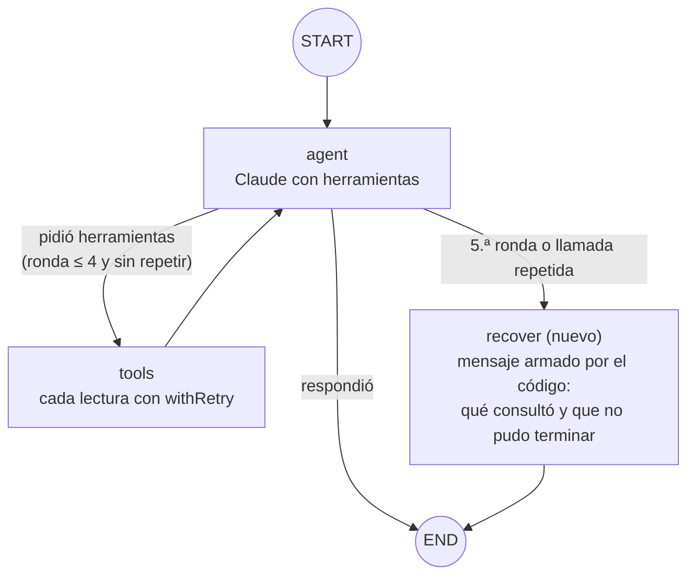
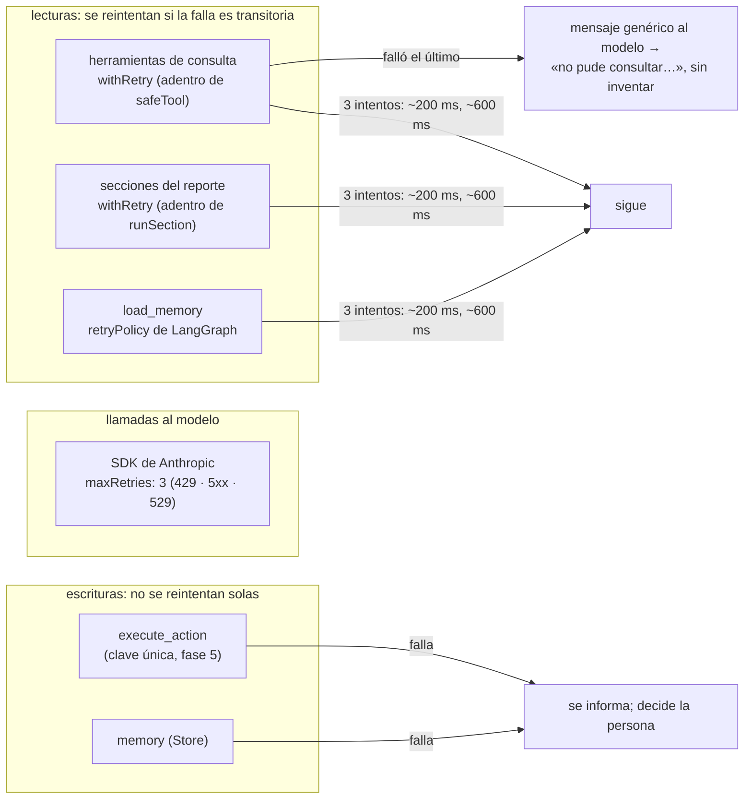
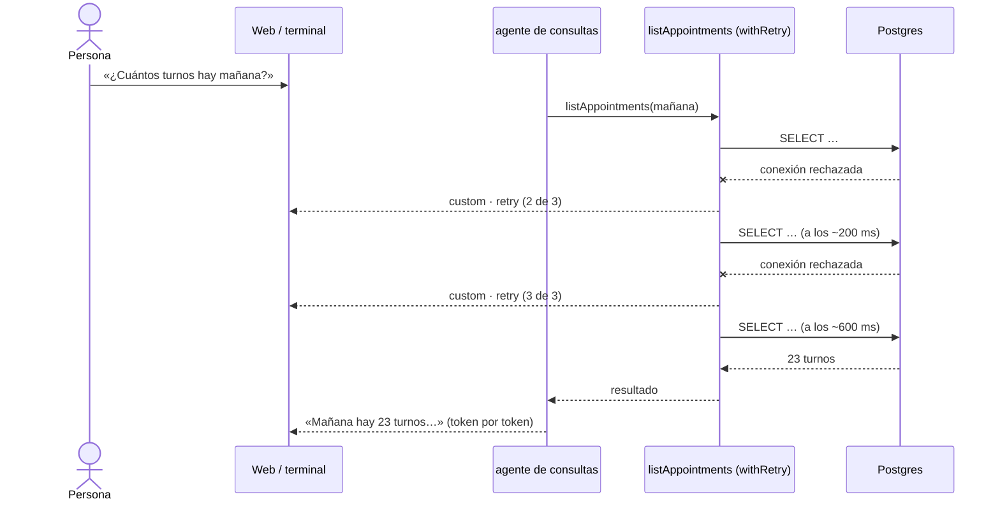
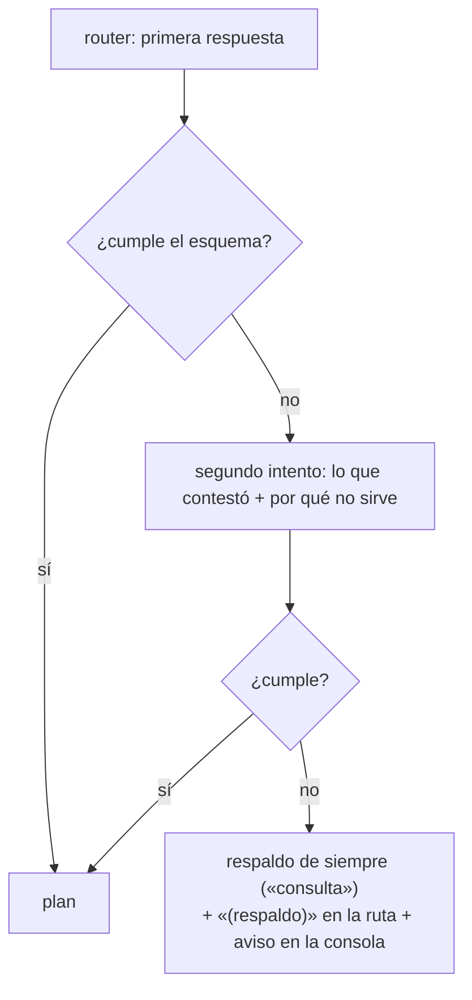
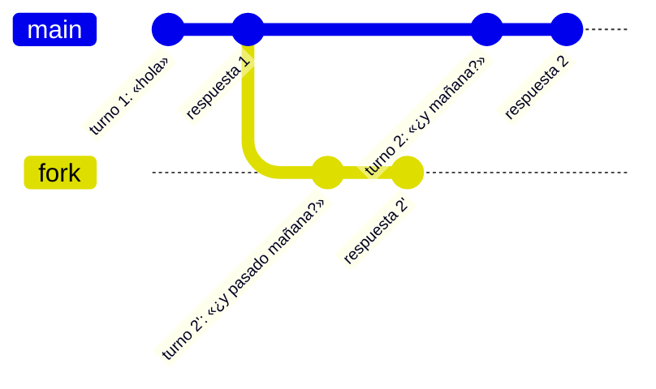
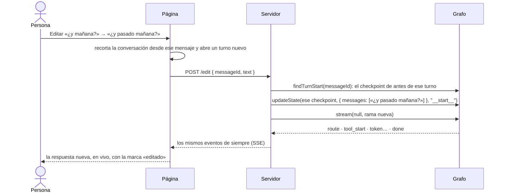

# Fase 10: Errores, reintentos y viaje en el tiempo

Estado: **en curso** (spec aprobada; el viaje en el tiempo va en la web)

## Objetivo
Que el copiloto se recupere de fallas sin quedar en loops ni inventar resultados: que reintente lo que vale la pena reintentar, que corte a tiempo a un agente que da vueltas, que corrija o informe una salida mal formada del modelo, y que se pueda volver a correr un turno desde un punto anterior del hilo, igual o con otro mensaje.

## Contexto
Existe de la fase 9 (etiqueta `fase-09`), más la documentación en `/doc`:

- **Herramientas.** Una herramienta que falla por un problema del sistema le devuelve al modelo un mensaje genérico (`safeTool`, fase 2). No hay reintentos propios. El SDK de Anthropic sí reintenta solo las llamadas al modelo: 2 veces ante errores 429, 5xx o 529.
- **Salidas mal formadas.** Si la salida estructurada no cumple el esquema:
  - el router cae a «consulta» (fase 3);
  - el planificador de reportes usa la semana actual (fase 6);
  - la memoria contesta que no entendió (fase 8).

  En los tres casos, sin un segundo intento.
- **Límite de pasos.** `AGENT_RECURSION_LIMIT = 12`. **Confirmado al escribir esta spec:** cada subgrafo tiene su propio límite. Un agente que pide herramientas sin parar corta con `GraphRecursionError` después de 6 llamadas al modelo, y el hilo **queda a medias**. «Continuar» volvería a entrar en el mismo loop: hoy es un bug.
- **Historia del hilo.** `npm run threads -- history <id>` muestra los checkpoints de un hilo, pero solo se pueden mirar. **Confirmado:** `graph.updateState(checkpoint, cambios, "__start__")` bifurca el hilo desde un checkpoint anterior. La rama nueva pasa a ser el estado actual y la original queda en la historia.
- **Acciones.** Cada acción se ejecuta una sola vez: tiene una clave única (fase 5).

Qué se necesita de tu parte:
- Aprobar esta spec.
- Las pruebas con el modelo real cuestan centavos (Haiku). Las fallas de la base se simulan en los tests: la base real no se toca.
- Un escenario aprueba una acción y borra lo que crea, como en la fase 9.

## Requisitos
**Reintentos: qué se reintenta, dónde y cuánto**
- R1: Las **lecturas de la base** se reintentan ante una **falla transitoria**: hasta 3 intentos, con esperas de ~200 y ~600 ms (con algo de azar). Abarca las herramientas de consulta, las secciones de los reportes y la lectura de la memoria. Cuenta como transitoria:
  - conexión rechazada, cortada o vencida;
  - los códigos de Prisma P1001, P1002, P1008 y P1017;
  - de Postgres, la clase `08` (conexión), 57P01 y 57P03 (servidor que se reinicia) y 40001 y 40P01 (conflicto de concurrencia).

  **No** se reintentan los datos inválidos, los errores de validación, los permisos (42501) ni los bugs: repetirlos da lo mismo. La lista vive en código (`isTransient`), con tests.
- R2: **Cada reintento se ve** mientras ocurre: «Reintentando stock de productos (2 de 3)» en la web, y `[reintento]` en la terminal. Viaja por el cuarto modo de streaming de LangGraph, `custom`: la herramienta escribe con `getWriter()`.
- R3: Si falla el último intento, la persona **se entera** y nada se inventa:
  - el modelo recibe el mensaje genérico de siempre y lo dice;
  - el resumen del turno marca qué herramienta falló;
  - la regla del prompt («si no podés consultarlo, decilo») se prueba con el modelo real.
- R4: **Quién reintenta cada cosa:**
  - los nodos que solo leen y lanzan el error (`load_memory`) usan la **`retryPolicy` de LangGraph**;
  - las herramientas y las secciones convierten sus errores en mensajes, así que el nodo nunca ve la falla: se reintenta adentro, con `withRetry`;
  - las llamadas al modelo las reintenta el SDK de Anthropic, ahora con `maxRetries: 3` explícito;
  - **las escrituras no se reintentan solas** (`execute_action`, el nodo `memory`): una escritura que falló se informa, y la persona decide.

**Topes y loops**
- R5: Cada agente con herramientas (consultas y acciones) tiene un **tope de 4 rondas de herramientas por tarea**. También cuenta como loop pedir **exactamente la misma herramienta con los mismos argumentos** que ya pidió en esa tarea.
- R6: Al llegar al tope, o ante una llamada repetida, el subgrafo pasa a un nodo nuevo, **`recover`**. Ese nodo termina la tarea con un mensaje que arma el código:
  - qué consultó;
  - que no pudo terminar;
  - una sugerencia de pedirlo más concreto.

  No inventa datos. El turno termina normalmente (no queda a medias), así que «Continuar» no repite el loop.
- R7: El límite de recursión sigue como **última barrera**, recalculado para los topes nuevos. Con 4 rondas, un subgrafo usa como mucho 1 + 4×2 + 1 = 10 pasos: 12 alcanza.

**Salidas mal formadas**
- R8: Para el router, la memoria y el período del reporte, si la salida no cumple el esquema, **un segundo intento con la corrección**: el modelo recibe lo que contestó y por qué no sirve («falta `tasks`», «`intent` inválido») y vuelve a contestar. Si el segundo intento tampoco sirve:
  - se usa el respaldo de siempre;
  - **se informa**: la ruta dice «(respaldo)» en la web y en la terminal;
  - queda un aviso en la consola de quien opera.
- R9: Los argumentos mal formados de una herramienta ya vuelven al modelo como error (fase 2) y él los corrige. Ahora cuentan para el tope de R5. Las acciones mal formadas siguen su camino de la fase 5.

**Viaje en el tiempo, desde la web** (cambio al revisar la spec: la web es la interfaz principal; la terminal se conserva, pero no recibe esta función)
- R10: **Editar y volver a preguntar.** Cada mensaje de la persona tiene un botón «Editar» (aparece al pasar el mouse o al tocarlo).
  - Se abre el texto para cambiarlo, y «Volver a preguntar» **bifurca** el hilo desde el inicio de ese turno con el mensaje nuevo: «¿y pasado mañana?» en vez de «¿y mañana?».
  - En pantalla, la conversación pasa a ser la de la rama nueva: lo que venía después del mensaje editado se reemplaza por la respuesta nueva, que llega en vivo.
  - Una marca indica que el mensaje se editó y que la versión anterior quedó en la historia del hilo.
- R11: **Reintentar.** Cada respuesta del copiloto tiene «Reintentar», que **vuelve a correr ese turno** desde su inicio, con el mismo mensaje. El modelo contesta de nuevo, así que el resultado puede cambiar. Sirve para repetir un turno que salió mal.
- R12: **Cómo funciona por dentro.** Los dos son una bifurcación de LangGraph desde el checkpoint en que el hilo estaba **antes** de ese turno:
  - `updateState(checkpoint, { messages: [mensaje] }, "__start__")`, con el mensaje nuevo (editar) o el mismo (reintentar);
  - después, `stream(null, …)` sobre la rama nueva.

  La rama nueva pasa a ser el estado del hilo y la original queda en la historia (`npm run threads -- history`). El turno se identifica por el **id del mensaje de la persona**: el servidor busca en la historia el checkpoint en que ese mensaje todavía no había entrado. Para que los mensajes de la sesión también tengan su id real, cada turno nuevo avisa el id de su mensaje en un evento `turn`, el primero del stream.
- R13: **El viaje en el tiempo nunca saltea una aprobación ni repite una escritura:**
  - volver a correr desde antes de una propuesta produce una **propuesta nueva**, con su tarjeta, que hay que aprobar;
  - una acción ya aprobada **no se deshace**: el turno de la rama original ya escribió en la base. La marca de «editado» lo aclara cuando la rama original tenía una acción ejecutada;
  - volver a pasar por una acción ya aprobada no la ejecuta dos veces (la clave de la fase 5);
  - editar y reintentar se rechazan (409) si el hilo tiene una tarjeta pendiente, un turno a medias o un turno en curso, igual que un mensaje nuevo, y tienen los mismos controles de origen y formato de la fase 9.
- R14: `streamReplayTurn` y `streamForkTurn` usan el mismo camino que los turnos (`streamTurn`) y terminan con el mismo `TurnResult`. Rutas nuevas:
  - `POST /api/threads/:id/edit { messageId, text }`, que responde SSE;
  - `POST /api/threads/:id/retry { messageId }`, que responde SSE.

## Escenarios con el modelo real (congelados)
Se guardan en `evals/resilience-cases.ts` **antes** de escribir los prompts. Las fallas se simulan envolviendo las herramientas reales (`failing(tool, n)`). La base no se apaga.

| # | Pedido | Falla simulada | Esperado |
| --- | --- | --- | --- |
| F1 | «¿Cuántos turnos hay mañana?» | `listAppointments` falla 2 veces (conexión rechazada) y después anda | Responde con la cantidad real (la misma que sin fallas); 2 reintentos visibles |
| F2 | el mismo | `listAppointments` falla siempre | Dice que no pudo consultar la agenda; **ningún número de turnos** en la respuesta; el hilo no queda a medias |
| F3 | «¿Cuánto stock queda de cera mate?» | `getStockLevels` falla siempre | Dice que no pudo consultar el stock; **ninguna cantidad** inventada |
| F4 | En la web: «¿Cuántos turnos hay mañana?», y después **Editar** ese mensaje a «¿Cuántos turnos hay pasado mañana?» | ninguna | La respuesta nueva es la cantidad de pasado mañana (la misma que en un hilo aparte); en pantalla queda la rama nueva con la marca de «editado»; al recargar, sigue la rama nueva; la historia conserva la original |
| F5 | En la web: «Agendá un corte para Julián Romero el martes \<fecha\> a las 15 con Lucas.», aprobar, y después **Editar** a «… a las 16 …» | ninguna | La rama nueva **propone** el turno de las 16 con su tarjeta y no ejecuta nada hasta aprobar (se rechaza); el turno de las 15 existe una sola vez y la marca avisa que ya se había ejecutado |
| F6 | En la web: «¿Cuánto stock queda de cera mate?», y después **Reintentar** | ninguna | El turno se vuelve a correr con el mismo mensaje y llega una respuesta nueva en vivo; la conversación no duplica el mensaje de la persona |

F4, F5 y F6 se corren en el navegador con Playwright, como los de la fase 9.

## Criterios de aceptación
- [ ] CA1 (reintentos): una falla simulada de la base se reintenta y se informa a la persona.
  - Con modelos falsos:
    - una herramienta que falla 2 veces de forma transitoria contesta al tercer intento;
    - una falla no transitoria no se reintenta;
    - `load_memory` se recupera con su `retryPolicy`;
    - una sección de reporte se recupera igual que una herramienta.
  - Los eventos `retry` llegan en orden por el modo `custom` y se ven en la web y en la terminal.
  - Con el modelo real: F1, F2 y F3 en tres corridas seguidas.
- [ ] CA2 (tope y loops): el agente respeta un tope de iteraciones y no entra en loops. Con un modelo falso que pide herramientas sin parar:
  - el agente de consultas y el de acciones pasan a `recover` después de 4 rondas, sin `GraphRecursionError`;
  - el hilo termina listo (no a medias) y la respuesta la arma el código;
  - una llamada repetida corta antes.
- [ ] CA3 (salidas mal formadas): una salida mal formada del modelo se corrige o se reporta. Con modelos falsos, para el router, la memoria y el período del reporte:
  - una salida inválida y después una válida se corrige (una llamada más);
  - dos inválidas usan el respaldo y se ve «(respaldo)».
- [ ] CA4 (viaje en el tiempo): se puede re-ejecutar desde un checkpoint anterior con otros parámetros, desde la web.
  - Con modelos falsos:
    - editar y reintentar crean una rama nueva, la original sigue en la historia y el estado del hilo es la rama nueva;
    - el turno se encuentra por el id del mensaje, también en un hilo de varios turnos;
    - se rechazan (409) con una tarjeta, un turno a medias o un turno en curso, y con los controles de la fase 9;
    - volver a pasar por una acción aprobada no la ejecuta otra vez (en `tests/writes`, con la base).
  - En el navegador, con el modelo real: F4, F5 y F6. Recargar después de editar muestra la rama nueva.
- [ ] CA5 (costo): se mide:
  - cuánto suma un reintento de la base (cero tokens: se reintenta la herramienta, no el modelo);
  - cuánto suma corregir una salida del router (una llamada más, solo cuando falla);
  - cuánto se ahorra al cortar un loop en 4 rondas en vez de llegar al límite de recursión.
- [ ] CA6: todos los tests de las fases 2 a 9 pasan, y también los que agrega esta fase. Además pasan `npm test`, los typecheck, `npm run web:build` y las pruebas del navegador. El mapa del grafo suma `recover` y la documentación queda al día (README, plan y `/doc`, que la toma sola).

## Fuera de alcance
- Navegar entre versiones de un mensaje editado (el «‹ 1/2 ›» de otros chats): la versión anterior queda en la historia del hilo, pero la web muestra solo la actual.
- Viaje en el tiempo desde la terminal: la terminal se conserva y sigue andando (y muestra los reintentos), pero editar y reintentar son de la web.
- Pasar a otro modelo si el primero no responde (por ejemplo, Sonnet si Haiku está caído).
- Un «cortacircuitos» que deje de llamar a la base por un rato tras muchas fallas.
- Reintentar escrituras.
- Límites de tiempo por nodo: son de la fase 12.

## Diseño (plan técnico)

**Subgrafos de consultas y de acciones**

```
START → agent ─┬─ pidió herramientas, dentro del tope y sin repetir → tools → agent
               ├─ llegó al tope o repitió una llamada               → recover → END   (nuevo)
               └─ respondió                                         → END
```

`routeAfterAgent` cuenta las rondas de la tarea, que son los mensajes de IA con `tool_calls` desde `startedAt`, y mira si la llamada nueva ya se hizo. En el de acciones vale lo mismo, antes de ir a `tools` o a `propose_action`.
- Nodos: consultas pasa de 2 a 3 y acciones, de 5 a 6.
- El grafo principal no cambia de forma: `load_memory` gana su `retryPolicy`.

**Código nuevo**
- `src/tools/retry.ts`:
  - `isTransient(error)`;
  - `withRetry(fn, { attempts: 3, delaysMs: [200, 600], onRetry })`, con azar en las esperas y un reloj inyectable para los tests.
- `safeTool` y `runSection` usan `withRetry`. `safeTool` avisa cada reintento con `getWriter()` (modo `custom`). A confirmar: que una herramienta dentro de un `ToolNode` de un subgrafo recibe el escritor.
- `src/graph/structured.ts`: `invokeWithCorrection(model, messages, schema)`. Si la salida no sirve, vuelve a llamar con un mensaje que trae lo que contestó (como texto) y los errores de Zod. Lo usan el router, la memoria y el planificador de reportes.
- `src/graph/nodes/recover.ts`: el mensaje de cierre, armado por el código a partir de las herramientas que se usaron en la tarea.
- `src/graph/time-travel.ts`:
  - `findTurnStart(graph, threadId, messageId)`: recorre la historia del hilo (rama actual) y devuelve el checkpoint en que ese mensaje de la persona todavía no había entrado;
  - `streamForkTurn(agent, threadId, messageId, text)` y `streamReplayTurn(agent, threadId, messageId)`: `updateState` sobre ese checkpoint con el mensaje (nuevo o el mismo, con un id nuevo), `asNode: "__start__"`, y después `stream(null, …)` por el mismo camino que un turno;
  - las validaciones de R13.
- Eventos:
  - `retry`, por el modo `custom`;
  - `turn`, con el id del mensaje de la persona, como primer evento de cada turno;
  - los dos con su parte en el reductor de la web, y `retry` también en la terminal.
  - `streamTurn` suma el modo `custom`.
- **Web**: `edit` y `retry` en `handlers.ts` (mismos controles que un mensaje nuevo) y en `web/app/api/threads/[id]/`. En la página:
  - «Editar» en cada mensaje de la persona, con el texto editable en el lugar (`InputGroup`) y «Volver a preguntar» / «Cancelar»;
  - «Reintentar» al pie de cada respuesta;
  - en el reductor, `startFork(estado, messageId, texto)`, que recorta la conversación desde ese mensaje y empieza un turno nuevo;
  - una marca (`Marker`) «Editaste este mensaje; la versión anterior quedó en la historia», con el aviso extra si la rama anterior tenía una acción ejecutada.

**Archivos**

```
src/tools/retry.ts, src/tools/safe.ts, src/graph/report/sections.ts
src/graph/structured.ts, nodes/router.ts, nodes/memory.ts, nodes/report.ts
src/graph/nodes/recover.ts, src/agents/query.ts, src/agents/action.ts, src/graph/limits.ts
src/graph/index.ts (retryPolicy de load_memory), models.ts (maxRetries)
src/graph/time-travel.ts, src/graph/run-turn.ts, src/cli/chat.ts, src/cli/format.ts (la línea [reintento])
src/web/events.ts, src/web/handlers.ts, src/web/turn-view.ts
web/app/api/threads/[id]/edit, web/app/api/threads/[id]/retry
web/hooks/use-chat.ts, web/components/chat/chat-app.tsx, turn.tsx, human-message.tsx (nuevo)
evals/resilience-cases.ts, web/e2e/time-travel.spec.ts
tests/retry.test.ts, tests/recover.test.ts, tests/structured.test.ts, tests/time-travel.test.ts,
tests/resilience.llm.test.ts, tests/writes/time-travel-actions.test.ts
```

## Mapas

**1. El agente de consultas con su salida de emergencia**



El de acciones es igual: `recover` entra antes de `tools` y de `propose_action`. El límite de recursión queda como última barrera.

**2. Quién reintenta qué**



**3. Una falla de la base, en vivo**



**4. Una salida mal formada**



**5. Viaje en el tiempo: editar un mensaje**



`updateState` sobre el final del turno 1 (`asNode: "__start__"`) crea el checkpoint de la rama nueva. `stream(null, …)` la corre, y ese pasa a ser el estado del hilo. La rama original sigue en `history`. Si un turno de la rama nueva propone una acción, aparece su tarjeta como siempre.

**6. «Editar» de punta a punta, en la web**



«Reintentar» es lo mismo con el mismo texto.

## Tareas
Una tarea = un commit en la rama `dev/fase-10`.

1. **T1:** esta spec aprobada; escenarios F1 a F5 congelados en `evals/resilience-cases.ts`.
2. **T2:** `isTransient` y `withRetry`; herramientas, secciones y `load_memory` con reintentos; `maxRetries` del SDK. Tests con fallas simuladas (CA1 sin modelo real).
3. **T3:** el modo `custom` y el evento `retry`, en la web y en la terminal (R2).
4. **T4:** tope de rondas, llamadas repetidas y nodo `recover` en consultas y acciones; límite recalculado (CA2).
5. **T5:** `invokeWithCorrection` en el router, la memoria y el período; «(respaldo)» a la vista (CA3).
6. **T6:** `findTurnStart`, `streamForkTurn` y `streamReplayTurn`; el evento `turn`; las rutas `edit` y `retry`. Tests con modelos falsos y con la base (CA4 sin modelo real).
7. **T7:** «Editar» y «Reintentar» en la página, con el reductor y sus tests.
8. **T8:** escenarios F1 a F3 (tests con el modelo real) y F4 a F6 (en el navegador) (CA1 y CA4 con el modelo real).
9. **T9:** medición (CA5), mapa del grafo, README, plan y cierre con la etiqueta `fase-10` (CA6).
