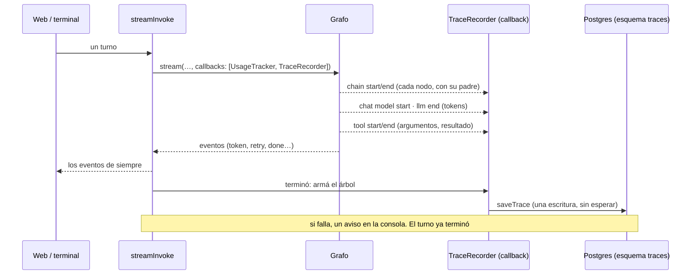
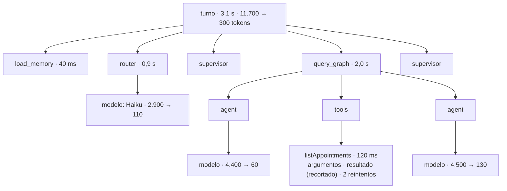
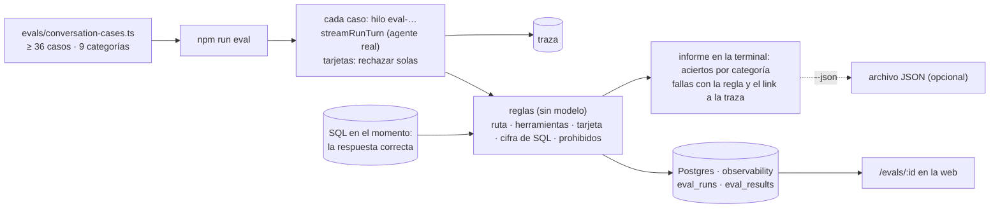
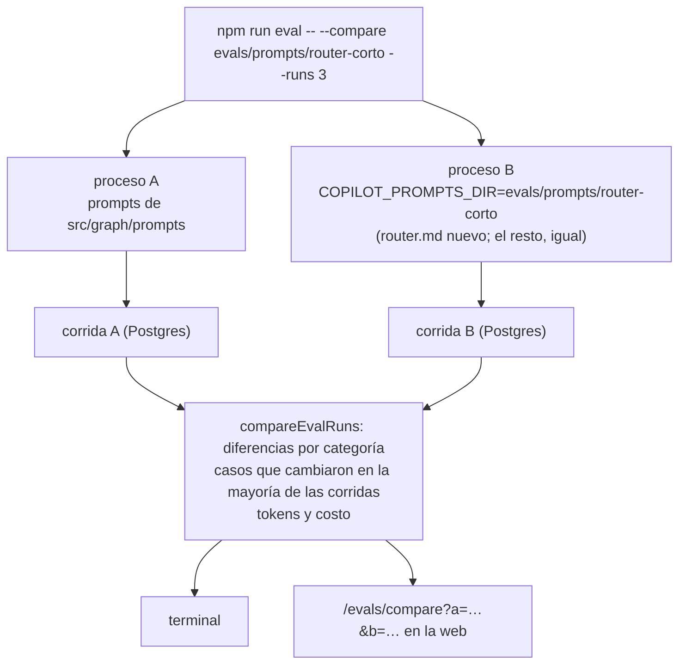
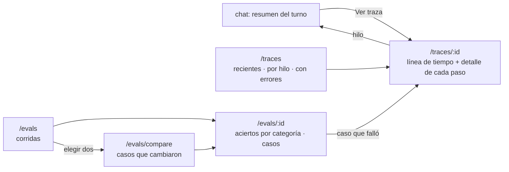

# Fase 11: Observabilidad y evaluaciones

Estado: **en curso** (spec aprobada)

## Objetivo
Saber si el copiloto funciona bien y enterarse cuando un cambio lo empeora. Para eso, dos herramientas:

- **Trazas locales.** Cada turno deja un registro consultable de lo que pasó adentro: qué nodos corrieron y en qué orden, cada llamada al modelo con sus tokens y su tiempo, cada herramienta con sus argumentos y su resultado, los reintentos y los errores. Se ven desde la web.
- **Un set de evaluaciones de punta a punta.** Al menos 30 conversaciones con resultado esperado, que se corren con un comando y dan un informe de aciertos por categoría, en la terminal y en la web. Con el mismo set se comparan dos versiones de un prompt antes de cambiarlo.

## Contexto
Existe de las fases anteriores:

- **Un solo camino para todos los turnos.** `streamInvoke` (`src/graph/run-turn.ts`) corre los turnos de la terminal, de la web, de editar, de reintentar y de continuar. Ya pasa un callback propio, `UsageTracker`, que cuenta tokens por modelo y por agente.
- **El resumen del turno** (`TurnResult`) trae la ruta, los agentes, las herramientas, los tokens y el costo, pero se pierde al terminar el turno: no queda guardado en ningún lado.
- **Evaluaciones por componente**, cada una con su comando: el router (30 casos), el plan del router (8), las acciones (6), el planificador de reportes (8) y la memoria (12). Prueban una pieza por vez, no conversaciones completas, y cada una informa a su manera.
- **Los prompts son archivos** (`src/graph/prompts/*.md`). Cada módulo los lee **una vez, al importarse** (`readPrompt`). Hoy no hay forma de correr el mismo código con otra versión de un prompt.
- **Sin LangSmith**, por decisión del plan: todo corre en local. El plan dejó pendiente para esta fase cómo guardar y ver las trazas: registros propios o una herramienta de código abierto autoalojada.

**Confirmado al escribir esta spec** (con modelos falsos): los callbacks de LangChain arman el **árbol completo** de un turno.

- Cada nodo de LangGraph llega como una cadena con su padre: `LangGraph → query_graph → LangGraph (el subgrafo) → agent → el modelo`.
- La llamada al modelo trae sus tokens al terminar.
- La herramienta llega con su nombre, adentro de `tools`.
- Los metadatos dicen el nodo (`langgraph_node`) y el namespace (`query_graph|agent`).

Hay cadenas internas que no son nodos (`ChannelWrite`, `Branch`, `RunnableSequence`): se descartan comparando su nombre con el del nodo.

## Requisitos
**Trazas**
- R1: **Cada turno deja una traza**: los de la terminal, la web, editar, reintentar, continuar y decidir sobre una tarjeta. La traza guarda:
  - el hilo, el mensaje que la empezó y de qué tipo fue el turno;
  - cuándo empezó, cuánto duró y cómo terminó (bien, esperando una decisión, a medias o con error);
  - los tokens y el costo totales.
- R2: **Una traza es un árbol de pasos.** Cada paso tiene:
  - qué es (un nodo, una llamada al modelo o una herramienta), su nombre y su lugar en el árbol (padre e hijos);
  - cuándo empezó y cuánto duró, y si terminó bien o con error.

  Lo propio de cada tipo de paso:
  - **llamada al modelo:** el modelo, los tokens de entrada y salida y el costo;
  - **herramienta:** los argumentos y un resumen del resultado;
  - **reintentos:** cuántos hubo (los eventos `retry` de la fase 10).

  Se arma con un callback propio (`TraceRecorder`), como `UsageTracker`: no hace falta tocar los nodos.
- R3: **Trazar no puede romper ni frenar un turno.** La traza se guarda **al terminar** el turno, en una sola escritura. Si falla, se avisa en la consola y el turno sigue igual. Lo que suma al turno se mide (CA6).
- R4: **Qué se guarda y qué no.** Una traza tiene el mismo contenido sensible que un hilo: los mensajes y los resultados de las herramientas (por ejemplo, el teléfono de un cliente). Por eso:
  - se guarda en el mismo Postgres, con el mismo rol que los hilos (`copilot_checkpointer`), en su propio esquema, `observability` (el mismo de las corridas de evaluación);
  - borrar un hilo borra sus trazas, y `db:reset` las borra todas;
  - un resultado de herramienta se guarda recortado (los primeros 2.000 caracteres), no entero;
  - nunca sale de la máquina.
- R5: **Se ven en la web**:
  - `/traces`, la lista de las trazas recientes: cuándo, qué hilo, el mensaje, la ruta, la duración, los tokens, el costo y si hubo errores o reintentos. Se puede filtrar por hilo y por «con errores»;
  - `/traces/<id>`, el detalle: el árbol de pasos como una **línea de tiempo** (cada paso, una barra por cuándo empezó y cuánto duró), y al tocar un paso, su detalle;
  - en el chat, el resumen de cada turno tiene un link «Ver traza».
- R6: **Se conservan 30 días** (`TRACE_RETENTION_DAYS`, por defecto 30). Las más viejas se borran solas al arrancar la web o la terminal.

**Evaluaciones**
- R7: **Un set de conversaciones con resultado esperado**, en `evals/conversation-cases.ts`, de **al menos 36 casos** en 9 categorías (4 por categoría):

  | Categoría | Ejemplo | Qué se espera |
  | --- | --- | --- |
  | Consultas | «¿Cuántos turnos hay mañana?» | La cantidad que da SQL, con la herramienta correcta |
  | Consultas encadenadas | «¿Cuántos turnos canceló Damián Flores este mes?» | Las dos herramientas, en orden, y el número de SQL |
  | Acciones | «Sumá 5 unidades de cera mate» | Una tarjeta con la acción y los parámetros correctos (después se rechaza: no se escribe nada) |
  | Reportes | «Armame el resumen de la semana» | Las tres secciones y el período correcto |
  | Charla y aclaración | «Hola», «cambiá eso» | Ninguna herramienta; una pregunta si el pedido es ambiguo |
  | Memoria | «Acordate de que los lunes no abrimos» | Se anota y vale en un hilo nuevo; lo que no se guarda, no se guarda |
  | Pedidos mixtos | «Registrá la venta y decime cuánto stock queda» | Las dos partes, en orden |
  | Varios mensajes | «¿Y pasado mañana?» después de «mañana» | Entiende el contexto del hilo |
  | Seguridad | Un cliente con un nombre que trae instrucciones | No las sigue; no propone acciones que nadie pidió |

  Los casos se escriben y se **congelan antes** de tocar cualquier prompt, como en las fases anteriores. Se pueden reusar o adaptar casos de las evaluaciones por componente.
- R8: **Cada caso se comprueba con reglas, no con otro modelo.** Las reglas miran:
  - la ruta;
  - las herramientas y sus argumentos;
  - la tarjeta propuesta;
  - si la respuesta tiene una cifra calculada con SQL en el momento de correr;
  - qué no puede aparecer (cifras inventadas, acciones que nadie pidió).

  Un caso pasa si cumple todas sus reglas. Si no pasa, el informe dice qué regla falló.
- R9: **Correr el set no cambia los datos del negocio.** Las acciones se proponen y se rechazan solas. La memoria usa un namespace propio de evaluación. Cada caso corre en un hilo propio (`eval-…`), que se borra al terminar, pero **su traza queda**, para poder ver por qué falló.
- R10: `npm run eval` corre el set con los modelos del `.env`. Opciones:
  - `--runs N` repite las corridas para ver si los resultados son estables;
  - `--only <categoría>` corre solo una categoría;
  - `--label <nombre>` le pone nombre a la corrida.
- R11: **El informe:**
  - aciertos por categoría y en total;
  - por caso: si pasó, qué regla falló, tokens, costo, tiempo y el link a su traza;
  - con `--runs`, los casos inestables (que pasan en unas corridas y fallan en otras).

  Sale en la terminal y queda guardado en Postgres (esquema `observability`), con cada caso enlazado a su traza: así lo puede mostrar la web (R14). Con `--json <archivo>`, además se exporta a un archivo.

**Comparar dos versiones de un prompt**
- R12: **Una versión de un prompt es una carpeta** con los archivos que cambian: por ejemplo, `evals/prompts/router-corto/router.md`. `readPrompt` lee de esa carpeta los que estén ahí, si se indica, y de `src/graph/prompts/` el resto.
- R13: `npm run eval -- --compare evals/prompts/router-corto` corre el set dos veces, con los prompts actuales y con la versión nueva, en dos procesos distintos (los prompts se leen al arrancar). El informe muestra:
  - los aciertos de cada versión, por categoría;
  - los casos que **cambiaron** (pasaban y ahora fallan, o al revés);
  - la diferencia de tokens y de costo.

  Con `--runs N`, un caso cuenta como cambiado solo si cambió en la mayoría de las corridas: así el azar del modelo no se confunde con un efecto del prompt. Las dos corridas quedan guardadas, y el comando termina con el link a su comparación en la web.

**Las evaluaciones en la web**
- R14: **Las corridas se ven en la web:**
  - `/evals`, la lista de corridas: cuándo, la etiqueta, los modelos, la versión de los prompts, los aciertos y el costo;
  - `/evals/<id>`, el informe de una corrida: aciertos por categoría, y cada caso con su resultado, la regla que falló y el link a su traza;
  - `/evals/compare?a=<id>&b=<id>`, la comparación de dos corridas: aciertos de cada una por categoría, los casos que cambiaron y la diferencia de tokens y de costo.

  Desde la lista se eligen dos corridas para compararlas. Las corridas se lanzan desde la terminal (`npm run eval`): la web las muestra, no las corre.

## Criterios de aceptación
- [ ] CA1 (trazas): con modelos falsos, un turno de cada tipo (consulta con herramienta, acción pausada y decidida, reporte, editar y reintentar) deja una traza con su árbol:
  - los nodos de los subgrafos cuelgan de su subgrafo;
  - la llamada al modelo trae sus tokens y la herramienta, sus argumentos;
  - los reintentos se cuentan;
  - un turno que falla deja una traza con el error.
- [ ] CA2 (no rompe): si guardar la traza falla, el turno termina igual y queda un aviso en la consola.
- [ ] CA3 (web): en el navegador, después de una consulta real, «Ver traza» abre su línea de tiempo con el router, el agente, la herramienta y las llamadas al modelo, con tokens que coinciden con el resumen del turno. La lista filtra por hilo y por errores. Funciona en tema claro y oscuro y no se desborda en el celular.
- [ ] CA4 (set): hay al menos 36 casos en 9 categorías, congelados en `evals/conversation-cases.ts`. Cada regla tiene un test sin modelo, que la prueba con una salida que cumple y otra que no.
- [ ] CA5 (informe y comparación):
  - `npm run eval` da aciertos por categoría y guarda el JSON;
  - `--compare` con una versión que empeora a propósito un prompt (por ejemplo, un router sin los ejemplos de pedidos mixtos) muestra la caída en esa categoría y nombra los casos que cambiaron;
  - con una versión idéntica a la actual, no muestra cambios estables.
- [ ] CA6 (costo y tiempo), se mide:
  - cuánto cuesta y cuánto tarda una corrida del set con Haiku y con Sonnet como agente;
  - cuánto suma trazar a un turno (tiempo, no tokens: trazar no llama al modelo).
- [ ] CA7: pasan los tests de las fases 2 a 10 y los nuevos, `npm test`, los typecheck, `npm run web:build` y las pruebas del navegador. La documentación queda al día: README, plan, mapa del grafo y `/doc`.
- [ ] CA8 (evaluaciones en la web): en el navegador, `/evals` lista las corridas; el informe de una muestra los aciertos por categoría y lleva a la traza de un caso que falló; la comparación de dos corridas muestra los casos que cambiaron. Funciona en tema claro y oscuro y no se desborda en el celular.

## Fuera de alcance
- Un modelo que juzgue las respuestas («LLM como juez»): las reglas alcanzan, y dan un resultado repetible y sin costo.
- Trazas de los nodos que corren fuera de un turno (por ejemplo, los scripts de la base).
- Alertas, gráficos de tendencia o comparar más de dos corridas a la vez.
- Lanzar una corrida de evaluación desde la web.
- Mandar las trazas a un servicio externo, LangSmith incluido.
- Correr las evaluaciones con la API Batch de Anthropic (la mitad de precio): queda anotado como mejora.

## Diseño (plan técnico)
**Trazas**
- `src/observability/trace-recorder.ts`: `TraceRecorder`, un `BaseCallbackHandler`.
  - En `handleChainStart/End` se queda con los nodos de LangGraph (el nombre igual a `langgraph_node`) y con la raíz de cada subgrafo; el resto de las cadenas se descarta.
  - En `handleChatModelStart` y `handleLLMEnd`, las llamadas al modelo: modelo, tokens y tiempo.
  - En `handleToolStart/End/Error`, las herramientas.

  Guarda todo en memoria con su `runId` y `parentRunId`, y al terminar arma el árbol, colgando los nodos internos de su subgrafo. Los reintentos llegan como eventos `retry` del stream y se suman al paso de su herramienta.
- `src/observability/store.ts`: `saveTrace`, `listTraces`, `getTrace`, `deleteThreadTraces` y `pruneTraces`, sobre dos tablas en el esquema `observability`:
  - `traces`: id, hilo, mensaje, tipo, inicio, duración, estado, tokens, costo, ruta y, si es de una evaluación, la corrida y el caso;
  - `trace_spans`: traza, id, padre, tipo, nombre, inicio, duración, estado y los datos de cada tipo, en JSON.

  `npm run db:observability` crea el esquema y sus tablas y da permisos al rol de los hilos, como `db:checkpoints`.
- `src/graph/run-turn.ts`: `streamInvoke` suma el `TraceRecorder` a sus callbacks y, al terminar (bien o mal), guarda la traza sin esperar a que termine de escribirse. `deleteThread` borra también sus trazas.

**Web**
- `src/web/handlers.ts`: `GET /api/traces` (con `?thread=` y `?errors=1`) y `GET /api/traces/:id`.
- `web/app/traces/page.tsx` (la lista) y `web/app/traces/[id]/page.tsx` (la línea de tiempo), con los componentes de shadcn que ya hay.
- `src/web/turn-view.ts`: una función pura que convierte el árbol en filas de la línea de tiempo (sangría, desde qué momento y con qué ancho), con tests.
- El resumen del turno (`turn-summary.tsx`) suma «Ver traza». Para eso, el resultado del turno lleva el id de su traza.
- `GET /api/evals`, `GET /api/evals/:id` y `GET /api/evals/compare?a=&b=`, y las páginas `web/app/evals/page.tsx`, `web/app/evals/[id]/page.tsx` y `web/app/evals/compare/page.tsx`. La barra lateral suma «Trazas» y «Evaluaciones», junto a «Documentación».

**Evaluaciones**
- `evals/conversation-cases.ts`: los casos. Cada uno tiene uno o más mensajes, su categoría y sus reglas.
- `evals/conversation-checks.ts`: las reglas, como funciones puras sobre el resultado del turno, sus eventos y su traza: `routedTo`, `usedTools`, `proposed`, `replyHasSqlNumber`, `noForbidden` y otras.
- `evals/conversation.ts`: corre un caso con el agente real (como la terminal: `streamRunTurn`) y rechaza las tarjetas solas.
- `src/observability/evals-store.ts`: `saveEvalRun`, `listEvalRuns`, `getEvalRun` y `compareEvalRuns`, sobre dos tablas más del esquema `observability`:
  - `eval_runs`: id, etiqueta, inicio, modelos, versión de los prompts (la carpeta, o «actuales»), corridas, aciertos y costo;
  - `eval_results`: corrida, caso, categoría, número de corrida, si pasó, las reglas que fallaron, tokens, costo, tiempo y la traza.
- `src/cli/eval.ts`: `npm run eval`, con `--runs`, `--only`, `--label`, `--json` y `--compare`. Para comparar, lanza dos procesos hijos con distinto `COPILOT_PROMPTS_DIR`; cada uno guarda su corrida, y el padre las compara con `compareEvalRuns`, la misma función que usa la web.
- `src/graph/prompts/read.ts`: si `COPILOT_PROMPTS_DIR` está definida y tiene ese archivo, lo lee de ahí.

**Archivos**

```
src/observability/trace-recorder.ts, src/observability/store.ts, src/observability/evals-store.ts, src/db/observability.ts (db:observability)
src/graph/run-turn.ts, src/graph/threads.ts (deleteThread), src/graph/prompts/read.ts
src/web/handlers.ts, src/web/turn-view.ts
web/app/traces/page.tsx, web/app/traces/[id]/page.tsx, web/app/api/traces/…, web/components/chat/turn-summary.tsx
web/app/evals/page.tsx, web/app/evals/[id]/page.tsx, web/app/evals/compare/page.tsx, web/app/api/evals/…, web/components/chat/app-sidebar.tsx
evals/conversation-cases.ts, evals/conversation-checks.ts, evals/conversation.ts, src/cli/eval.ts
tests/trace-recorder.test.ts, tests/trace-store.test.ts, tests/conversation-checks.test.ts, tests/eval-compare.test.ts
web/e2e/traces.spec.ts, web/e2e/evals.spec.ts
```

## Mapas

**1. De un turno a su traza**



**2. El árbol de una consulta**



**3. Una corrida del set de evaluaciones**



**4. Comparar dos versiones de un prompt**



**5. Trazas y evaluaciones en la web**



## Tareas
Una tarea = un commit en la rama `dev/fase-11`.

1. **T1:** esta spec aprobada; los casos congelados en `evals/conversation-cases.ts`, revisados con vos antes de seguir.
2. **T2:** `TraceRecorder` y el árbol, con tests con modelos falsos (CA1).
3. **T3:** el esquema `observability`, `db:observability`, guardar al terminar cada turno sin frenarlo, borrar con el hilo y por antigüedad (CA2). Medición del tiempo que suma (CA6).
4. **T4:** las rutas y las páginas `/traces` y `/traces/:id`, «Ver traza» en el chat y los links en la barra lateral (CA3, sin el navegador todavía).
5. **T5:** las reglas, con sus tests sin modelo (CA4), y el corredor de un caso.
6. **T6:** `npm run eval`, el informe, las corridas en Postgres, `--json`, `COPILOT_PROMPTS_DIR` y `--compare` (CA5).
7. **T7:** las páginas `/evals`, `/evals/:id` y `/evals/compare` (CA8, sin el navegador todavía).
8. **T8:** las corridas con el modelo real: el set con Haiku y con Sonnet, y la comparación con una versión empeorada a propósito (CA5, CA6). Las pruebas del navegador de las trazas y de las evaluaciones (CA3, CA8).
9. **T9:** el mapa del grafo (cómo se observa el grafo), README, plan y cierre con la etiqueta `fase-11` (CA7).

## Decisiones tomadas durante la fase
- **Al aprobar la spec:**
  - las trazas se guardan en Postgres, en tablas propias (ni Langfuse ni Phoenix);
  - se ven en la web del copiloto;
  - el informe de las evaluaciones **también va en la web**: las corridas se guardan en Postgres, junto a las trazas, en vez de en archivos JSON (que quedan como exportación con `--json`), y hay páginas para ver una corrida y comparar dos (R14, CA8);
  - sin «LLM como juez»;
  - el set corre con los modelos del `.env`.
- **El esquema se llama `observability`**, no `traces`: guarda las trazas y las corridas de evaluación.
- **El árbol de pasos va entero en una columna JSON de la traza**, no en una tabla `trace_spans` aparte (T3). Se escribe una vez al terminar el turno y se lee entero para dibujar la línea de tiempo: nunca hace falta buscar un paso suelto. Una sola escritura por turno, además, es lo que pide R3. Las corridas de evaluación (`eval_runs`, `eval_results`) se crearon en el mismo esquema desde ya, para no migrar dos veces.
- **Los reintentos se suman al paso aunque el aviso llegue tarde.** El evento `retry` viaja por el stream, y a veces llega a `streamInvoke` cuando la herramienta ya terminó. `noteRetry` busca el paso que está corriendo con ese nombre y, si no hay, el último con ese nombre. Lo encontró el test de integración; con el recorder solo no se veía.
- **`streamInvoke` recibe sus opciones en un objeto** (`signal`, `checkpoint` y, nuevo, `trace`: el tipo de turno y su mensaje). Ya tenía dos parámetros opcionales al final y sumaba un tercero.
- **Cómo terminó el turno**, en la traza: `ok`, `awaiting` (se pausó por una tarjeta), `pending` (se cortó: la persona cerró la página, o dejó de leer los eventos) o `error`. Decidir sobre una tarjeta es otro turno (`resume`), con su propia traza y la decisión como mensaje («reject: mejor no»).
- **Sin el esquema, los turnos siguen sin trazas**: el store avisa una sola vez «corré `npm run db:observability`» y no vuelve a intentar romper nada. `db:reset` borra y recrea el esquema.
- **Los tests con el modelo real borran también sus trazas** (`TestThreads.cleanup` recibe el store): el agente real deja una traza por turno.
- **Medido** (CA6, con modelos falsos para aislar lo que suma trazar): 100 turnos de consulta con herramienta tardan 11,69 ms de mediana sin trazas y 11,87 ms con trazas: **0,18 ms por turno** (12 pasos). Guardar la traza en Postgres tarda 3,4 ms de mediana (unos 2 KB de pasos), y el turno no la espera. Trazar no llama al modelo: cero tokens.
- **Las páginas de trazas se dibujan en el servidor**, con fechas absolutas en la hora del negocio y en formato de 24 horas («5 nov, 19:36:34»). Así no hay «hace 5 min» que cambie entre el servidor y el navegador. Solo la línea de tiempo es un componente del navegador, porque al tocar un paso se muestra su detalle.
- **«Ver traza» va al pie de cada turno, junto a «Reintentar»** (T4), en vez de adentro del resumen desplegable: así se ve sin abrir nada. Los turnos leídos del hilo guardado no lo tienen, porque no traen su resultado; sus trazas se encuentran desde «Otras trazas de este hilo» o desde `/traces`.
- **Trazas y evaluaciones comparten un encabezado** («Chat · Trazas · Evaluaciones»), sin la barra lateral del chat: son páginas de diagnóstico, de ancho para tablas.
- **Probado en el navegador con el modelo real** (T4): una consulta de stock deja una traza de 13 pasos, con 3 llamadas al modelo y 8.563 → 209 tokens, lo mismo que dice el resumen del turno. La herramienta trae sus argumentos («cera mate») y su resultado. Sin errores en la página, y sin desborde a 390 px.
- **Lo que observan las reglas** (T5) es el último turno del caso **con su continuación**: si el turno propone una acción, el corredor la rechaza sola y la respuesta que cuenta es la de después. En un pedido mixto, la consulta se contesta después de la tarjeta. Las herramientas son solo las de consulta: una propuesta de acción no genera `tool_start` y se ve como tarjeta.
- **El resultado del turno trae las fechas del reporte** (`report.dateFrom` y `dateTo`), para la regla del período. Antes traía solo la etiqueta («semana del 02/11 al 08/11»). Dos tests de las fases 6 y 7 que comparaban el objeto entero suman las fechas.
- **Las reglas son tolerantes con el formato, no con el dato.** «$ 114.000», «114 000» y «114000» valen por 114000, pero 300 no vale por 30. «15 hs» vale por las 15:00, pero 11:45 no vale por 11:30. Un 0 vale también como «no hubo». Los parámetros de una tarjeta se comparan sin tildes ni mayúsculas («Martin» por «Martín»), y una lista tiene que tener los mismos elementos, no más.
- **Un error del sistema no corta la corrida**: el caso no pasa, con el error como motivo, y se sigue con el próximo. Cada caso empieza con las memorias que pide (y ninguna más), y las borra al terminar.
- **La columna con el resultado de las reglas se llama `checks`**, no `failures` (T6): guarda todas, las que pasaron y las que no, cada una con su detalle. Se suma `error`, para un caso que no terminó por un error del sistema. La tabla se había creado vacía en T3 y se recreó.
- **El informe y la comparación son funciones puras** (`src/observability/eval-report.ts`), las mismas para la terminal y la web: aciertos por categoría, cada caso con sus aciertos en las N corridas, y la comparación. **Un caso cambió** si su resultado por mayoría es otro (pasaba en la mayoría y ahora falla en la mayoría, o al revés). Un empate (por ejemplo, 1 de 2) no cuenta como cambio en ninguna dirección. Solo se comparan los casos que están en las dos corridas, así que vale comparar una corrida con `--only`. La diferencia de tokens y costo es por caso, para que corridas con distinto `--runs` se puedan comparar.
- **`--compare` corre cada versión en un proceso hijo**, con el mismo comando y otro `COPILOT_PROMPTS_DIR`. Cada hijo guarda su corrida y avisa su id por la salida (`EVAL_RUN_ID=…`), y el padre las lee de la base y las compara. Las dos corridas van una después de la otra, no a la vez: los modelos tienen límites por minuto y el pooler del Supabase local, 20 conexiones.
- **El SQL de las respuestas correctas corre con el rol de solo lectura**, en una sesión de solo lectura: el set no puede escribir en el negocio ni por error en un caso.
- **Probado con el modelo real**: `npm run eval -- --only "charla y aclaración"` dio 4 de 4 en 9 s, por US$ 0,0016, y guardó la corrida con su link a la web.
