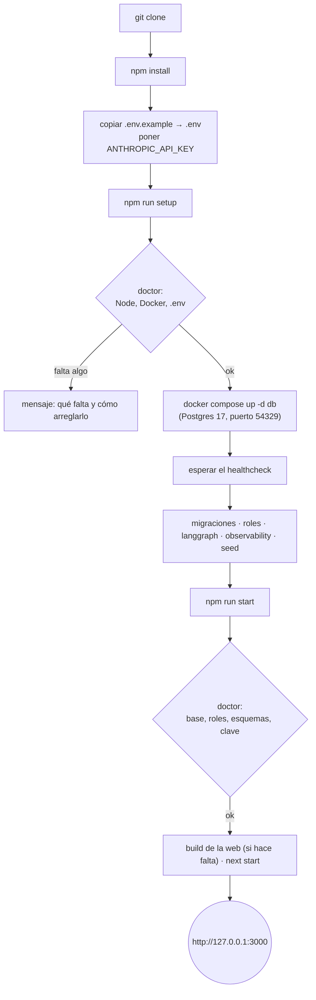
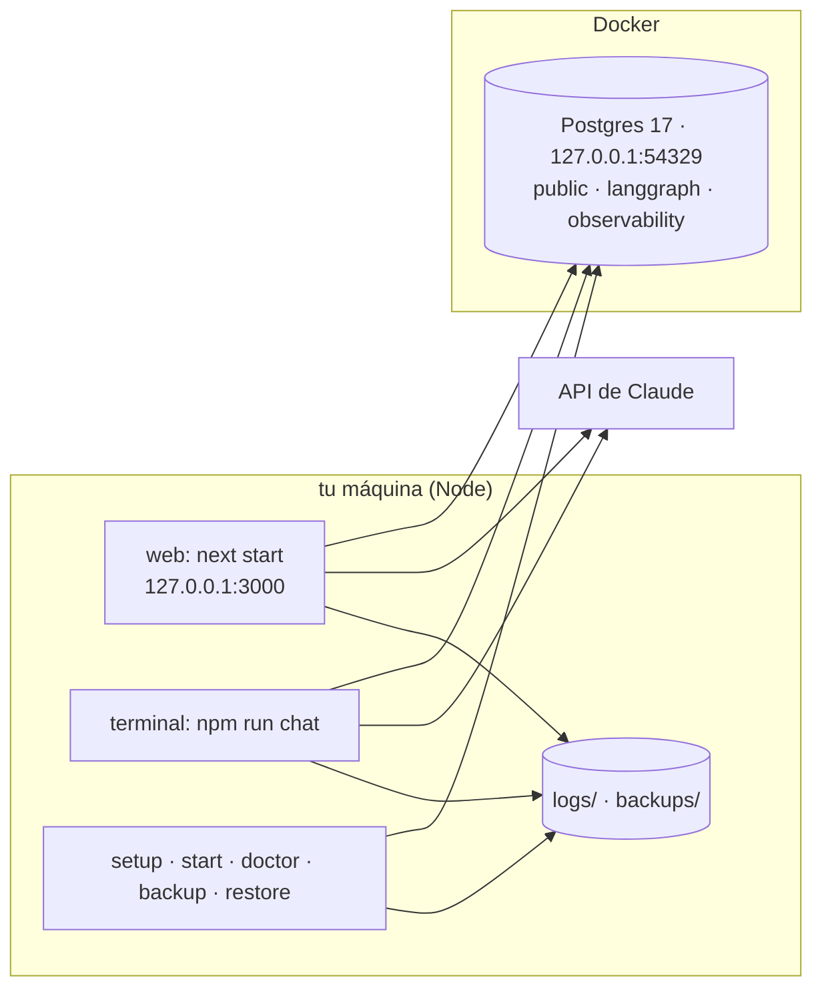
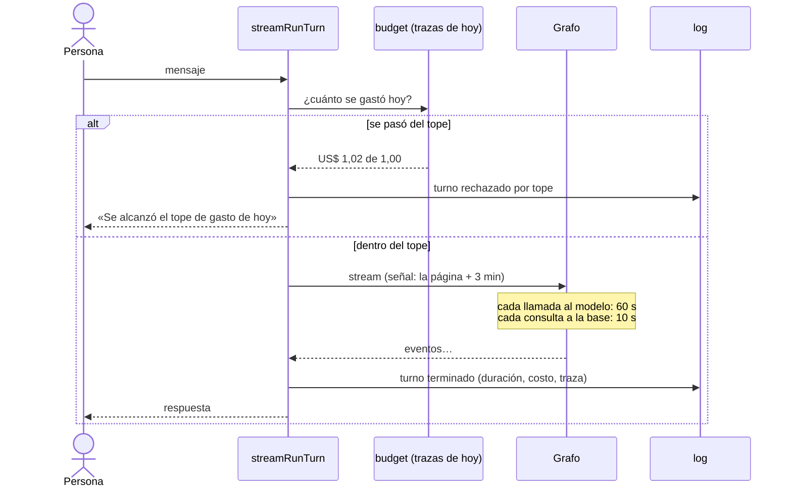
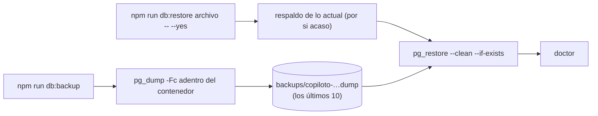

# Fase 12: Empaquetado y operación local

Estado: **en curso** (spec aprobada)

## Objetivo
Dejar el copiloto listo para levantarse desde cero, con pocos comandos y sin servicios externos salvo la API de Claude, y para operarlo:
- arrancarlo y pararlo;
- saber si está sano;
- poner límites al gasto y al tiempo;
- tener registros de lo que pasa;
- respaldar la base y restaurarla.

Es la última fase del plan: al terminarla, el proyecto queda completo.

## Contexto
Existe de las fases anteriores (etiqueta `fase-11`):

- **La base es la de tu Supabase**, que vive fuera del repositorio (`Desktop\supabase\supabase-automatizaciones`, 11 contenedores, compartido con otras automatizaciones). La fase 1 dejó para esta fase empaquetar la base en el repositorio. **El copiloto solo usa Postgres**: tablas, roles, RLS y dos esquemas propios (`langgraph`, `observability`). No usa Auth, Storage, Realtime ni las APIs de Supabase. Se conecta por el pooler (Supavisor), que exige el sufijo del tenant en el usuario.
- **Preparar la base** son cinco comandos que `npm run db:reset` encadena: migraciones, roles, esquema de hilos, esquema de trazas y seed. Hoy suponen que la base ya está corriendo.
- **Las variables de entorno se validan** con Zod (`parseEnv`): si falta una, el error las nombra. Lo hacen la terminal y la web al arrancar, pero no hay un comando que revise todo junto (la base, los roles, los esquemas y la clave de la API).
- **Límites que ya existen:**
  - un turno a la vez por hilo;
  - 4.000 caracteres por mensaje;
  - 4 rondas de herramientas por tarea y el límite de recursión (fase 10);
  - 3 reintentos de las llamadas al modelo.

  **No hay** límite de gasto, ni límite de tiempo para un turno, una llamada al modelo o una consulta a la base. Las fases 4 y 10 dejaron para esta fase los límites de tiempo y la retención de los hilos.
- **Registros:** cada turno deja su traza (fase 11), pero los avisos y errores de operación (la base caída, un reintento, una traza que no se pudo guardar) solo salen por la consola y se pierden.
- **Respaldo:** no hay. El plan lo pide probado: «un corte de Docker deja una ejecución a medias; el respaldo de la base se prueba en la fase 12». Esto pasó de verdad el 6 de noviembre: Docker Desktop se cerró durante la noche y la primera corrida del día falló con la base caída.
- **La web corre en modo desarrollo** (`npm run web`). Hay un build de producción (`npm run web:build`), pero no un comando para servirlo.

**Averiguado al escribir esta spec** (documentación de LangChain, noviembre de 2026; ver [LangGraph CLI](https://docs.langchain.com/langsmith/cli) y [Local development & testing](https://docs.langchain.com/langsmith/local-dev-testing)): el servidor local de LangGraph tiene dos modos.
- **`langgraph dev`** corre el grafo como una API, sin Docker y sin clave. Es un servidor de desarrollo, con el estado en una carpeta local (`.langgraph_api`).
- **`langgraph up`** (en Docker) pide una clave de LangSmith incluso para probar en local, y una licencia para producción. El plan dice «sin LangSmith», así que el servidor de LangGraph no puede ser lo que corre el copiloto. La web y la terminal siguen con su propio servidor (fase 9), y el servidor de LangGraph se explica en la guía de operación (R12).

## Requisitos
**Levantarlo desde cero**
- R1: **El repositorio trae su propia base**: un `docker-compose.yml` con Postgres 17 solo, sin Supabase. Usa otro puerto (54329), así no choca con tu Supabase. El copiloto sigue andando con tu Supabase como hoy: es cuestión de cómo están las URL del `.env`. `.env.example` trae las dos formas, la base propia (la de un clon limpio) y un Supabase con pooler.
- R2: **Dos comandos para arrancar:**
  - `npm run setup`, la primera vez: revisa lo necesario (Node, Docker, el `.env`), levanta la base, espera a que esté lista y la prepara (migraciones, roles, esquemas y seed);
  - `npm run start`, cada vez: levanta la base si está parada, revisa que esté sana y sirve la web en modo producción (build y `next start`), en `http://127.0.0.1:3000`.

  `npm run stop` para la base. Los comandos son scripts de Node (con `tsx`), así andan igual en PowerShell y en otras terminales. La web y la terminal corren con Node en la máquina, no en contenedores: Docker es solo para la base, y es lo único que hay que instalar aparte de Node.
- R3: **`npm run doctor` revisa que todo esté en orden**, y dice qué arreglar si algo falla:
  - las variables de entorno;
  - que la base responda;
  - que existan los roles y que cada uno entre con su contraseña;
  - que estén las tablas y los dos esquemas;
  - que la clave de la API sea válida: se pide la lista de modelos, que no gasta tokens.

  `setup` y `start` lo corren antes de seguir.
- R4: **Las claves quedan fuera del repositorio**: `.env` no se versiona (ya pasa), los respaldos y los registros tampoco. Si falta una variable o es inválida, la terminal, la web, `setup` y `start` se niegan a arrancar con un mensaje que dice cuál falta y dónde se define. Nada arranca a medias.

**Límites**
- R5: **Un tope de gasto diario** (`DAILY_BUDGET_USD`, por defecto US$ 1). Antes de cada turno, el copiloto suma lo que costaron los turnos de hoy (desde la medianoche de Argentina), según sus trazas (fase 11). Si ya se pasó, no llama al modelo: contesta que se alcanzó el tope del día, en la web y en la terminal, y deja un registro. Las corridas de evaluación (`npm run eval`) no cuentan para el tope y no lo consultan: cada corrida muestra su costo. `0` lo desactiva. La consola de Anthropic tiene su propio límite mensual, que la guía de operación explica cómo configurar.
- R6: **Límites de tiempo:**
  - una llamada al modelo, 60 s (`MODEL_TIMEOUT_MS`), sumado a los reintentos de LangChain;
  - una consulta a la base, 10 s (las escrituras de una acción aprobada, 5 s, como desde la fase 5): `statement_timeout` en cada conexión de la aplicación y en los roles;
  - un turno entero, 3 minutos (`TURN_TIMEOUT_MS`). Si se pasa, el turno se corta como si se cerrara la página: el hilo queda a medias y «Continuar» lo retoma (fase 4).

  Cada corte deja un registro con qué se cortó.
- R7: **Los hilos no se borran solos**: son la historia de trabajo. Se borran a mano (`npm run threads -- delete <id>`) o con `db:reset`. Las trazas sí tienen su retención (30 días, fase 11), y los registros, la suya (R8).

**Registros**
- R8: **Un registro de operación en archivos**, `logs/copiloto-AAAA-MM-DD.log`, una línea JSON por evento:
  - el arranque y la parada;
  - cada turno (hilo, tipo, duración, costo, estado, id de la traza);
  - los reintentos, los cortes por tiempo y por tope de gasto;
  - los errores del sistema, con su detalle (el que la persona no ve).

  Reemplaza los `console.warn` y `console.error` sueltos de la terminal y la web, que siguen saliendo también por la consola. Se guardan 14 días (`LOG_RETENTION_DAYS`). No guarda los mensajes ni los resultados de las herramientas: para eso están las trazas, que tienen su propia protección.

**Respaldo**
- R9: **`npm run db:backup`** hace un respaldo completo de la base del copiloto con `pg_dump`, corrido adentro del contenedor:
  - las tablas del negocio;
  - los hilos (`langgraph`);
  - las trazas y las evaluaciones (`observability`).

  Queda en `backups/copiloto-AAAA-MM-DD-HHMM.dump`, fuera del repositorio. Se guardan los últimos 10.
- R10: **`npm run db:restore <archivo> -- --yes`** restaura un respaldo con `pg_restore`, reemplazando lo que hay. Sin `--yes`, dice qué va a borrar y no hace nada. Antes de restaurar hace un respaldo de lo actual, por si acaso. Después corre `doctor`.
- R11: **El respaldo se prueba**: un test respalda la base propia, borra datos (un hilo, una traza, un turno agendado), restaura y comprueba que todo volvió.

**Guía de operación**
- R12: **`doc/operacion.md`**, una guía corta con:
  - cómo arrancar, parar y saber si está sano;
  - qué hacer cuando Docker se cierra o la base no responde;
  - los respaldos: cuándo y cómo restaurar;
  - los límites y dónde se cambian (el tope diario, los límites de tiempo, el límite de la consola de Anthropic);
  - dónde están los registros y las trazas;
  - cómo actualizar (dependencias, migraciones, reiniciar la web después de cambiar `src/`);
  - el servidor local de LangGraph: qué es, qué permiten `langgraph dev` y `langgraph up`, y por qué el copiloto no lo usa (pide LangSmith o una licencia);
  - una **checklist de operación** con cada punto comprobado.

  Aparece en `/doc`.

## Criterios de aceptación
- [ ] CA1 (clon limpio): en una carpeta nueva, `git clone` del repositorio y lo que dice el README (`npm install`, copiar `.env.example`, poner la clave de la API, `npm run setup`, `npm run start`) dejan el copiloto respondiendo con los datos de prueba: «¿Cuántos turnos hay mañana?» contesta la cantidad que da SQL, en la web y en la terminal. Se hace con la base propia, sin tocar tu Supabase.
- [ ] CA2 (configuración): sin `.env`, con una variable de menos o con una inválida, la terminal, la web, `setup` y `start` no arrancan y el mensaje nombra la variable. `doctor` señala cada problema, con una base caída, un rol sin contraseña, un esquema que falta y una clave inválida (con tests).
- [ ] CA3 (límites):
  - con el tope de gasto alcanzado, el turno no llama al modelo y lo dice, en la web y en la terminal;
  - una llamada al modelo que no responde se corta a su tiempo;
  - una consulta lenta (`pg_sleep`) se corta con el `statement_timeout`, y la herramienta lo informa como falla;
  - un turno que se pasa de su tiempo queda a medias y «Continuar» lo termina.

  Todo con tests, con modelos falsos o con la base.
- [ ] CA4 (registros): un turno, un reintento, un corte y un error dejan sus líneas en el archivo del día, sin el texto de los mensajes. Los archivos de más de 14 días se borran.
- [ ] CA5 (respaldo): R11 pasa, y la guía de operación tiene la restauración probada paso a paso.
- [ ] CA6: pasan los tests de las fases 2 a 11, `npm test`, los typecheck, `npm run web:build` y las pruebas del navegador. Hay checklist de operación cumplida, y la documentación queda al día (README, plan, mapa del grafo, `/doc`). La spec y el plan dicen que el proyecto terminó.

## Fuera de alcance
- Que la web o el grafo corran en contenedores (ver la pregunta abierta 2).
- Usuarios, acceso desde otra máquina, HTTPS: el copiloto sigue escuchando solo en `127.0.0.1`.
- Cifrado en reposo de la base: se explica cómo cifrar el disco (BitLocker) en la guía, pero no se cifra la base.
- Respaldos automáticos programados: se explica cómo programarlos con el Programador de tareas de Windows.
- Monitoreo con alertas, métricas o tableros.
- Migrar los hilos de tu Supabase a la base propia: se puede con `db:backup` y `db:restore`, pero no se hace.
- El servidor local de LangGraph (`langgraph.json`, `langgraph dev`): solo se explica en la guía.
- Borrar hilos viejos automáticamente.

## Diseño (plan técnico)
**Arranque**
- `docker-compose.yml`: un servicio `db` (`postgres:17`), con un volumen con nombre, el puerto `127.0.0.1:54329`, un healthcheck (`pg_isready`) y la contraseña del dueño tomada de `.env` (`POSTGRES_PASSWORD`).
- `src/ops/setup.ts`, `start.ts`, `stop.ts` y `doctor.ts`:
  - `doctor` es una lista de comprobaciones, cada una con su resultado y su arreglo sugerido, con las funciones separadas para poder probarlas;
  - `start` corre `doctor`, el build si hace falta y `next start` (se suma `web:start` en `web/package.json`).
- La clave de la API se comprueba con `GET /v1/models`, que no gasta tokens.

**Límites**
- `src/ops/budget.ts`: `spentToday(traces)` (suma `cost_usd` de las trazas desde la medianoche de Argentina) y `checkBudget`. `streamRunTurn` y las otras entradas de un turno lo consultan antes de llamar al grafo; si se pasó, lanzan `BudgetExceededError`, que la web y la terminal muestran como aviso.
- Límites de tiempo:
  - `timeout` en los modelos (`models.ts`);
  - `ALTER ROLE … SET statement_timeout = '10s'` para `copilot_reader` y `copilot_actions` (`roles.ts`);
  - `AbortSignal.timeout(TURN_TIMEOUT_MS)` unido a la señal de cada turno, en `streamInvoke`.

**Registros**
- `src/ops/log.ts`: `log.info/warn/error(evento, datos)`. Escribe una línea JSON al archivo del día y a la consola; borra los archivos viejos al arrancar. Reemplaza los avisos sueltos: los reintentos, las trazas, `[web] Falló un turno…`, el router, la memoria y el reporte.

**Respaldo**
- `src/ops/backup.ts` y `restore.ts`: `docker compose exec db pg_dump -Fc …` y `pg_restore --clean --if-exists`, con la salida en `backups/`. Con la base de tu Supabase (otro contenedor), toman el nombre del contenedor de `BACKUP_CONTAINER`.

**Archivos**

```
docker-compose.yml, .env.example, .gitignore (backups/, logs/)
src/ops/setup.ts, start.ts, stop.ts, doctor.ts, budget.ts, log.ts, backup.ts, restore.ts
src/config/env.ts, src/graph/models.ts, src/graph/run-turn.ts, src/db/roles.ts, src/web/handlers.ts, src/cli/chat.ts
web/package.json (web:start), doc/operacion.md, README.md
tests/doctor.test.ts, tests/budget.test.ts, tests/timeouts.test.ts, tests/log.test.ts, tests/writes/backup-restore.test.ts
```

## Mapas

**1. De un clon limpio a la web andando**



**2. Qué corre dónde**



**3. Antes y durante un turno**



**4. Respaldar y restaurar**



## Tareas
Una tarea = un commit en la rama `dev/fase-12`.

1. **T1:** esta spec aprobada; `.env.example` con las dos formas (base propia y Supabase).
2. **T2:** `docker-compose.yml`, `setup`, `start`, `stop` y `web:start` (CA1, sin el ensayo del clon todavía).
3. **T3:** `doctor` y la validación de la configuración en todas las entradas, con tests (CA2).
4. **T4:** los límites de tiempo (modelo, base, turno), con tests (CA3).
5. **T5:** el tope de gasto diario, con tests, y su aviso en la web y la terminal (CA3).
6. **T6:** el registro de operación (CA4).
7. **T7:** respaldo y restauración, con el test de R11 (CA5).
8. **T8:** el ensayo del clon limpio (CA1), la guía de operación con la checklist cumplida, README, plan y mapa del grafo; cierre con la etiqueta `fase-12` y del proyecto (CA6).

## Decisiones tomadas durante la fase
- **Al aprobar la spec:**
  - la base de un clon limpio es **Postgres 17 solo**, en el `docker-compose.yml` del repositorio: el copiloto no necesita nada más de Supabase;
  - la web y la terminal corren **con Node en la máquina**, no en contenedores;
  - el servidor local de LangGraph **solo se explica en la guía** de operación;
  - el tope de gasto es de **US$ 1 por día**;
  - **los hilos no se borran solos**.

Costo de esta fase en la API: casi nada. Solo el ensayo del clon limpio (un par de turnos) y las pruebas del navegador del final, unos US$ 0,15 en total.
- **La migración inicial necesitaba un esquema de Supabase** (T2): instala `btree_gist` (la que impide turnos superpuestos) en el esquema `extensions`, que Supabase trae y un Postgres solo no. No se tocó la migración, que ya está aplicada en tu Supabase y cambiarla rompería su suma de control. La base propia crea `extensions` al inicializarse (`docker/initdb/01-extensions.sql`). La restricción usa la clase de operadores por defecto, que Postgres encuentra sin importar el esquema.
- **Toda la suite pasa sobre la base propia**: 755 + 54 tests, igual que con tu Supabase. Solo hubo que ajustar tres tests que comprobaban que los roles no leen `auth.users`, una tabla de Supabase. Ahora, si el esquema `auth` existe, exigen «sin permiso», como antes. Si no existe, la tabla no se puede leer porque no está (`42P01`).
- **`setup` se puede repetir sin pisar nada.** Los pasos de la base ya eran idempotentes, y los datos de prueba se cargan solo si no hay clientes. Corre además `prisma generate`, porque el cliente generado no se versiona y un clon limpio no lo tiene.
- **`start` compila la web solo si hace falta**: si no hay build, o si algún archivo de `src/` o `web/` es más nuevo que el último. La web compila también `src/`.
- **La base propia vuelve sola si Docker se reinicia** (`restart: unless-stopped`). Si Docker Desktop se cierra, no hay forma de levantarla desde el copiloto: `setup` y `start` lo detectan y piden abrirlo.
- **Probado sin tocar tu `.env`**: las variables puestas en la terminal tienen prioridad sobre las del archivo, también para Prisma. Así se armó una base propia completa en el puerto 54329 mientras tu Supabase seguía en el 5432.
- **`doctor` entra con cada rol, en vez de solo mirar si la base responde** (T3): así detecta una contraseña que no coincide, el error más común al copiar un `.env`. Si la base no responde, lo dice una sola vez y no sigue probando tablas, pero revisa la clave de la API igual. La URL del dueño es opcional (la aplicación no la usa); si está, revisa también las migraciones. Con tu Supabase, el pooler devuelve el rol sin el sufijo del tenant, así que la comprobación sirve para las dos bases.
- **La web valida la configuración al arrancar** (`web/instrumentation.ts`, el gancho de arranque de Next). Si falta una variable, dice cuál y el proceso termina, en vez de servir páginas que fallan en el primer pedido. Next llega a decir «Ready» antes, porque el gancho corre al terminar de arrancar.
- **Los comandos de la terminal que mostraban la pila del error** (`bench`, `eval-router`, `eval`) ahora usan `loadEnvOrExit`: el mismo mensaje, sin la pila. Los demás ya lo hacían.
- **El pooler de Supabase neutraliza el `statement_timeout` del rol** (T4). Supavisor aplica `default_transaction_read_only` (la configuración del rol de lectura de la fase 2), pero deja `statement_timeout` en el valor de fábrica, y también ignora el que el cliente pide al conectarse. Respeta, en cambio, el de la sesión. Por eso `createPrisma` fija el límite con un `SET statement_timeout` al abrir cada conexión (en un `pg.Pool` propio, que el adaptador de Prisma cierra con `$disconnect`). Probado a través del pooler: `pg_sleep(12)` se cortó a los 10.032 ms con el código `57014`. `npm run db:roles` lo fija además en los roles, para las conexiones directas, como las de la base propia.
- **Un corte por tiempo no se confunde con «se cerró la página».** El límite del turno se une a la señal de quien lo pidió. Si el que cortó fue el límite, el error es `TurnTimeoutError`, con un mensaje para la persona («El turno superó el límite de 180 s y se cortó. Quedó a medias: podés continuarlo»), que la web muestra como error del turno y la terminal, como siempre. La traza queda «a medias». Si la persona cierra la página, todo sigue como en la fase 9.
- **Un corte de la base no se reintenta.** `57014` no está entre las fallas transitorias de la fase 10 (repetir una consulta que tarda demasiado tarda lo mismo): la herramienta lo informa como un problema del sistema, con el código.
- **El rol de acciones ya tenía su límite: 5 s, desde su migración de la fase 5** (corrección de T4). El primer `db:roles` de esta fase lo había pisado con 10 s, y lo detectó el test de la fase 5 que lo comprueba. Se commiteó con ese test fallando; se corrigió enseguida. Ahora `db:roles` solo fija el del rol de lectura, y `createPrisma` recibe el límite: las acciones se abren con 5 s. Se restauraron los 5 s en las dos bases.
- **El tope se revisa en dos lugares** (T5). `streamInvoke` lo revisa antes de llamar al grafo, para todas las entradas de un turno: mensaje, continuar, decidir, editar y reintentar. La web lo revisa además antes de empezar el pedido y responde 429, así la página vuelve atrás con el aviso, como con un 409, en vez de mostrar un mensaje que nunca se guardó. Con el tope alcanzado no se toca el hilo: una tarjeta pendiente sigue pendiente hasta el día siguiente (o hasta subir el tope).
- **Lo gastado sale de las trazas**: la suma de `cost_usd` desde la medianoche de Argentina, sin las corridas de evaluación (`eval_run_id`). Las evaluaciones tampoco consultan el tope: el corredor no le pasa los límites al agente. Si el esquema de trazas no existe, lo gastado es 0 (y `doctor` lo marca).
