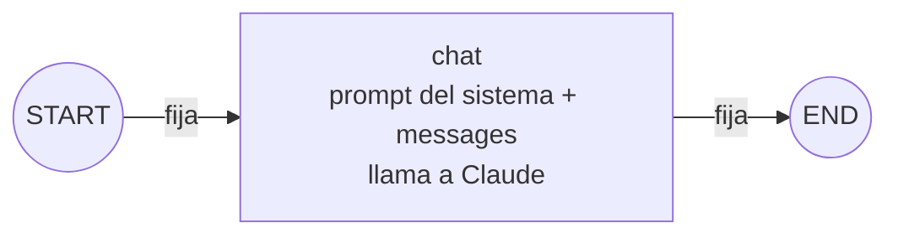
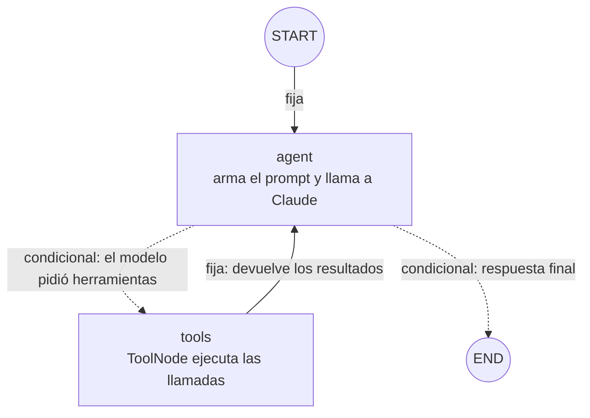

# Mapa del grafo

Documento vivo: al cerrar cada fase se agrega su diagrama. Los datos de cada fase salen del código de su etiqueta de git (`git show fase-NN:src/graph/index.ts`) y del grafo compilado (`graph.getGraphAsync()`), no de memoria.

Convención de los diagramas: **línea continua** = arista fija (siempre ocurre); **línea punteada** = arista condicional (una función decide cuál se toma); **círculo** = `START` o `END`.

## Evolución

| Fase | Nodos propios | Aristas fijas | Aristas condicionales | Conexiones | Estado (campos) | Qué se incorporó |
| --- | --- | --- | --- | --- | --- | --- |
| 1 | 1 (`chat`) | 2 | 0 | 2 | `messages` | Primer grafo: un nodo que llama a Claude |
| 2 | 2 (`agent`, `tools`) | 2 | 2 | 4 | `messages` | Herramientas de lectura y el ciclo `agent ↔ tools` |

Qué cambió de la fase 1 a la 2: el nodo `chat` pasó a llamarse `agent` y ahora puede pedir herramientas; apareció el nodo `tools`; la arista `chat → END` se volvió condicional (`agent → END` solo si no hay llamadas pendientes) y se sumó `tools → agent`, que cierra el ciclo.

---

## Fase 1: un nodo (`fase-01`)

**Resumen:** 1 nodo propio, 2 nodos especiales, 2 aristas fijas, 0 condicionales.

| Nodo | Quién lo escribió | Qué hace | Escribe en el estado |
| --- | --- | --- | --- |
| `chat` | Nosotros (`src/graph/nodes/chat.ts`) | Antepone el prompt del sistema y llama a Claude, sin herramientas | Agrega 1 mensaje de IA a `messages` |

| # | Desde | Hasta | Tipo | Cómo se declara |
| --- | --- | --- | --- | --- |
| 1 | `START` | `chat` | Fija | `.addEdge(START, "chat")` |
| 2 | `chat` | `END` | Fija | `.addEdge("chat", END)` |

**Recorrido:** siempre `START → chat → END`, un solo paso. El grafo no recuerda nada entre invocaciones: la terminal le vuelve a pasar el historial que devolvió.

---

## Fase 2: ciclo agente ↔ herramientas (`fase-02`)

**Resumen:** 2 nodos propios, 2 nodos especiales, 2 aristas fijas, 2 condicionales (salen de una sola decisión), 4 conexiones.

| Nodo | Quién lo escribió | Qué hace | Lee del estado | Escribe en el estado |
| --- | --- | --- | --- | --- |
| `agent` | Nosotros (`src/graph/nodes/agent.ts`) | Antepone el prompt del sistema (con la fecha de hoy) y llama a Claude con las herramientas enlazadas | `messages` | Agrega 1 mensaje de IA a `messages` |
| `tools` | LangGraph (`ToolNode`) | Ejecuta cada `tool_call` del último mensaje; un error se convierte en mensaje de error | `messages` | Agrega 1 mensaje de herramienta por cada llamada |

| # | Desde | Hasta | Tipo | Cómo se declara (`src/graph/index.ts`) |
| --- | --- | --- | --- | --- |
| 1 | `START` | `agent` | Fija | `.addEdge(START, "agent")` |
| 2 | `agent` | `tools` | Condicional | `.addConditionalEdges("agent", routeAfterAgent, ["tools", END])` |
| 3 | `agent` | `END` | Condicional | (misma llamada que la 2) |
| 4 | `tools` | `agent` | Fija | `.addEdge("tools", "agent")` |

La decisión condicional es `routeAfterAgent`: si el último mensaje es de IA y trae `tool_calls`, devuelve `"tools"`; si no, devuelve `END`.

| Situación | Camino | Pasos del grafo |
| --- | --- | --- |
| Charla sin datos ("hola") | `START → agent → END` | 1 |
| Una consulta ("¿cuántos turnos hay mañana?") | `START → agent → tools → agent → END` | 3 |
| Dos herramientas encadenadas (buscar cliente, luego sus turnos) | `START → agent → tools → agent → tools → agent → END` | 5 |
| Error de una herramienta | igual que una consulta: el error vuelve como mensaje y el agente lo informa | 3 |

El tope `recursionLimit` es 10 pasos, así que el ciclo `agent ↔ tools` puede repetirse hasta 4 veces antes de cortar.

---

## Próximas fases (planeado, aún no existe)

| Fase | Cambio previsto en el grafo |
| --- | --- |
| 3 | Nuevo nodo `router` al inicio (`START → router`) y aristas condicionales a las ramas consulta, acción, reporte y charla |
| 4 | Sin cambios en nodos ni aristas: se compila con un checkpointer y el grafo recuerda por `thread_id` |
| 5 | Nodos para proponer la acción y esperar la aprobación humana (`interrupt`), más las herramientas de escritura |
| 6 | Reportes en paralelo con `Send` (varios nodos a la vez que se juntan en uno) |
| 7 | Los caminos pasan a ser subgrafos coordinados por un supervisor |
