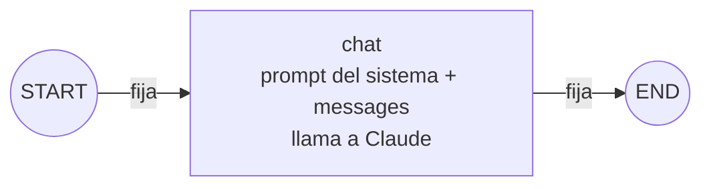
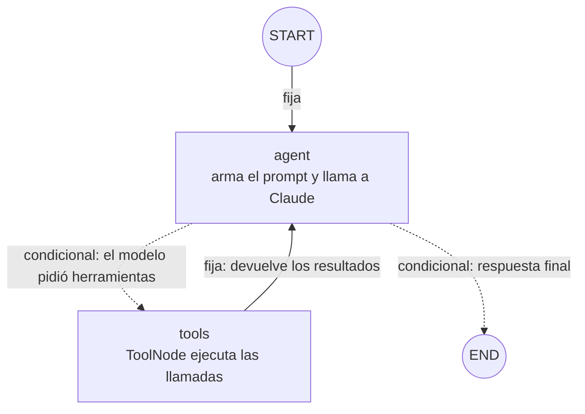
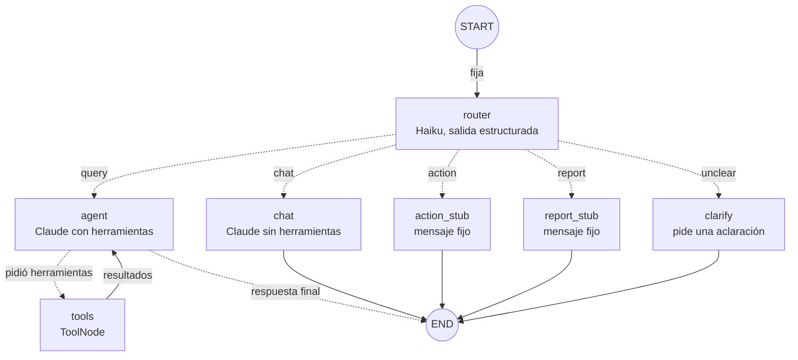
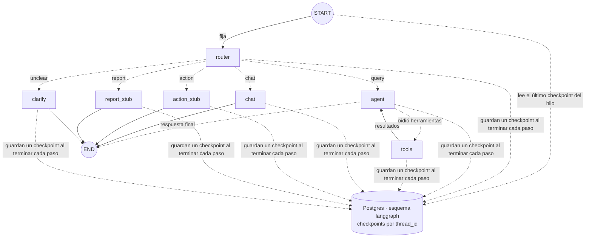
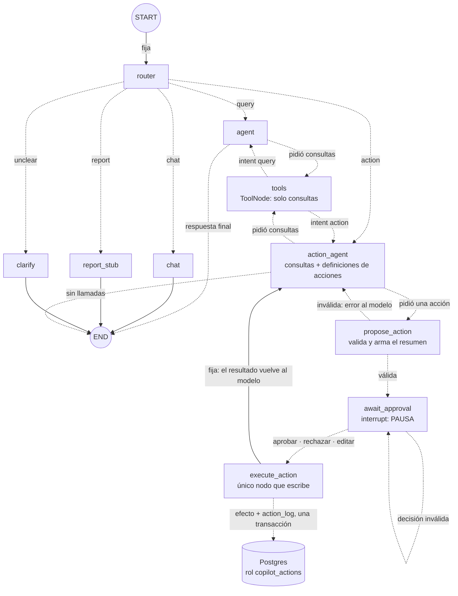

# Mapa del grafo

Documento vivo: al cerrar cada fase se agrega su diagrama. Los datos de cada fase salen del código de su etiqueta de git (`git show fase-NN:src/graph/index.ts`) y del grafo compilado (`graph.getGraphAsync()`), no de memoria.

Convención de los diagramas: **línea continua** = arista fija (siempre ocurre); **línea punteada** = arista condicional (una función decide cuál se toma); **círculo** = `START` o `END`.

## Evolución

| Fase | Nodos propios | Aristas fijas | Aristas condicionales | Conexiones | Estado (campos) | Qué se incorporó |
| --- | --- | --- | --- | --- | --- | --- |
| 1 | 1 (`chat`) | 2 | 0 | 2 | `messages` | Primer grafo: un nodo que llama a Claude |
| 2 | 2 (`agent`, `tools`) | 2 | 2 | 4 | `messages` | Herramientas de lectura y el ciclo `agent ↔ tools` |
| 3 | 7 (`router`, `agent`, `tools`, `chat`, `action_stub`, `report_stub`, `clarify`) | 6 | 7 | 13 | `messages`, `intent`, `intentReason` | Router de intención y cinco ramas |
| 4 | 7 (los mismos) | 6 | 7 | 13 | `messages`, `intent`, `intentReason` | Checkpointer de Postgres: el estado se guarda por `thread_id` (cambia cómo se compila, no la forma del grafo) |
| 5 | 10 (`router`, `agent`, `tools`, `chat`, `report_stub`, `clarify`, `action_agent`, `propose_action`, `await_approval`, `execute_action`) | 5 | 16 | 21 | `messages`, `intent`, `intentReason`, `pendingAction`, `approval` | Acciones con aprobación humana: `interrupt`, `Command({ resume })`, rol de escritura acotado y auditoría |

Qué cambió de la fase 1 a la 2: el nodo `chat` pasó a llamarse `agent` y ahora puede pedir herramientas; apareció el nodo `tools`; la arista `chat → END` se volvió condicional (`agent → END` solo si no hay llamadas pendientes) y se sumó `tools → agent`, que cierra el ciclo.

Qué cambió de la fase 4 a la 5: el marcador `action_stub` se reemplazó por una rama real de cuatro nodos que **pausa el grafo** antes de escribir. La arista `tools → agent` dejó de ser fija: ahora vuelve al agente que preguntó (el de consultas o el de acciones). Se sumaron dos campos al estado.

Qué cambió de la fase 3 a la 4: nada en nodos ni aristas. El grafo se compila con un checkpointer; por eso la terminal ya no guarda el historial y el estado sobrevive al cierre del programa.

Qué cambió de la fase 2 a la 3: el grafo ya no arranca en `agent` sino en un nuevo nodo `router`, que decide a cuál de cinco ramas ir. El ciclo `agent ↔ tools` quedó intacto como una de esas ramas (`query`). Volvió un nodo `chat` (el de la fase 1, ahora sin herramientas y con otro prompt) y aparecieron `clarify` y dos marcadores (`action_stub`, `report_stub`).

---

## Fase 1: un nodo (`fase-01`)

**Resumen:** 1 nodo propio, 2 nodos especiales, 2 aristas fijas, 0 condicionales.

| Nodo | Quién lo escribió | Qué hace | Escribe en el estado |
| --- | --- | --- | --- |
| `chat` | Nosotros (`src/graph/nodes/chat.ts`) | Antepone el prompt del sistema y llama a Claude, sin herramientas | Agrega 1 mensaje de IA a `messages` |

| # | Desde | Hasta | Tipo | Cómo se declara |
| --- | --- | --- | --- | --- |
| 1 | `START` | `chat` | Fija | `.addEdge(START, "chat")` |
| 2 | `chat` | `END` | Fija | `.addEdge("chat", END)` |

**Recorrido:** siempre `START → chat → END`, un solo paso. El grafo no recuerda nada entre invocaciones: la terminal le vuelve a pasar el historial que devolvió.

---

## Fase 2: ciclo agente ↔ herramientas (`fase-02`)

**Resumen:** 2 nodos propios, 2 nodos especiales, 2 aristas fijas, 2 condicionales (salen de una sola decisión), 4 conexiones.

| Nodo | Quién lo escribió | Qué hace | Lee del estado | Escribe en el estado |
| --- | --- | --- | --- | --- |
| `agent` | Nosotros (`src/graph/nodes/agent.ts`) | Antepone el prompt del sistema (con la fecha de hoy) y llama a Claude con las herramientas enlazadas | `messages` | Agrega 1 mensaje de IA a `messages` |
| `tools` | LangGraph (`ToolNode`) | Ejecuta cada `tool_call` del último mensaje; un error se convierte en mensaje de error | `messages` | Agrega 1 mensaje de herramienta por cada llamada |

| # | Desde | Hasta | Tipo | Cómo se declara (`src/graph/index.ts`) |
| --- | --- | --- | --- | --- |
| 1 | `START` | `agent` | Fija | `.addEdge(START, "agent")` |
| 2 | `agent` | `tools` | Condicional | `.addConditionalEdges("agent", routeAfterAgent, ["tools", END])` |
| 3 | `agent` | `END` | Condicional | (misma llamada que la 2) |
| 4 | `tools` | `agent` | Fija | `.addEdge("tools", "agent")` |

La decisión condicional es `routeAfterAgent`: si el último mensaje es de IA y trae `tool_calls`, devuelve `"tools"`; si no, devuelve `END`.

| Situación | Camino | Pasos del grafo |
| --- | --- | --- |
| Charla sin datos ("hola") | `START → agent → END` | 1 |
| Una consulta ("¿cuántos turnos hay mañana?") | `START → agent → tools → agent → END` | 3 |
| Dos herramientas encadenadas (buscar cliente, luego sus turnos) | `START → agent → tools → agent → tools → agent → END` | 5 |
| Error de una herramienta | igual que una consulta: el error vuelve como mensaje y el agente lo informa | 3 |

El tope `recursionLimit` es 10 pasos, así que el ciclo `agent ↔ tools` puede repetirse hasta 4 veces antes de cortar.

---

## Fase 3: router de intención (`fase-03`)

**Resumen:** 7 nodos propios, 2 nodos especiales, 6 aristas fijas y 7 condicionales, que salen de dos decisiones (`routeByIntent` con 5 destinos y `routeAfterAgent` con 2): 13 conexiones.

| Nodo | Quién lo escribió | Qué hace | Modelo | Escribe en el estado |
| --- | --- | --- | --- | --- |
| `router` | Nosotros (`nodes/router.ts`) | Ve una transcripción acotada (6 mensajes, 500 caracteres, sin herramientas) y clasifica el último mensaje | `MODEL_ROUTER` (Haiku) con salida estructurada | `intent`, `intentReason` |
| `agent` | Nosotros (`nodes/agent.ts`) | Igual que en la fase 2: prompt con la fecha de hoy y herramientas enlazadas | `MODEL_AGENT` | 1 mensaje de IA |
| `tools` | LangGraph (`ToolNode`) | Igual que en la fase 2 | — | 1 mensaje por llamada |
| `chat` | Nosotros (`nodes/chat.ts`) | Charla breve **sin herramientas** | `MODEL_AGENT` | 1 mensaje de IA |
| `clarify` | Nosotros (`nodes/clarify.ts`) | Escribe una sola pregunta de aclaración que termina en `?` | `MODEL_ROUTER` | 1 mensaje de IA |
| `action_stub` | Nosotros (`nodes/stubs.ts`) | Mensaje fijo: las acciones llegan en la fase 5 | ninguno | 1 mensaje de IA |
| `report_stub` | Nosotros (`nodes/stubs.ts`) | Mensaje fijo: los reportes llegan en la fase 6 | ninguno | 1 mensaje de IA |

| # | Desde | Hasta | Tipo | Cómo se declara (`src/graph/index.ts`) |
| --- | --- | --- | --- | --- |
| 1 | `START` | `router` | Fija | `.addEdge(START, "router")` |
| 2 | `router` | `agent` | Condicional (`intent = query`) | `.addConditionalEdges("router", routeByIntent, [...])` |
| 3 | `router` | `chat` | Condicional (`chat`) | (misma llamada) |
| 4 | `router` | `action_stub` | Condicional (`action`) | (misma llamada) |
| 5 | `router` | `report_stub` | Condicional (`report`) | (misma llamada) |
| 6 | `router` | `clarify` | Condicional (`unclear`) | (misma llamada) |
| 7 | `agent` | `tools` | Condicional | `.addConditionalEdges("agent", routeAfterAgent, ["tools", END])` |
| 8 | `agent` | `END` | Condicional | (misma llamada que la 7) |
| 9 | `tools` | `agent` | Fija | `.addEdge("tools", "agent")` |
| 10 | `chat` | `END` | Fija | `.addEdge("chat", END)` |
| 11 | `action_stub` | `END` | Fija | `.addEdge("action_stub", END)` |
| 12 | `report_stub` | `END` | Fija | `.addEdge("report_stub", END)` |
| 13 | `clarify` | `END` | Fija | `.addEdge("clarify", END)` |

La decisión del router es `routeByIntent`: un `Record<Intent, nodo>` que TypeScript obliga a completar para las cinco intenciones. Sin intención, cae en `agent` (la rama de solo lectura).

| Situación | Camino | Pasos del grafo |
| --- | --- | --- |
| Charla ("hola") | `START → router → chat → END` | 2 |
| Pedido de acción o de reporte | `START → router → action_stub / report_stub → END` | 2 |
| Pedido ambiguo | `START → router → clarify → END` | 2 |
| Una consulta | `START → router → agent → tools → agent → END` | 4 |
| Dos herramientas encadenadas | `START → router → agent → tools → agent → tools → agent → END` | 6 |

El tope `recursionLimit` subió a 12 porque el router suma un paso: caben 4 rondas de herramientas más la respuesta final.

---

## Fase 4: el grafo recuerda por hilo (`fase-04`)

**Resumen:** el grafo no cambió: mismos 7 nodos propios, 6 aristas fijas y 7 condicionales (13 conexiones) y mismos campos de estado. Lo que cambió es cómo se compila: `compile({ checkpointer })` con un `PostgresSaver`. No es un nodo ni una arista: es una capa por debajo que guarda el estado después de cada paso y lo carga al arrancar.

| Qué | Antes (fases 1 a 3) | Ahora |
| --- | --- | --- |
| Quién guarda el historial | La terminal, en una variable | Postgres (`langgraph.checkpoints`), por `thread_id` |
| Qué se manda al invocar | Todo el historial más el mensaje nuevo | Solo el mensaje nuevo y el `thread_id`; el reducer de `messages` lo **agrega** al estado guardado |
| Al cerrar el programa | Se pierde la conversación | Se retoma con `npm run chat <id>` |
| Si un turno se corta | Se descarta (el historial no se actualizaba) | El hilo queda a medias (`next` no vacío) y se reanuda con `/continuar` (`invoke(null)`) |

**Checkpoints por turno** (cada uno es un paso del grafo más uno de entrada, `source: input`):

| Situación | Camino | Checkpoints que deja |
| --- | --- | --- |
| Charla, acción, reporte o aclaración | `__start__ → router → rama` | 4 |
| Una consulta con una herramienta | `__start__ → router → agent → tools → agent` | 6 |

`metadata.writes` viene vacío en LangGraph.js 1.5.3, así que "qué nodo corrió" se deduce de los `next` del checkpoint anterior (ver `specs/fase-04-persistencia.md`).

---

## Fase 5: aprobación humana antes de escribir (`fase-05`)

**Resumen:** 10 nodos propios (`action_stub` desapareció; se sumaron `action_agent`, `propose_action`, `await_approval` y `execute_action`), 2 nodos especiales, 5 aristas fijas y 16 condicionales: **21 conexiones** (comprobado con `getGraphAsync()`). Sale de seis decisiones: `routeByIntent` (5 destinos), `routeAfterAgent` (2), `routeAfterTools` (2), `routeAfterActionAgent` (3), `routeAfterPropose` (2) y `routeAfterApproval` (2). El estado suma `pendingAction` y `approval`.

| Nodo | Quién lo escribió | Qué hace | Modelo | Escribe en el estado |
| --- | --- | --- | --- | --- |
| `action_agent` | Nosotros (`nodes/action-agent.ts`) | Prompt de acciones con la fecha; junta ids con las consultas y pide **una** acción | `MODEL_AGENT` con consultas + definiciones de las 4 acciones | 1 mensaje de IA |
| `propose_action` | Nosotros (`nodes/actions.ts`) | Valida la acción con las reglas del negocio y arma el resumen y el riesgo **desde la base**; rechaza varias acciones juntas | ninguno | `pendingAction`, o mensajes de error de herramienta |
| `await_approval` | Nosotros (`nodes/actions.ts`) | Llama a `interrupt`: el grafo se pausa hasta que llegue la decisión; la valida (estricta). Una **edición** se re-valida y reemplaza la propuesta, pero **no se ejecuta**: vuelve a preguntar con la tarjeta recalculada | ninguno | `approval` (y `pendingAction`, si se editó) |
| `execute_action` | Nosotros (`nodes/actions.ts`) | Con una decisión vigente sobre **esa** acción, ejecuta (o registra el rechazo) en una transacción con la auditoría | ninguno | 1 mensaje de herramienta; `pendingAction` y `approval` a `null` |

| # | Desde | Hasta | Tipo | Cómo se declara (`src/graph/index.ts`) |
| --- | --- | --- | --- | --- |
| 1 | `START` | `router` | Fija | `.addEdge(START, "router")` |
| 2–6 | `router` | `agent`, `chat`, `action_agent`, `report_stub`, `clarify` | Condicional (`intent`) | `.addConditionalEdges("router", routeByIntent, [...])` |
| 7–8 | `agent` | `tools`, `END` | Condicional | `routeAfterAgent` |
| 9–10 | `tools` | `agent`, `action_agent` | Condicional (`intent`) | `routeAfterTools`: vuelve a quien preguntó |
| 11–13 | `action_agent` | `tools`, `propose_action`, `END` | Condicional | `routeAfterActionAgent` |
| 14–15 | `propose_action` | `await_approval`, `action_agent` | Condicional (`pendingAction`) | `routeAfterPropose` |
| 16–17 | `await_approval` | `execute_action`, `await_approval` | Condicional (`approval.decision`) | `routeAfterApproval`: solo `approved` y `rejected` ejecutan; `revised` (editada) e `invalid` vuelven a preguntar |
| 18 | `execute_action` | `action_agent` | Fija | `.addEdge("execute_action", "action_agent")` |
| 19–21 | `chat`, `report_stub`, `clarify` | `END` | Fijas | `.addEdge(…, END)` |

| Situación | Camino | Notas |
| --- | --- | --- |
| Pedido claro de una acción | `START → router → action_agent → tools → action_agent → propose_action → await_approval` ⏸ | El grafo **se pausa**; la terminal muestra la tarjeta |
| Aprobada o rechazada | `await_approval → execute_action → action_agent → END` | Se retoma con `Command({ resume })`, incluso tras reiniciar el programa |
| Editada | `await_approval → await_approval` ⏸ | La propuesta se reemplaza con la edición y se vuelve a pedir la aprobación; no se ejecuta nada hasta aprobar |
| Falta un dato o hay varias opciones | `START → router → action_agent → END` | El agente hace una pregunta; no hay propuesta |
| Propuesta inválida (turno que ya pasó, stock insuficiente…) | `action_agent → propose_action → action_agent` | El error vuelve al modelo como mensaje de herramienta |
| Decisión mal formada o edición inválida | `await_approval → await_approval` | Se vuelve a preguntar con el motivo; no se ejecuta nada |
| Varias acciones en un mensaje | `action_agent → propose_action → action_agent` | Todas las llamadas reciben el error; no se propone ninguna |

**Qué NO existe:** ninguna arista lleva una acción a `tools`. Si el modelo la pidiera por otro camino, el único `ToolNode` solo responde «la herramienta no existe».

---

## Próximas fases (planeado, aún no existe)

| Fase | Cambio previsto en el grafo |
| --- | --- |
| 6 | Reportes en paralelo con `Send` (varios nodos a la vez que se juntan en uno) |
| 7 | Los caminos pasan a ser subgrafos coordinados por un supervisor |
