# Mapa del grafo

Documento vivo: al cerrar cada fase se agrega su diagrama. Los datos de cada fase salen del código de su etiqueta de git (`git show fase-NN:src/graph/index.ts`) y del grafo compilado (`graph.getGraphAsync()`), no de memoria.

Convención de los diagramas: **línea continua** = arista fija (siempre ocurre); **línea punteada** = arista condicional (una función decide cuál se toma); **círculo** = `START` o `END`.

## Evolución

| Fase | Nodos propios | Aristas fijas | Aristas condicionales | Conexiones | Estado (campos) | Qué se incorporó |
| --- | --- | --- | --- | --- | --- | --- |
| 1 | 1 (`chat`) | 2 | 0 | 2 | `messages` | Primer grafo: un nodo que llama a Claude |
| 2 | 2 (`agent`, `tools`) | 2 | 2 | 4 | `messages` | Herramientas de lectura y el ciclo `agent ↔ tools` |
| 3 | 7 (`router`, `agent`, `tools`, `chat`, `action_stub`, `report_stub`, `clarify`) | 6 | 7 | 13 | `messages`, `intent`, `intentReason` | Router de intención y cinco ramas |
| 4 | 7 (los mismos) | 6 | 7 | 13 | `messages`, `intent`, `intentReason` | Checkpointer de Postgres: el estado se guarda por `thread_id` (cambia cómo se compila, no la forma del grafo) |
| 5 | 10 (`router`, `agent`, `tools`, `chat`, `report_stub`, `clarify`, `action_agent`, `propose_action`, `await_approval`, `execute_action`) | 5 | 16 | 21 | `messages`, `intent`, `intentReason`, `pendingAction`, `approval` | Acciones con aprobación humana: `interrupt`, `Command({ resume })`, rol de escritura acotado y auditoría |
| 6 | 14 (los de la fase 5 menos `report_stub`, más `plan_report`, `report_sales`, `report_appointments`, `report_stock` y `compose_report`) | 8 | 19 | 27 | `messages`, `intent`, `intentReason`, `pendingAction`, `approval`, `report`, `reportParts` | Reportes en paralelo: fan-out con `Send`, fan-in y un reducer que concatena |
| 7 | 7 en el principal (`router`, `supervisor`, `query_graph`, `action_graph`, `report_graph`, `chat`, `clarify`); los tres `*_graph` son subgrafos con 2, 5 y 5 nodos | 7 | 6 | 13 (más 4, 10 y 8 dentro de los subgrafos) | principal: `messages`, `intent`, `intentReason`, `plan`, `activeAgent`, `report`; privados: `pendingAction` y `approval` (acciones), `reportParts` (reportes) | Subgrafos con estado compartido y privado, y un supervisor que traspasa el control con `Command`: pedidos mixtos |
| 8 | 9 en el principal (los de la fase 7 más `load_memory` y `memory`); subgrafos sin cambios | 9 | 7 | 16 (más 4, 10 y 8 dentro de los subgrafos) | principal: los de la fase 7 más `businessContext` (compartido con consultas y acciones); privados, igual que en la fase 7 | Memoria de largo plazo: un Store de Postgres que no depende del hilo, leído al empezar cada turno |
| 9 | 9 (los mismos) | 9 | 7 | 16 (más 4, 10 y 8 dentro de los subgrafos) | los mismos que en la fase 8 | Streaming: el turno corre con `graph.stream` (modos `values`, `updates` y `messages`, con subgrafos) y un chat web lo muestra en vivo. Cambia cómo se invoca el grafo, no su forma |
| 10 | 9 en el principal (los mismos); consultas y acciones suman `recover` (3 y 6 nodos) | 9 | 7 | 16 (más 6, 12 y 8 dentro de los subgrafos) | los mismos que en la fase 9 | Errores y viaje en el tiempo: reintentos de las lecturas (`retryPolicy` en `load_memory`, `withRetry` en herramientas y secciones), un tope de 4 rondas que sale por `recover`, segundo intento ante salidas mal formadas, y bifurcar el hilo desde un checkpoint para editar o reintentar un turno |

Qué cambió de la fase 1 a la 2: el nodo `chat` pasó a llamarse `agent` y ahora puede pedir herramientas; apareció el nodo `tools`; la arista `chat → END` se volvió condicional (`agent → END` solo si no hay llamadas pendientes) y se sumó `tools → agent`, que cierra el ciclo.

Qué cambió de la fase 9 a la 10: el grafo principal tiene la misma forma, pero `load_memory` ganó una **`retryPolicy`**: si la lectura del Store falla por una caída transitoria, LangGraph repite el nodo. Los subgrafos de consultas y de acciones suman un nodo, **`recover`**, al que `routeAfterAgent` manda cuando la tarea llega a la 5.ª ronda de herramientas o repite una llamada idéntica. El turno termina con un mensaje del código en vez de un `GraphRecursionError`. El modo `custom` se sumó al stream (los avisos de reintento). Y el hilo ya no es una línea: editar o reintentar un turno lo **bifurca** desde el checkpoint en que entró ese mensaje (`updateState` como `__start__`).

Qué cambió de la fase 8 a la 9: nada en nodos, aristas ni estado. Todo turno (de la terminal o de la web) corre con `graph.stream` en vez de `graph.invoke`, y cada dato que sale del grafo se traduce a un evento de la interfaz (`toUiEvents`). Un efecto en los modelos: el modo `messages` le pide a cada modelo que transmita, así que los de salida estructurada (router, memoria, período del reporte) se crearon con `disableStreaming` para que contesten todo junto.

Qué cambió de la fase 7 a la 8: el turno ya no empieza en el router sino en `load_memory`, que lee las memorias del negocio del **Store** y las deja en `businessContext`; el supervisor tiene un destino más, `memory`, que guarda, lista y borra memorias. El grafo se compila también con el Store (`compile({ checkpointer, store })`) y LangGraph se lo da a cada nodo en `config.store`. Los subgrafos no cambiaron: reciben las memorias por el estado.

Qué cambió de la fase 6 a la 7: el grafo plano se partió en **tres subgrafos** (consultas, acciones y reportes) que el grafo principal usa como nodos, y un **supervisor** reparte entre ellos el plan que arma el router. Los nodos de las fases 2 a 6 siguen existiendo con el mismo nombre, pero adentro de su subgrafo. Cada subgrafo tiene su propio `tools`, así que `routeAfterTools` (que miraba `intent` para saber a quién volver) desapareció. Del estado principal salieron los tres campos que usaba un solo agente (ahora son privados) y entraron `plan` y `activeAgent`.

Qué cambió de la fase 5 a la 6: el último marcador, `report_stub`, se reemplazó por un **fan-out**: `plan_report` lanza con `Send` tres nodos en el mismo paso y un nodo final los consolida (**fan-in**). Se sumaron dos campos al estado y el primero con reducer propio, aparte de `messages`.

Qué cambió de la fase 4 a la 5: el marcador `action_stub` se reemplazó por una rama real de cuatro nodos que **pausa el grafo** antes de escribir. La arista `tools → agent` dejó de ser fija: ahora vuelve al agente que preguntó (el de consultas o el de acciones). Se sumaron dos campos al estado.

Qué cambió de la fase 3 a la 4: nada en nodos ni aristas. El grafo se compila con un checkpointer; por eso la terminal ya no guarda el historial y el estado sobrevive al cierre del programa.

Qué cambió de la fase 2 a la 3: el grafo ya no arranca en `agent` sino en un nuevo nodo `router`, que decide a cuál de cinco ramas ir. El ciclo `agent ↔ tools` quedó intacto como una de esas ramas (`query`). Volvió un nodo `chat` (el de la fase 1, ahora sin herramientas y con otro prompt) y aparecieron `clarify` y dos marcadores (`action_stub`, `report_stub`).

---

## Fase 1: un nodo (`fase-01`)

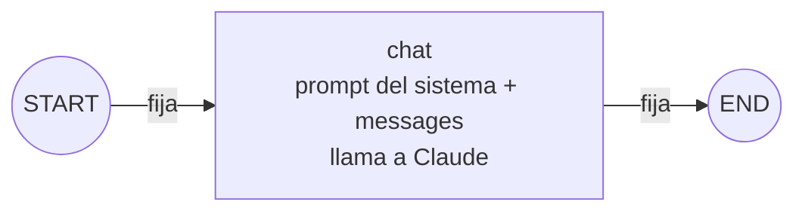

**Resumen:** 1 nodo propio, 2 nodos especiales, 2 aristas fijas, 0 condicionales.

| Nodo | Quién lo escribió | Qué hace | Escribe en el estado |
| --- | --- | --- | --- |
| `chat` | Nosotros (`src/graph/nodes/chat.ts`) | Antepone el prompt del sistema y llama a Claude, sin herramientas | Agrega 1 mensaje de IA a `messages` |

| # | Desde | Hasta | Tipo | Cómo se declara |
| --- | --- | --- | --- | --- |
| 1 | `START` | `chat` | Fija | `.addEdge(START, "chat")` |
| 2 | `chat` | `END` | Fija | `.addEdge("chat", END)` |

**Recorrido:** siempre `START → chat → END`, un solo paso. El grafo no recuerda nada entre invocaciones: la terminal le vuelve a pasar el historial que devolvió.

---

## Fase 2: ciclo agente ↔ herramientas (`fase-02`)

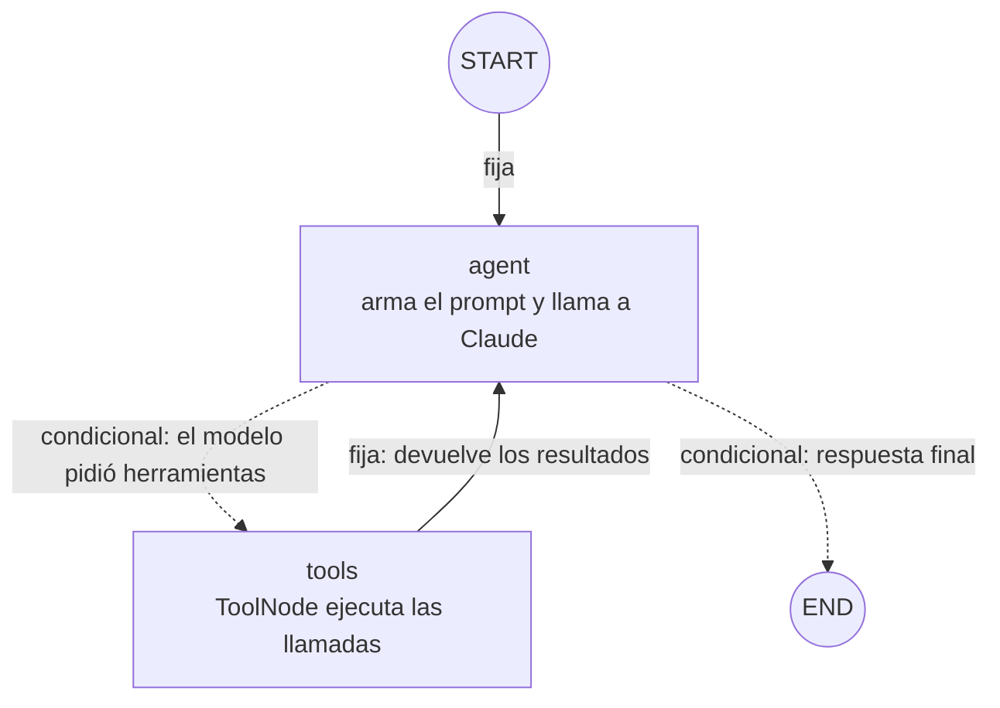

**Resumen:** 2 nodos propios, 2 nodos especiales, 2 aristas fijas, 2 condicionales (salen de una sola decisión), 4 conexiones.

| Nodo | Quién lo escribió | Qué hace | Lee del estado | Escribe en el estado |
| --- | --- | --- | --- | --- |
| `agent` | Nosotros (`src/graph/nodes/agent.ts`) | Antepone el prompt del sistema (con la fecha de hoy) y llama a Claude con las herramientas enlazadas | `messages` | Agrega 1 mensaje de IA a `messages` |
| `tools` | LangGraph (`ToolNode`) | Ejecuta cada `tool_call` del último mensaje; un error se convierte en mensaje de error | `messages` | Agrega 1 mensaje de herramienta por cada llamada |

| # | Desde | Hasta | Tipo | Cómo se declara (`src/graph/index.ts`) |
| --- | --- | --- | --- | --- |
| 1 | `START` | `agent` | Fija | `.addEdge(START, "agent")` |
| 2 | `agent` | `tools` | Condicional | `.addConditionalEdges("agent", routeAfterAgent, ["tools", END])` |
| 3 | `agent` | `END` | Condicional | (misma llamada que la 2) |
| 4 | `tools` | `agent` | Fija | `.addEdge("tools", "agent")` |

La decisión condicional es `routeAfterAgent`: si el último mensaje es de IA y trae `tool_calls`, devuelve `"tools"`; si no, devuelve `END`.

| Situación | Camino | Pasos del grafo |
| --- | --- | --- |
| Charla sin datos ("hola") | `START → agent → END` | 1 |
| Una consulta ("¿cuántos turnos hay mañana?") | `START → agent → tools → agent → END` | 3 |
| Dos herramientas encadenadas (buscar cliente, luego sus turnos) | `START → agent → tools → agent → tools → agent → END` | 5 |
| Error de una herramienta | igual que una consulta: el error vuelve como mensaje y el agente lo informa | 3 |

El tope `recursionLimit` es 10 pasos, así que el ciclo `agent ↔ tools` puede repetirse hasta 4 veces antes de cortar.

---

## Fase 3: router de intención (`fase-03`)

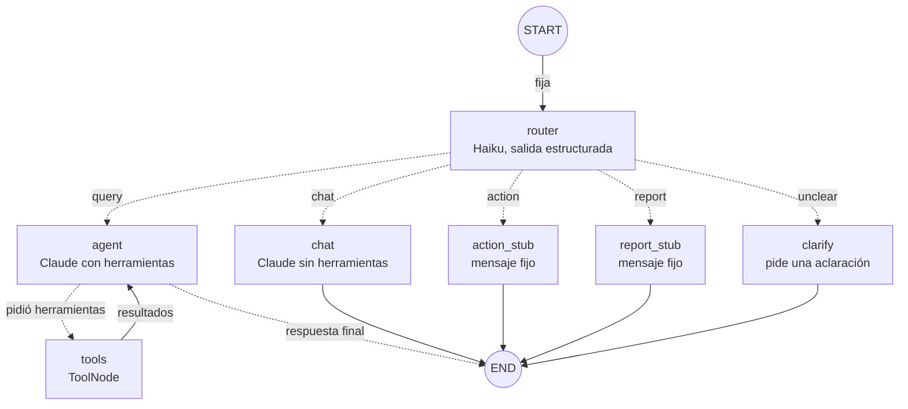

**Resumen:** 7 nodos propios, 2 nodos especiales, 6 aristas fijas y 7 condicionales, que salen de dos decisiones (`routeByIntent` con 5 destinos y `routeAfterAgent` con 2): 13 conexiones.

| Nodo | Quién lo escribió | Qué hace | Modelo | Escribe en el estado |
| --- | --- | --- | --- | --- |
| `router` | Nosotros (`nodes/router.ts`) | Ve una transcripción acotada (6 mensajes, 500 caracteres, sin herramientas) y clasifica el último mensaje | `MODEL_ROUTER` (Haiku) con salida estructurada | `intent`, `intentReason` |
| `agent` | Nosotros (`nodes/agent.ts`) | Igual que en la fase 2: prompt con la fecha de hoy y herramientas enlazadas | `MODEL_AGENT` | 1 mensaje de IA |
| `tools` | LangGraph (`ToolNode`) | Igual que en la fase 2 | — | 1 mensaje por llamada |
| `chat` | Nosotros (`nodes/chat.ts`) | Charla breve **sin herramientas** | `MODEL_AGENT` | 1 mensaje de IA |
| `clarify` | Nosotros (`nodes/clarify.ts`) | Escribe una sola pregunta de aclaración que termina en `?` | `MODEL_ROUTER` | 1 mensaje de IA |
| `action_stub` | Nosotros (`nodes/stubs.ts`) | Mensaje fijo: las acciones llegan en la fase 5 | ninguno | 1 mensaje de IA |
| `report_stub` | Nosotros (`nodes/stubs.ts`) | Mensaje fijo: los reportes llegan en la fase 6 | ninguno | 1 mensaje de IA |

| # | Desde | Hasta | Tipo | Cómo se declara (`src/graph/index.ts`) |
| --- | --- | --- | --- | --- |
| 1 | `START` | `router` | Fija | `.addEdge(START, "router")` |
| 2 | `router` | `agent` | Condicional (`intent = query`) | `.addConditionalEdges("router", routeByIntent, [...])` |
| 3 | `router` | `chat` | Condicional (`chat`) | (misma llamada) |
| 4 | `router` | `action_stub` | Condicional (`action`) | (misma llamada) |
| 5 | `router` | `report_stub` | Condicional (`report`) | (misma llamada) |
| 6 | `router` | `clarify` | Condicional (`unclear`) | (misma llamada) |
| 7 | `agent` | `tools` | Condicional | `.addConditionalEdges("agent", routeAfterAgent, ["tools", END])` |
| 8 | `agent` | `END` | Condicional | (misma llamada que la 7) |
| 9 | `tools` | `agent` | Fija | `.addEdge("tools", "agent")` |
| 10 | `chat` | `END` | Fija | `.addEdge("chat", END)` |
| 11 | `action_stub` | `END` | Fija | `.addEdge("action_stub", END)` |
| 12 | `report_stub` | `END` | Fija | `.addEdge("report_stub", END)` |
| 13 | `clarify` | `END` | Fija | `.addEdge("clarify", END)` |

La decisión del router es `routeByIntent`: un `Record<Intent, nodo>` que TypeScript obliga a completar para las cinco intenciones. Sin intención, cae en `agent` (la rama de solo lectura).

| Situación | Camino | Pasos del grafo |
| --- | --- | --- |
| Charla ("hola") | `START → router → chat → END` | 2 |
| Pedido de acción o de reporte | `START → router → action_stub / report_stub → END` | 2 |
| Pedido ambiguo | `START → router → clarify → END` | 2 |
| Una consulta | `START → router → agent → tools → agent → END` | 4 |
| Dos herramientas encadenadas | `START → router → agent → tools → agent → tools → agent → END` | 6 |

El tope `recursionLimit` subió a 12 porque el router suma un paso: caben 4 rondas de herramientas más la respuesta final.

---

## Fase 4: el grafo recuerda por hilo (`fase-04`)

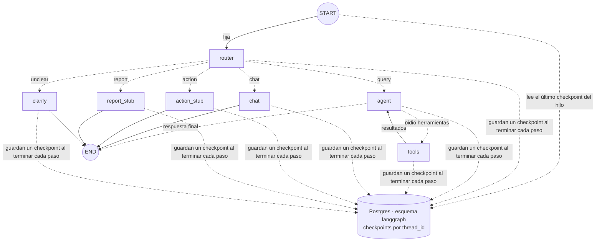

**Resumen:** el grafo no cambió: mismos 7 nodos propios, 6 aristas fijas y 7 condicionales (13 conexiones) y mismos campos de estado. Lo que cambió es cómo se compila: `compile({ checkpointer })` con un `PostgresSaver`. No es un nodo ni una arista: es una capa por debajo que guarda el estado después de cada paso y lo carga al arrancar.

| Qué | Antes (fases 1 a 3) | Ahora |
| --- | --- | --- |
| Quién guarda el historial | La terminal, en una variable | Postgres (`langgraph.checkpoints`), por `thread_id` |
| Qué se manda al invocar | Todo el historial más el mensaje nuevo | Solo el mensaje nuevo y el `thread_id`; el reducer de `messages` lo **agrega** al estado guardado |
| Al cerrar el programa | Se pierde la conversación | Se retoma con `npm run chat <id>` |
| Si un turno se corta | Se descarta (el historial no se actualizaba) | El hilo queda a medias (`next` no vacío) y se reanuda con `/continuar` (`invoke(null)`) |

**Checkpoints por turno** (cada uno es un paso del grafo más uno de entrada, `source: input`):

| Situación | Camino | Checkpoints que deja |
| --- | --- | --- |
| Charla, acción, reporte o aclaración | `__start__ → router → rama` | 4 |
| Una consulta con una herramienta | `__start__ → router → agent → tools → agent` | 6 |

`metadata.writes` viene vacío en LangGraph.js 1.5.3, así que "qué nodo corrió" se deduce de los `next` del checkpoint anterior (ver `specs/fase-04-persistencia.md`).

---

## Fase 5: aprobación humana antes de escribir (`fase-05`)

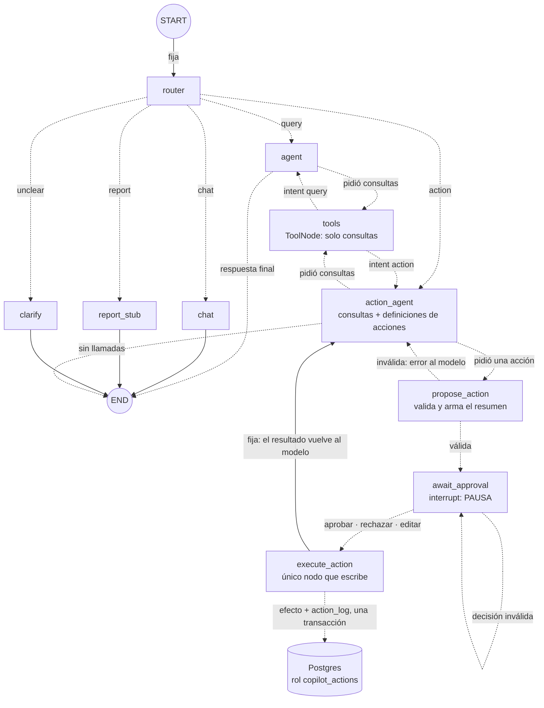

**Resumen:** 10 nodos propios (`action_stub` desapareció; se sumaron `action_agent`, `propose_action`, `await_approval` y `execute_action`), 2 nodos especiales, 5 aristas fijas y 16 condicionales: **21 conexiones** (comprobado con `getGraphAsync()`). Sale de seis decisiones: `routeByIntent` (5 destinos), `routeAfterAgent` (2), `routeAfterTools` (2), `routeAfterActionAgent` (3), `routeAfterPropose` (2) y `routeAfterApproval` (2). El estado suma `pendingAction` y `approval`.

| Nodo | Quién lo escribió | Qué hace | Modelo | Escribe en el estado |
| --- | --- | --- | --- | --- |
| `action_agent` | Nosotros (`nodes/action-agent.ts`) | Prompt de acciones con la fecha; junta ids con las consultas y pide **una** acción | `MODEL_AGENT` con consultas + definiciones de las 4 acciones | 1 mensaje de IA |
| `propose_action` | Nosotros (`nodes/actions.ts`) | Valida la acción con las reglas del negocio y arma el resumen y el riesgo **desde la base**; rechaza varias acciones juntas | ninguno | `pendingAction`, o mensajes de error de herramienta |
| `await_approval` | Nosotros (`nodes/actions.ts`) | Llama a `interrupt`: el grafo se pausa hasta que llegue la decisión; la valida (estricta). Una **edición** se re-valida y reemplaza la propuesta, pero **no se ejecuta**: vuelve a preguntar con la tarjeta recalculada | ninguno | `approval` (y `pendingAction`, si se editó) |
| `execute_action` | Nosotros (`nodes/actions.ts`) | Con una decisión vigente sobre **esa** acción, ejecuta (o registra el rechazo) en una transacción con la auditoría | ninguno | 1 mensaje de herramienta; `pendingAction` y `approval` a `null` |

| # | Desde | Hasta | Tipo | Cómo se declara (`src/graph/index.ts`) |
| --- | --- | --- | --- | --- |
| 1 | `START` | `router` | Fija | `.addEdge(START, "router")` |
| 2–6 | `router` | `agent`, `chat`, `action_agent`, `report_stub`, `clarify` | Condicional (`intent`) | `.addConditionalEdges("router", routeByIntent, [...])` |
| 7–8 | `agent` | `tools`, `END` | Condicional | `routeAfterAgent` |
| 9–10 | `tools` | `agent`, `action_agent` | Condicional (`intent`) | `routeAfterTools`: vuelve a quien preguntó |
| 11–13 | `action_agent` | `tools`, `propose_action`, `END` | Condicional | `routeAfterActionAgent` |
| 14–15 | `propose_action` | `await_approval`, `action_agent` | Condicional (`pendingAction`) | `routeAfterPropose` |
| 16–17 | `await_approval` | `execute_action`, `await_approval` | Condicional (`approval.decision`) | `routeAfterApproval`: solo `approved` y `rejected` ejecutan; `revised` (editada) e `invalid` vuelven a preguntar |
| 18 | `execute_action` | `action_agent` | Fija | `.addEdge("execute_action", "action_agent")` |
| 19–21 | `chat`, `report_stub`, `clarify` | `END` | Fijas | `.addEdge(…, END)` |

| Situación | Camino | Notas |
| --- | --- | --- |
| Pedido claro de una acción | `START → router → action_agent → tools → action_agent → propose_action → await_approval` ⏸ | El grafo **se pausa**; la terminal muestra la tarjeta |
| Aprobada o rechazada | `await_approval → execute_action → action_agent → END` | Se retoma con `Command({ resume })`, incluso tras reiniciar el programa |
| Editada | `await_approval → await_approval` ⏸ | La propuesta se reemplaza con la edición y se vuelve a pedir la aprobación; no se ejecuta nada hasta aprobar |
| Falta un dato o hay varias opciones | `START → router → action_agent → END` | El agente hace una pregunta; no hay propuesta |
| Propuesta inválida (turno que ya pasó, stock insuficiente…) | `action_agent → propose_action → action_agent` | El error vuelve al modelo como mensaje de herramienta |
| Decisión mal formada o edición inválida | `await_approval → await_approval` | Se vuelve a preguntar con el motivo; no se ejecuta nada |
| Varias acciones en un mensaje | `action_agent → propose_action → action_agent` | Todas las llamadas reciben el error; no se propone ninguna |

**Qué NO existe:** ninguna arista lleva una acción a `tools`. Si el modelo la pidiera por otro camino, el único `ToolNode` solo responde «la herramienta no existe».

---

## Fase 6: reportes en paralelo (`fase-06`)

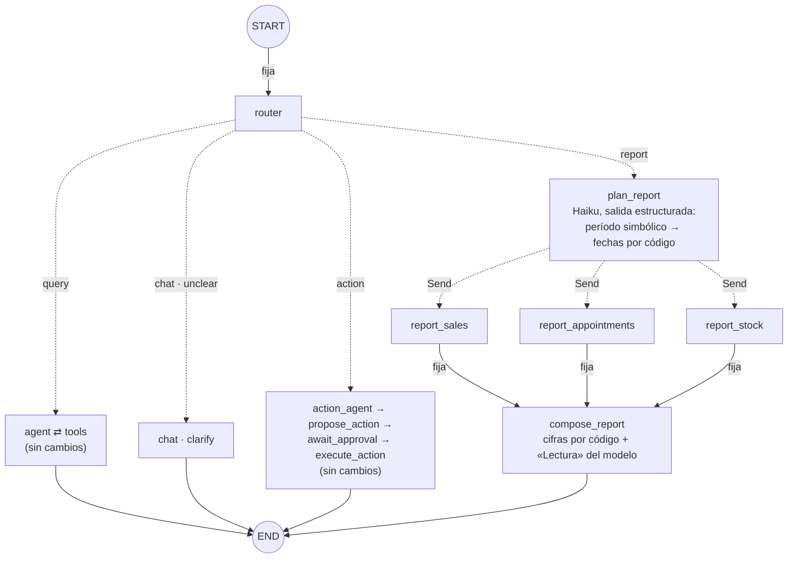

**Resumen:** 14 nodos propios (`report_stub` desapareció; se sumaron `plan_report`, `report_sales`, `report_appointments`, `report_stock` y `compose_report`), 2 nodos especiales, 8 aristas fijas y 19 condicionales: **27 conexiones** (comprobado con `getGraphAsync()`). Las condicionales salen de siete decisiones: las seis de antes y `fanOutReport` (3 destinos, uno por sección). El estado suma `report` y `reportParts` (**con reducer**): 7 campos.

| Nodo | Quién lo escribió | Qué hace | Modelo | Escribe en el estado |
| --- | --- | --- | --- | --- |
| `plan_report` | Nosotros (`nodes/report.ts`) | Elige el período con una forma simbólica (`this_week`, `last_month`, `last_days`…) y **el código calcula las fechas** con el reloj de Argentina | `MODEL_ROUTER` con salida estructurada | `report` (id, fechas, título, aviso) |
| `report_sales`, `report_appointments`, `report_stock` | Nosotros (`nodes/report.ts`, `report/sections.ts`) | Corren **a la vez**; cada una llama a la misma función de lectura que su herramienta. Nunca lanzan: si fallan devuelven una parte con el motivo | ninguno | 1 parte en `reportParts` |
| `compose_report` | Nosotros (`nodes/report.ts`, `report/render.ts`) | Corre **una vez** cuando terminaron las tres. El texto con las cifras lo arma el código; el modelo agrega una «Lectura» que se descarta si cita una cifra que no está en los datos | `MODEL_REPORT` | 1 mensaje de IA |

| # | Desde | Hasta | Tipo | Cómo se declara (`src/graph/index.ts`) |
| --- | --- | --- | --- | --- |
| 1 | `START` | `router` | Fija | `.addEdge(START, "router")` |
| 2–6 | `router` | `agent`, `chat`, `action_agent`, `plan_report`, `clarify` | Condicional (`intent`) | `routeByIntent` |
| 7–8 | `agent` | `tools`, `END` | Condicional | `routeAfterAgent` |
| 9–10 | `tools` | `agent`, `action_agent` | Condicional (`intent`) | `routeAfterTools` |
| 11–13 | `action_agent` | `tools`, `propose_action`, `END` | Condicional | `routeAfterActionAgent` |
| 14–15 | `propose_action` | `await_approval`, `action_agent` | Condicional | `routeAfterPropose` |
| 16–17 | `await_approval` | `execute_action`, `await_approval` | Condicional | `routeAfterApproval` |
| **18–20** | **`plan_report`** | **`report_sales`, `report_appointments`, `report_stock`** | **Condicional que devuelve `Send`** | **`.addConditionalEdges("plan_report", fanOutReport, [...])`: lanza las tres en el mismo paso** |
| 21 | `execute_action` | `action_agent` | Fija | `.addEdge("execute_action", "action_agent")` |
| **22–24** | **cada sección** | **`compose_report`** | **Fijas (fan-in)** | **`.addEdge(sección, "compose_report")`: corre una vez, en el paso siguiente** |
| 25 | `compose_report` | `END` | Fija | `.addEdge("compose_report", END)` |
| 26–27 | `chat`, `clarify` | `END` | Fijas | `.addEdge(…, END)` |

**Cómo se ve el paralelismo en la traza** (`npm run threads -- history <id>`, del más viejo al más nuevo):

| Paso | Corrió | Notas |
| --- | --- | --- |
| 1 | `router` | Elige `report` |
| 2 | `plan_report` | Decide el período |
| 3 | **`report_sales` + `report_appointments` + `report_stock`** | **Los tres en un único paso (superstep)**; escriben a la vez en `reportParts` y el reducer los junta |
| 4 | `compose_report` | Fin |

| Situación | Camino | Notas |
| --- | --- | --- |
| Pedido de reporte | `START → router → plan_report → (3 secciones) → compose_report → END` | 3 llamadas al modelo: router, planificador y «Lectura» |
| Una sección falla | igual | Esa sección dice «No disponible: …» y las otras salen completas |
| Fallan las tres | igual, sin «Lectura» | El reporte lo dice y no hay llamada al modelo para la «Lectura» |
| Falla solo la «Lectura» | igual | El reporte sale con las cifras y un aviso |
| Período inválido | igual | Se usa la semana actual y el reporte lo avisa |
| Segundo reporte en el mismo hilo | igual | El reducer reemplaza las partes del anterior (otro `reportId`) |

**Qué NO usa el reporte:** ninguna herramienta ni `ToolNode`, ni el rol `copilot_actions`: solo lee con `copilot_reader`.

---

## Fase 7: subgrafos y supervisor (`fase-07`)

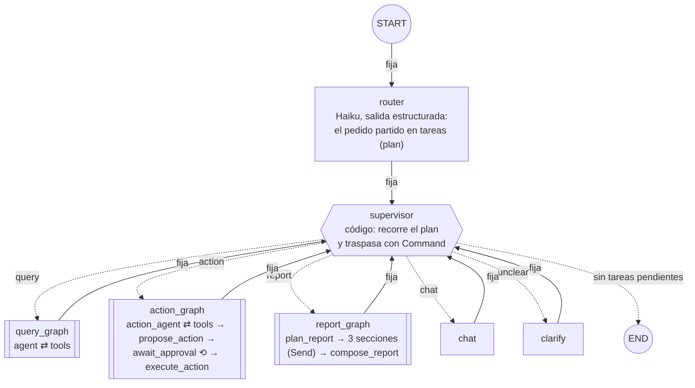

Los nodos con doble borde son **subgrafos**: grafos compilados agregados como un nodo. Se dibujan por dentro en las fases 2 (`agent ⇄ tools`), 5 (aprobación) y 6 (reportes en paralelo); su forma no cambió, solo dónde viven.

**Resumen:** 7 nodos propios en el grafo principal, 2 especiales, 7 aristas fijas y 6 condicionales: **13 conexiones** (comprobado con `getGraphAsync()` en `tests/graph-shape.test.ts`). Las 6 condicionales son los destinos que el supervisor declara en `ends` (cinco agentes y `END`): no hay función de arista, decide el `Command` que devuelve el nodo. Dentro de los subgrafos: consultas 2 nodos y 4 conexiones, acciones 5 y 10, reportes 5 y 8.

| Nodo | Quién lo escribió | Qué hace | Modelo | Escribe en el estado |
| --- | --- | --- | --- | --- |
| `router` | Nosotros (`nodes/router.ts`) | Parte el último mensaje en 1 a 3 tareas; el código normaliza el plan (`normalizePlan`: `unclear` anula, la charla se descarta, la acción va primero, una sola acción, consultas unidas) | `MODEL_ROUTER` con salida estructurada | `plan`, `intent` (la de la primera tarea), `intentReason` |
| `supervisor` | Nosotros (`nodes/supervisor.ts`) | Cierra la tarea que volvió, despacha la siguiente a su agente (con `startedAt`) o termina el turno, con el aviso del plan si lo hay | ninguno | `plan`, `activeAgent` (y el aviso, como mensaje de IA) |
| `query_graph` | Nosotros (`agents/query.ts`) | Subgrafo de consultas: el ciclo de la fase 2 con su propio `tools` | `MODEL_AGENT` con herramientas de lectura | `messages` |
| `action_graph` | Nosotros (`agents/action.ts`) | Subgrafo de acciones: el flujo de aprobación de la fase 5; **la pausa ocurre acá adentro** | `MODEL_AGENT` con lectura + definiciones de acciones | `messages` (privados: `pendingAction`, `approval`) |
| `report_graph` | Nosotros (`agents/report.ts`) | Subgrafo de reportes: el fan-out/fan-in de la fase 6 | `MODEL_ROUTER` (período) y `MODEL_REPORT` («Lectura») | `messages`, `report` (con el estado de cada sección; privado: `reportParts`) |
| `chat`, `clarify` | Nosotros | Los de la fase 3, ahora vuelven al supervisor | `MODEL_AGENT` / `MODEL_ROUTER`, sin herramientas | `messages` |

| # | Desde | Hasta | Tipo | Cómo se declara (`src/graph/index.ts`) |
| --- | --- | --- | --- | --- |
| 1 | `START` | `router` | Fija | `.addEdge(START, "router")` |
| 2 | `router` | `supervisor` | Fija | `.addEdge("router", "supervisor")` |
| **3–8** | **`supervisor`** | **`query_graph`, `action_graph`, `report_graph`, `chat`, `clarify`, `END`** | **`Command({ goto })`** | **`.addNode("supervisor", supervise, { ends: [...] })`: el nodo devuelve la actualización y el destino juntos** |
| 9–13 | cada agente | `supervisor` | Fijas | `.addEdge(agente, "supervisor")`: el control vuelve siempre al supervisor |

**Estado compartido y privado.** Un subgrafo agregado como nodo recibe del principal los campos con el **mismo nombre** en los dos esquemas y devuelve solo esos. Lo demás es privado: vive en los checkpoints del subgrafo, en su propio espacio de nombres (`action_graph:<id de la tarea>`), y cada corrida arranca de cero.

| Campo | Principal | `query_graph` | `action_graph` | `report_graph` |
| --- | --- | --- | --- | --- |
| `messages` | ✔ | compartido | compartido | compartido |
| `plan` | ✔ | compartido (lee su tarea) | compartido | compartido |
| `report` | ✔ | — | — | compartido (escribe el estado de cada sección) |
| `intent`, `intentReason`, `activeAgent` | ✔ | — | — | — |
| `pendingAction`, `approval` | — | — | **privados** | — |
| `reportParts` | — | — | — | **privado** (con reducer) |

**Cómo se ve un pedido mixto en la traza** («registrá la venta y decime cuánto stock queda», aprobando). `npm run threads -- history <id>` muestra el grafo principal; con `--subgraphs`, también los pasos de cada corrida:

| Grafo | Pasos (del más viejo al más nuevo) |
| --- | --- |
| principal | `router` → `supervisor` → `action_graph` ⏸ (pausa adentro) → `supervisor` → `query_graph` → `supervisor` |
| `action_graph:…` | `action_agent` → `propose_action` → `await_approval` ⏸ … `execute_action` → `action_agent` |
| `query_graph:…` | `agent` → `tools` → `agent` |

| Situación | Camino en el principal | Notas |
| --- | --- | --- |
| Pedido de una sola tarea | `router → supervisor → <agente> → supervisor → END` | Adentro del agente, lo mismo que en las fases 2 a 6 |
| Acción y consulta | `… → action_graph` ⏸ `→ supervisor → query_graph → supervisor → END` | La consulta corre después de decidir, en el mismo turno |
| Acción rechazada o con pregunta | igual | Las tareas siguientes se hacen igual |
| Dos acciones en un mensaje | `… → action_graph → supervisor → END` | Se hace la primera; el supervisor agrega el aviso de la otra |
| Una parte `unclear` | `… → clarify → supervisor → END` | Se pide aclaración antes de hacer nada |

**Qué NO existe:** un supervisor que llama al modelo entre agente y agente, ni un agente que le pase el control a otro sin volver al supervisor.

---

## Fase 8: memoria de largo plazo (`fase-08`)

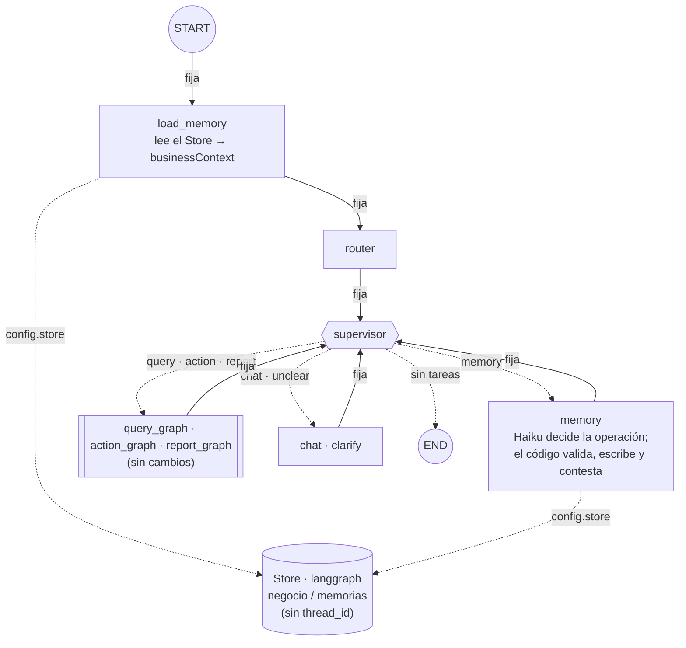

**Resumen:** 9 nodos propios en el grafo principal, 2 especiales, 9 aristas fijas y 7 condicionales: **16 conexiones** (comprobado con `getGraphAsync()` en `tests/graph-shape.test.ts`). Las 7 condicionales son los destinos del supervisor (`ends`): seis agentes y `END`. Los subgrafos no cambiaron.

| Nodo | Quién lo escribió | Qué hace | Modelo | Escribe en el estado |
| --- | --- | --- | --- | --- |
| `load_memory` | Nosotros (`nodes/load-memory.ts`) | Lee las memorias del Store (`config.store`) al empezar cada turno; sin Store, ninguna | ninguno | `businessContext` |
| `memory` | Nosotros (`nodes/memory.ts`) | Guarda, lista o borra una memoria. El modelo elige la operación y escribe el texto; el código aplica `checkMemory` (qué no se guarda), escribe en el Store y arma la respuesta | `MODEL_ROUTER` con salida estructurada | 1 mensaje de IA y `businessContext` (lo anotado ya vale para las tareas siguientes del turno) |

| # | Desde | Hasta | Tipo | Cómo se declara (`src/graph/index.ts`) |
| --- | --- | --- | --- | --- |
| 1 | `START` | `load_memory` | Fija | `.addEdge(START, "load_memory")` |
| 2 | `load_memory` | `router` | Fija | `.addEdge("load_memory", "router")` |
| 3 | `router` | `supervisor` | Fija | `.addEdge("router", "supervisor")` |
| 4–10 | `supervisor` | los 6 agentes y `END` | `Command({ goto })` | `ends` del nodo `supervisor` |
| 11–16 | cada agente (también `memory`) | `supervisor` | Fijas | `.addEdge(agente, "supervisor")` |

**Memoria del hilo y memoria entre hilos:**

| | Checkpointer (fase 4) | Store (fase 8) |
| --- | --- | --- |
| Qué guarda | El estado completo de un hilo, paso a paso | Datos sueltos por namespace y clave (`["negocio", "memorias"]`, id) |
| Quién lo ve | Solo ese `thread_id` | Todos los hilos |
| Cómo llega al grafo | `compile({ checkpointer })` y el `thread_id` de cada invocación | `compile({ store })`; cada nodo lo recibe en `config.store` |
| Quién escribe | LangGraph, después de cada paso | El nodo `memory`, solo cuando la persona lo pide |
| Ejemplo | «me llamo Ana» queda en el hilo A | «los lunes no se agendan turnos» vale en A, en B y en los que vengan |

| Situación | Camino en el principal | Notas |
| --- | --- | --- |
| Pedido sin memoria | `START → load_memory → router → supervisor → <agente> → supervisor → END` | Con memorias, el agente las recibe en su prompt |
| Anotar, listar u olvidar | `… → supervisor → memory → supervisor → END` | La respuesta la arma el código |
| Anotar y consultar en el mismo mensaje | `… → memory → supervisor → query_graph → supervisor → END` | La memoria va primero; la consulta ya la tiene en el prompt |
| Algo que no se guarda (cliente, cifras, seguridad) | `… → memory → supervisor → END` | «No lo anoté: …»; el Store no cambia |

---

## Fase 9: streaming y chat web (`fase-09`)

El grafo es el de la fase 8. Lo nuevo es cómo se lo invoca y qué sale de él mientras corre.

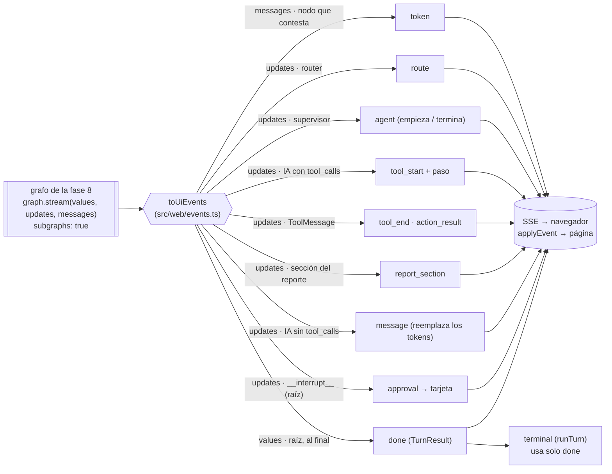

| Modo de LangGraph | Qué entrega | Para qué se usa |
| --- | --- | --- |
| `messages` | Cada fragmento de texto de un modelo, con el nodo y el namespace que lo produjo | Los tokens de la respuesta. Solo de los nodos que contestan (`agent` y `action_agent` dentro de sus subgrafos, `chat`, `clarify`); los de salida estructurada no transmiten (`disableStreaming`) y la «Lectura» del reporte no se muestra en vivo (el código la puede descartar) |
| `updates` | Lo que devolvió cada nodo, también dentro de los subgrafos (`subgraphs: true`) | La ruta, qué agente trabaja, cada herramienta pedida y terminada, las secciones del reporte, los mensajes terminados y la pausa de aprobación (se toma la de la raíz; la del subgrafo llega repetida) |
| `values` | El estado completo del grafo principal después de cada paso | El último es el final: con él se arma el mismo `TurnResult` que antes devolvía `invoke` (al pausarse llega además un dato que es solo `{ __interrupt__ }`, que no es el estado) |

| Situación | Eventos, en orden |
| --- | --- |
| Consulta con herramienta | `route` → `agent` (empieza) → `tool_start` → `tool_end` → `token`… → `message` → `agent` (termina) → `done` |
| Acción | `route` → `agent` → (`tool_start`/`tool_end` si consulta algo) → `approval` → `done` con `awaiting`; al decidir: `action_result` → `token`… → `message` → `done` |
| Reporte | `route` → `agent` → `report_section` ×3 → `message` (entero) → `done` |
| Corte (se cierra la página) | se corta el turno (`signal`): el hilo queda a medias y «Continuar» lo termina |

---

## Fase 10: errores, reintentos y viaje en el tiempo (`fase-10`)

El grafo principal es el de la fase 8, con una política de reintento en `load_memory`. Lo nuevo está adentro de los subgrafos de consultas y de acciones.

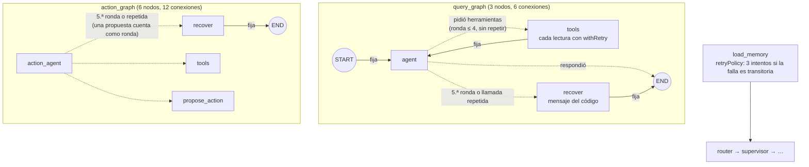

**Resumen:** el principal no cambia: 9 nodos y 16 conexiones. Consultas pasa de 2 a 3 nodos y de 4 a 6 conexiones. Acciones pasa de 5 a 6 nodos y de 10 a 12. Reportes queda igual (5 y 8). Todo comprobado con `getGraphAsync()` en `tests/graph-shape.test.ts`. El estado no suma campos: el resultado de una acción queda marcado en su mensaje de herramienta (`artifact: { outcome }`), no en el estado.

| Nodo | Quién lo escribió | Qué hace | Modelo | Escribe en el estado |
| --- | --- | --- | --- | --- |
| `recover` (consultas y acciones) | Nosotros (`nodes/recover.ts`) | Cierra la tarea cuando el agente llega al tope o repite una llamada. Responde las llamadas que quedaron pedidas con «no se ejecutó» (la API exige una respuesta por llamada) y arma un mensaje con lo que consultó, que no pudo terminar y que conviene pedirlo más concreto | ninguno | Los mensajes de herramienta marcados `skipped` y 1 mensaje de IA |

| # | Desde | Hasta | Tipo | Cómo se declara |
| --- | --- | --- | --- | --- |
| nueva | `agent` (o `action_agent`) | `recover` | Condicional | un destino más de `routeAfterAgent`, que cuenta las rondas de la tarea desde `startedAt` y compara la llamada nueva con las anteriores |
| nueva | `recover` | `END` | Fija | `.addEdge("recover", END)` |

**Quién reintenta qué:**

| Qué falla | Quién reintenta | Cuánto |
| --- | --- | --- |
| Una herramienta de consulta (la base) | `withRetry`, dentro de `safeTool` | 3 intentos, esperas de ~200 y ~600 ms, solo si la falla es transitoria (`isTransient`) |
| Una sección del reporte | `withRetry`, dentro de `runSection` | igual |
| `load_memory` (el Store) | LangGraph (`retryPolicy` del nodo) | igual |
| Una llamada al modelo | LangChain (`AsyncCaller`) | 3 reintentos (429, 5xx, 529, red) |
| Una salida estructurada mal formada (router, memoria, período) | `invokeWithCorrection` | 1 segundo intento con la corrección; después, el respaldo de siempre, a la vista como «(respaldo)» |
| Una escritura (`execute_action`, `memory`) | nadie | se informa y decide la persona |

**El hilo como árbol.** Editar o reintentar un turno no agrega nodos: es otra forma de invocar el grafo.

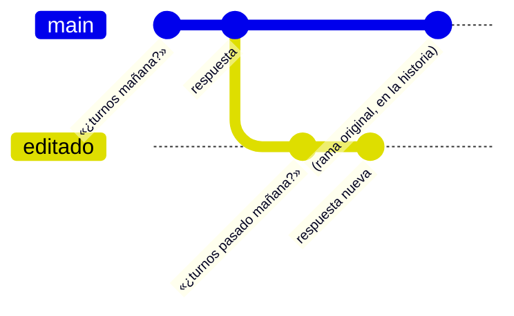

| Situación | Camino | Notas |
| --- | --- | --- |
| Una lectura que falla 2 veces y anda | `… → agent → tools → agent → END` | Igual que sin falla; los reintentos se ven como eventos `retry` (modo `custom`) |
| Un agente que da vueltas | `… → agent → tools → … → agent → recover → END` | Corta en la 5.ª ronda, o en la segunda llamada idéntica; el hilo queda listo |
| Editar o reintentar | `updateState(checkpoint, { messages: [mensaje] }, "__start__")` y `stream(null)` | La rama nueva es el estado del hilo; una acción ya aprobada no se ejecuta de nuevo (clave de la fase 5) |

**Extra: las ramas del hilo** ([specs/ramas-del-hilo.md](ramas-del-hilo.md)). El grafo no cambia de forma. Cambia cómo se elige el estado actual: siempre es el último checkpoint, y para volver a una versión anterior alcanza con `updateState(punta, null)`. Eso crea una copia de esa punta, que pasa a ser el último checkpoint. La web lista las ramas a partir de la historia (`listBranches`): las puntas son los checkpoints sin hijos y las bifurcaciones, los que tienen más de uno.

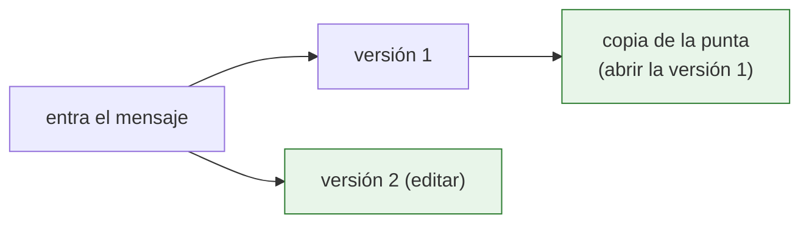

---

## Próximas fases (planeado, aún no existe)

| Fase | Cambio previsto en el grafo |
| --- | --- |
| 11 | Trazas locales de cada ejecución (pasos, herramientas y tokens) con callbacks y eventos del stream, y un set de evaluaciones que se corre por comando. Cambia cómo se observa el grafo, no su forma |
| 12 | El grafo corre en el servidor local de LangGraph, con límites de tiempo por nodo y la guía de operación |
