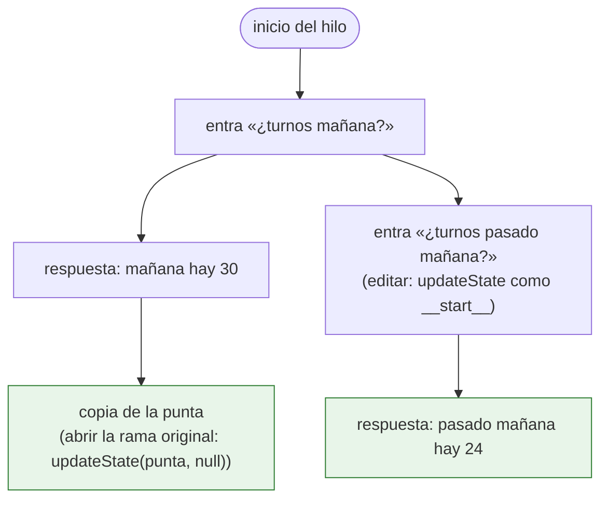
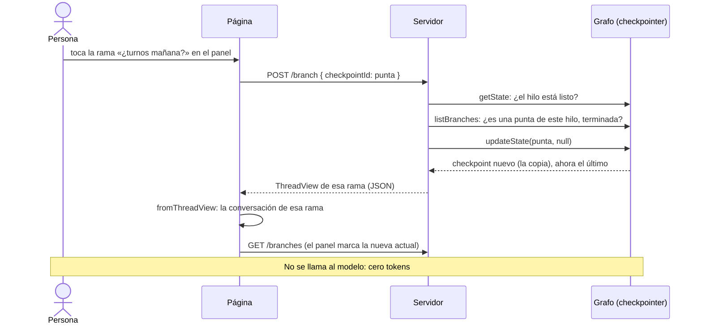
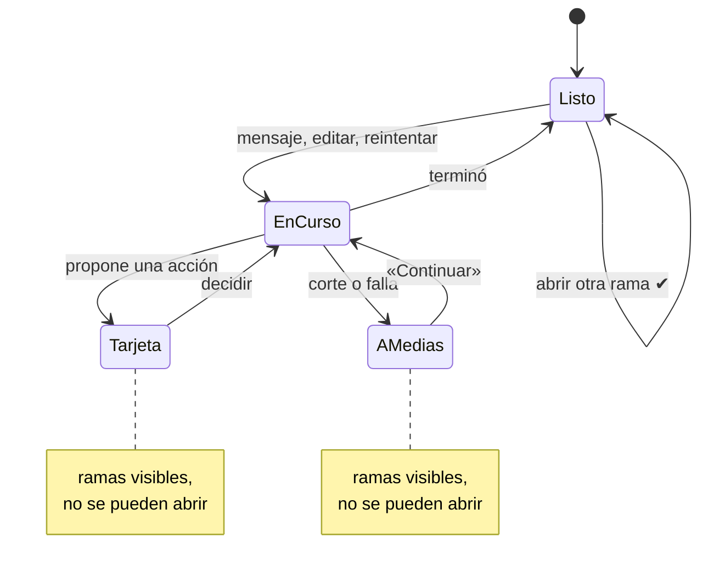
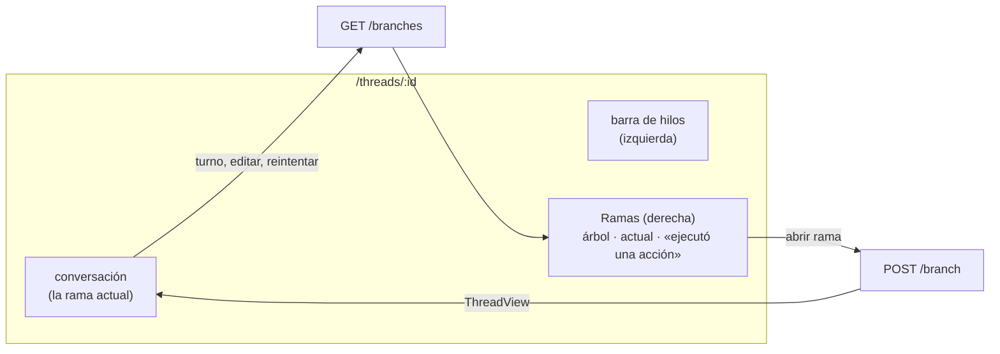

# Extra: las ramas del hilo en la web

Estado: **terminada** (fuera del plan de fases, después de `fase-10`)

## Objetivo
Ver las ramas de un hilo y moverse entre ellas desde el chat web. Desde la fase 10, editar un mensaje o reintentar una respuesta **bifurca** el hilo: la versión anterior queda guardada en la historia, pero la web muestra solo la actual y no hay forma de volver. Con esto, un panel a la derecha del chat muestra todas las ramas y deja abrir cualquiera. La rama elegida pasa a ser la conversación del hilo: la que ves, la que ve el modelo y desde la que siguen los turnos nuevos.

## Contexto
Existe desde la fase 10 (etiqueta `fase-10`):

- **Ramas.** `streamForkTurn` y `streamReplayTurn` hacen `updateState(checkpoint, { messages: [mensaje] }, "__start__")` sobre el checkpoint en que entró ese mensaje, y la rama nueva pasa a ser el estado del hilo. La original sigue en la historia.
- **La historia trae todas las ramas mezcladas.** `getStateHistory` devuelve los checkpoints de todas las ramas, cada uno con su `parentConfig`. `findTurnStart` ya arma el mapa de checkpoints y sigue la cadena de padres desde el último para quedarse con la rama actual.
- **El estado actual es el último checkpoint.** La web, la terminal y el modelo siguen siempre desde ahí.
- **Editar y reintentar** se rechazan (409) con una tarjeta pendiente, un turno a medias o un turno en curso.

**Confirmado al escribir esta spec** (con modelos falsos y `MemorySaver`):
- `updateState(punta de una rama, null)` crea un checkpoint hijo de esa punta, con sus mismos mensajes y `next: []`, sin correr ningún nodo. Ese checkpoint pasa a ser el último, así que la rama vuelve a ser la actual. Un turno nuevo sigue desde ahí: «hola → eco 1», volver, «chau» da `hola | eco 1 | chau | eco 3`.
- Sobre una punta **con una tarjeta pendiente**, la copia **pierde la pausa**. El hilo queda a medias (`next: ["action_graph"]`) en vez de esperando la decisión, y «Continuar» volvería a correr el agente. Por eso cambiar de rama exige el hilo listo (R5).

## Requisitos
**Qué es una rama**
- R1: Una **rama** es un camino desde el inicio del hilo hasta una **punta**, un checkpoint sin hijos. Cada rama tiene exactamente una punta. Al cambiar de rama, la copia nueva pasa a ser la punta de esa rama, así que las ramas no se duplican.
- R2: Una **bifurcación** es un checkpoint con más de un hijo: ahí se editó o se reintentó un mensaje. Cada rama se describe por:
  - un **número de versión**, en el orden en que se creó (la original es la 1). Hace falta porque «reintentar» repite el texto: dos ramas pueden separarse con el mismo mensaje;
  - el mensaje de la persona con el que se separó de las otras (o el primero del hilo, para la original);
  - cuántos mensajes tiene;
  - cuándo fue su último cambio;
  - las acciones que ejecutó y que la rama actual no tiene (R7).
- R3: Las ramas salen de la historia de LangGraph (`getStateHistory`). **No hay una tabla propia**: lo que muestra el panel es siempre lo que está guardado.

**El panel**
- R4: **«Versiones de la conversación», a la derecha del chat.** En la pantalla se llaman «versiones»; en el código y en la documentación, «ramas». Un botón en el encabezado abre y cierra el panel. En pantallas anchas es una columna al lado de la conversación; en el celular, una hoja lateral (`Sheet`), como el panel de memorias. Muestra:
  - las ramas como un **árbol chico**: dónde se separa cada una y con qué mensaje;
  - cuál es la **actual**;
  - para cada una, su cantidad de mensajes y cuándo cambió por última vez.

  Un hilo sin bifurcaciones muestra «Esta conversación tiene una sola versión. Editá un mensaje o reintentá una respuesta para crear otra».
- R5: **Abrir una rama.** Tocar una rama que no es la actual la convierte en la actual: la conversación en pantalla pasa a ser la de esa rama y el panel marca la nueva actual. Solo se puede con el hilo **listo**, igual que editar o reintentar: no con una tarjeta pendiente, un turno a medias o un turno en curso. En esos casos el panel se ve, pero las ramas no se pueden abrir, y un texto explica por qué.
- R6: **Qué cambia al abrir una rama:**
  - lo que ves: la conversación de esa rama, también al recargar;
  - lo que ve el modelo: el turno siguiente sigue desde esa rama, como si las otras no existieran;
  - nada más: la rama que dejás sigue entera en la historia y se puede volver a abrir.

  No se llama al modelo: abrir una rama no cuesta tokens.
- R7: **Lo escrito en la base no cambia de rama.** Si otra rama ejecutó una acción (un turno agendado, una venta, un ajuste de stock), eso sigue en la base aunque abras una rama donde no pasó. Lo mismo con las memorias: el Store no depende del hilo. El panel marca las ramas que ejecutaron algo («ejecutó una acción») y, al abrir una rama distinta de la que la ejecutó, un aviso lo recuerda.
- R8: Una punta que no está terminada (por ejemplo, de antes de esta spec o de un corte) se muestra como **«incompleta»** y no se puede abrir.

**Cómo funciona por dentro**
- R9: `listBranches(graph, threadId)` arma el árbol a partir de la historia. `switchBranch(graph, threadId, checkpointId)`:
  - valida que `checkpointId` sea la punta de una rama de ese hilo y que esté terminada;
  - valida que el hilo esté listo;
  - hace `updateState({ thread_id, checkpoint_id }, null)`.

  Las dos funciones van en `src/graph/branches.ts`, junto a `time-travel.ts`, y la terminal podría usarlas más adelante.
- R10: **Rutas nuevas:**
  - `GET /api/threads/:id/branches`: el árbol, en JSON;
  - `POST /api/threads/:id/branch { checkpointId }`: abre esa rama y responde con la vista del hilo (`ThreadView`), en JSON y no por SSE, porque no corre ningún turno.

  Las dos tienen los controles de la fase 9: origen, JSON y formato del id. Abrir una rama responde 409 con una tarjeta, un turno a medias o un turno en curso, 404 si el checkpoint no es la punta de una rama de ese hilo, y 409 si la punta está incompleta.
- R11: El panel se actualiza solo después de cada turno, de editar, de reintentar y de abrir una rama.

## Escenarios en el navegador (congelados)
Se corren con Playwright, el modelo real y la base real, como F4 a F6. El modelo no participa en cambiar de rama, así que los escenarios son baratos (un par de turnos de charla y consulta).

| # | Pasos | Esperado |
| --- | --- | --- |
| B1 | «¿Cuántos turnos hay mañana?»; editar a «¿Cuántos turnos hay pasado mañana?»; abrir el panel | Dos versiones: la 1 con «¿Cuántos turnos hay mañana?» y la 2, actual, con «… pasado mañana?» |
| B2 | Desde B1, abrir la versión 1 | En pantalla queda la conversación original, con su respuesta. Al recargar, sigue esa. El panel marca la versión 1 como actual |
| B3 | Desde B2, escribir «¿Qué te pregunté recién? Repetímelo textual.» | La respuesta trae «mañana» y no «pasado mañana»: el modelo ve la rama original. El panel sigue con dos versiones y la 1 crece |
| B4 | «Agendá un corte para Julián Romero el \<martes\> a las 15 con Lucas.», aprobar, reintentar, y abrir la versión 1 | Al reintentar no aparece una tarjeta: el turno de las 15 ya existe (lo creó la versión 1) y el agente avisa que no se pudo. Las dos versiones empiezan con el mismo mensaje y se distinguen por su número; la 1 figura con «ejecutó una acción». Abrirla no ejecuta nada: el registro de acciones queda en una aprobación y el turno de las 15 existe una sola vez |

## Criterios de aceptación
- [x] CA1 (árbol): con modelos falsos, `listBranches` da las ramas correctas:
  - en un hilo sin bifurcaciones, una;
  - después de editar el primer mensaje, dos;
  - editando un mensaje del medio, la parte común aparece una sola vez;
  - después de ir y volver de una rama a otra (A → B → A), siguen siendo las mismas ramas, sin duplicados;
  - una punta incompleta se marca como tal;
  - una rama que ejecutó una acción se marca;
  - los números de versión siguen el orden de creación y no cambian al ir y volver; dos ramas con el mismo mensaje (un reintento) tienen números distintos.
- [x] CA2 (abrir): con modelos falsos, `switchBranch` deja el hilo con los mensajes de la rama elegida, sin llamar al modelo. El turno siguiente sigue desde esa rama: el modelo recibe solo sus mensajes. La rama que se dejó sigue en la historia.
- [x] CA3 (controles): abrir una rama responde:
  - 409 con una tarjeta, un turno a medias o un turno en curso;
  - 404 con un checkpoint de otro hilo, o uno que no es una punta;
  - 409 con una punta incompleta;
  - lo mismo que las otras rutas para un origen ajeno (403) y un cuerpo inválido (400).
- [x] CA4 (con la base): en `tests/writes`, ir de una rama a otra no repite ni deshace una acción aprobada. El registro de acciones y el stock no cambian al abrir una rama.
- [x] CA5 (navegador): B1 a B4 pasan. El panel no se desborda en el celular (390 px) y funciona en tema claro y oscuro.
- [x] CA6 (tiempo): `GET /branches` tarda menos de 500 ms en un hilo de 30 turnos con 5 ramas, con la base local. Si no, se mide y se decide (ver Riesgos).
- [x] CA7: pasan los tests de las fases 2 a 10, `npm test`, los typecheck, `npm run web:build` y las pruebas del navegador. La spec aparece en `/doc` y el README lo menciona.

## Fuera de alcance
- Las ramas en la terminal: `npm run threads -- history` sigue igual.
- Borrar o renombrar una rama.
- Comparar dos ramas lado a lado.
- Deshacer lo que una rama escribió en la base: sería otra acción, con su aprobación.
- Abrir una rama que dejó una tarjeta pendiente. Con R5 no se puede generar, porque para dejar una rama tiene que estar lista.
- El selector «‹ 1/2 ›» en el mensaje, para pasar de una versión a otra sin abrir el panel. Usaría los mismos datos y la misma ruta; queda para después.

## Diseño (plan técnico)
**`src/graph/branches.ts`**
- `listBranches(graph, threadId)`:
  - recorre `getStateHistory` una vez y arma un mapa `checkpoint_id → { padre, hijos, mensajes, next, ts }`;
  - las puntas son los checkpoints sin hijos;
  - para cada punta, sigue la cadena de padres hasta la raíz y encuentra dónde se separa de las demás (el primer ancestro con más de un hijo);
  - devuelve un árbol: `{ current, branches: [{ tipId, version, forkFromId?, label, messageCount, updatedAt, executedActions, complete }] }`.

  La etiqueta es el primer mensaje de la persona después de la bifurcación. El número de versión sale de cuándo se creó el primer checkpoint propio de la rama: los checkpoints no cambian, así que el número tampoco, aunque se vaya y se vuelva. La rama actual es la de la punta más nueva.
- `switchBranch(graph, threadId, tipId)`: las validaciones de R9 y `updateState({ configurable: { thread_id, checkpoint_id: tipId, checkpoint_ns: "" } }, null)`.
- `executedActions` y la lectura de la historia se comparten con `time-travel.ts`: se mueven a un módulo común en vez de copiarse.

**Web**
- `src/web/handlers.ts`: `getBranches` y `postBranch`, con los mismos controles que `edit` y `retry`. `web/app/api/threads/[id]/branches/route.ts` y `.../branch/route.ts`.
- `web/components/chat/branches-panel.tsx` (nuevo): el árbol, con los componentes de shadcn que ya hay. En pantallas anchas es una columna a la derecha; en el celular, un `Sheet`.
- `web/hooks/use-chat.ts`: `openBranch(tipId)`. Al responder, la página se arma de nuevo con `fromThreadView`, como al recargar, y el panel vuelve a pedir el árbol. Las marcas de «editado» de la sesión se pierden: ya no hacen falta, porque el panel muestra las versiones.
- `src/web/turn-view.ts`: el tipo del árbol para el navegador, y una función pura que lo convierte en filas para dibujar (sangría, línea de la bifurcación, rama actual), con tests.

**Documentación**
- `web/lib/docs-core.ts`: `ramas-del-hilo` en la lista de referencia, como `doc-web`.
- README (qué hace el panel), y una nota en `specs/mapa-del-grafo.md`: el grafo no cambia de forma; cambia cómo se elige el estado actual.

**Riesgos**
- **Leer la historia entera en cada pedido.** Cada checkpoint trae sus mensajes, y un hilo largo con muchas ramas puede pesar. `findTurnStart` ya lo hace al editar. Si `GET /branches` supera el CA6, se prueba con `checkpointer.list` (que puede traer menos datos) o se limita la profundidad. Esto se mide en T2, antes de hacer la página.
- **Cada cambio de rama suma un checkpoint.** Ir y venir muchas veces alarga la historia, aunque no las ramas (R1). Se acepta: es como funciona LangGraph, y un checkpoint sin cambios es chico.

**Archivos**

```
src/graph/branches.ts (nuevo), src/graph/time-travel.ts (comparte la lectura de la historia)
src/web/handlers.ts, src/web/turn-view.ts
web/app/api/threads/[id]/branches/route.ts, web/app/api/threads/[id]/branch/route.ts
web/hooks/use-chat.ts, web/components/chat/chat-app.tsx, web/components/chat/branches-panel.tsx (nuevo)
web/lib/docs-core.ts, README.md, specs/mapa-del-grafo.md
tests/branches.test.ts, tests/writes/branches-actions.test.ts, tests/web-view.test.ts, web/e2e/branches.spec.ts
```

## Mapas

**1. Las ramas de un hilo, como checkpoints**



`C1` es una bifurcación: tiene dos hijos. Las puntas son `A2` y `B2`, y la actual es la más nueva, `A2`. Al abrir una rama no aparece una rama nueva: la punta de la original pasa de `A1` a su copia, `A2`.

**2. Abrir una rama**



**3. Cuándo se puede abrir una rama**



**4. La página con el panel**



## Tareas
Una tarea = un commit en la rama `dev/ramas-del-hilo`, que sale de `main` con la fase 10 ya unida.

1. **T1:** esta spec aprobada; `ramas-del-hilo` en `/doc`; escenarios B1 a B4 congelados en `evals/branch-cases.ts`.
2. **T2:** `listBranches` y `switchBranch` en `src/graph/branches.ts`, con la lectura de la historia compartida con `time-travel.ts`. Tests con modelos falsos (CA1, CA2) y medición del tiempo con la base (CA6).
3. **T3:** las rutas `branches` y `branch`, con sus controles (CA3), y el test con la base de que una acción no se repite ni se deshace (CA4).
4. **T4:** el panel en la página (columna en pantallas anchas, `Sheet` en el celular), `openBranch` en el hook, y las filas del árbol en el reductor, con tests.
5. **T5:** B1 a B4 en el navegador (CA5); README, nota en el mapa del grafo y cierre (CA7).

## Decisiones tomadas
- **Solo el panel, sin el selector «‹ 1/2 ›»** (al aprobar la spec). Se empieza por lo que se pidió; el selector pasa a fuera de alcance.
- **Se trabaja en `dev/ramas-del-hilo`, desde `main`.** Antes se unió `dev/fase-10` a `main` (avance directo, como las fases anteriores).
- **«Versiones de la conversación» en la pantalla, «ramas» en el código y en la documentación.**
- **La historia del hilo se lee en un módulo propio, `src/graph/history.ts`** (T2). Lo comparten el viaje en el tiempo (`findTurnStart`) y las ramas: arma el árbol de checkpoints (cada uno con sus hijos, del más viejo al más nuevo) y el camino desde la raíz hasta cualquier checkpoint. `time-travel.ts` pasó a usarlo sin cambiar su comportamiento.
- **En una bifurcación, el hijo más viejo sigue la rama de la que salió** y cada hijo más nuevo empieza una rama. Así, la versión de cada rama sale de cuándo se creó su primer checkpoint propio, y no cambia al ir y volver.
- **«Ejecutó una acción» es relativo a la rama actual.** El panel marca las acciones de una rama que **no están** en la actual. Una acción de la parte común está en las dos, así que no se marca. Al abrir una rama, `switchBranch` devuelve las acciones de la rama que se deja que la abierta no tiene: son las que hay que recordar.
- **Abrir una rama lee la historia una sola vez.** El primer borrador la leía antes y después de cambiar. Leerla es lo que cuesta, así que ahora se arma el árbol una vez y las acciones se comparan con los mensajes de las dos puntas.
- **Medido con Postgres** (CA6): un hilo de 30 turnos, editado 4 veces (5 ramas, 234 checkpoints), con respuestas de ~600 caracteres. `listBranches`: **313 ms de mediana** (282 a 503; el máximo es la primera lectura). `switchBranch`: 308 a 354 ms. Entra en el criterio. Si hiciera falta bajarlo, el camino es leer la estructura (padres, fechas, `next`) sin los mensajes y pedir los mensajes solo de las puntas y las bifurcaciones. Hoy `getStateHistory` trae los mensajes de cada checkpoint.
- **El servidor dice de qué versión salió cada una** (`parentVersion`, T4). El navegador no tiene la historia para calcularlo. Desde la bifurcación se siguen los hijos más viejos hasta una punta: esa es la rama madre, la que siguió por ahí sin separarse.
- **La columna aparece desde 1280 px; en pantallas más angostas, el panel es una hoja lateral.** Entre 768 y 1280 px, con la barra de hilos abierta, una columna más dejaba la conversación demasiado angosta. En la hoja, abrir una versión la cierra sola.
- **Al abrir una versión, la página se arma de nuevo desde el hilo**, como al recargar, pero conserva lo que gastó la sesión. Las marcas de «editado» de la sesión se pierden, porque el panel ya muestra las versiones. El aviso de lo que quedó hecho en la base usa el mismo lugar que los otros avisos, arriba de la entrada.
- **B4 cambió al correrlo por primera vez** (T5). Se había congelado suponiendo que reintentar mostraba una tarjeta nueva, que se rechazaba. Con la base real, el agente vuelve a intentar agendar y la validación lo frena: Lucas ya tiene ese turno, porque lo creó la versión 1. No hay tarjeta ni registro nuevo (una propuesta que no pasa la validación no se registra). Es R7 en la práctica: la base no cambia de rama, y la versión 2 la ve igual. El escenario quedó así, sin el rechazo.
